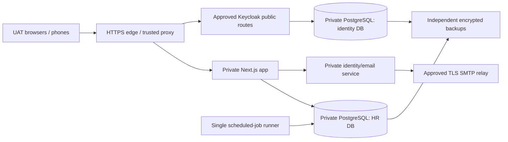

# UAT hosting, security acceptance and deployment guide

Prepared 12 October 2026 (Asia/Kuala_Lumpur). This is a preparation/runbook document, not a deployment sign-off or live status register. Record executed results in the release/UAT evidence system; re-read Git and the target server before each run.

## 1. Scope and evidence

**REQUIREMENT:** 1,000 employees and 200 concurrent testers, confirmed by the owner in this chat. This changes the UAT baseline; it does not replace the earlier 4,000-employee production-growth proposal.

**ASSUMPTION:** use the previously proposed Malaysia private-cloud location for planning. Provider, hostnames, budget and target access are still to be confirmed. Use synthetic data initially. A single active app and database are acceptable for this UAT proposal; it has planned downtime and is not high availability.

**FACT — source inspected:** `main@12b7d709fd90909dde3f0b2e4f9bc687f2ce3d27`, Next.js 16.3.8, PostgreSQL 16 deployment conventions, 435 migration-journal entries. Git currently locates main at `/Users/zenlam/Projects/ai-hr/.claude/worktrees/mainwt`; the scratch-root AGENTS.md points to a missing `.Codex` path. Main uses CLAUDE.md.

**OBSERVATION — existing demo, 12 October:** read-only SSH checks succeeded after using the approved local execution path. The server reports built/source ref a7f38e9556a524658ac79794873083ba1419f8c9, deploy state ok/stale_build=0, 435 applied migrations, app/Keycloak services active and health ok. RAM is 3,915 MiB with about 1,050 MiB swap in use. Effective web service runs as ubuntu, caps memory at 1.5 GiB, and has neither ProtectSystem nor UnsetEnvironment enabled. AUTH_PROVIDER is unset, demo mode is true, audit environment fallback is false and no backup destination is configured. This verifies those settings, not every tenant audit setting or the absence of independently operated backups. Source/build parity, TLS, restore and security acceptance are still open. No server or cloud resource was changed.

| Area | Evidence found | What it establishes / does not establish |
|---|---|---|
| Architecture | `docs/adr/`, kernel/pack boundaries, `db/client.ts`, identity ADR-0098 | Substantial design exists. Deployment topology and operational acceptance still need closure. |
| Security | September readiness review; authorization/RLS, Keycloak, mobile and backup test suites | Internal review and implementation exist. This is not an independent penetration-test sign-off or a fresh full security audit. |
| Capacity | Readiness §7 and later deploy-script/build records | Existing shared demo host was recorded at about 2 vCPU / 4 GiB; build memory pressure is repeated. No verified 200-tester capacity result was found. |
| Runbooks | `deploy/DEPLOY.md`, `deploy/keycloak/README.md`, backup/restore scripts | Working components and procedures exist, but older sections are demo/WorkOS-oriented. |
| Parked customer preparation | `codex/production-readiness@023643d2`, 41 commits absent from the inspected main | Includes `deploy/CUSTOMER.md`, `PRODUCTION-ARCHITECTURE.md`, customer unit/preflight, fresh bootstrap and backup hardening. These are not installed features of main. |
| Latest recorded deployment | History entries dated 11–12 October | Report private Keycloak/email services installed, but app still in demo auth; origin TLS, owner password/MFA, SMTP activation and off-host restore remain open. These are historical reports, not live verification today. |

The parked branch also contains older WorkOS integration, dependency and pagination changes. Reconcile selected changes against current main; do not merge its entire history blindly. Main already has newer Keycloak and notification implementations. The old Slice-0 threat model excludes payroll, attendance and AI and therefore cannot serve as the current whole-product threat model.

Production dependency audit on 12 October found pdfjs-dist 5.6.205 affected by [GHSA-hq66-cqwq-w95j](https://github.com/mozilla/pdf.js/security/advisories/GHSA-hq66-cqwq-w95j). The candidate pins the patched 6.2.108 release; browser extraction and full build verification are required. The reader uses the PDF text API, not the scripting-enabled viewer described by the advisory; no application exploit is claimed. PDF.js 6 removed its eval-based PostScript compiler and the old isEvalSupported option; the candidate reader follows that API. Repeat the exact-lockfile audit before release.

## 2. Proposed starting resources

**RECOMMENDATION, subject to load testing and quotation.** Reserve dedicated resources; do not reuse the shared 4 GiB demo machine for the 200-tester acceptance run. Disk figures are initial allocations, not measured demand.

| Component | vCPU | RAM | Initial encrypted SSD | Notes |
|---|---:|---:|---|---|
| Web app + HTTPS proxy + Keycloak/private email + local identity PostgreSQL | 8 | 24 GiB | 80 GiB OS/app + 40 GiB identity data | Separate OS identities; one active app process. Profile before replicas; one Node process cannot use all cores for a CPU-bound task. |
| PostgreSQL primary | 4 | 16 GiB | 40 GiB OS + 200 GiB data/WAL | HR database only; private TLS connection from app, jobs and identity email service. |
| Scheduled jobs | 2 | 4 GiB | 40 GiB | One scheduler, same application release; stagger heavy jobs. |
| Build/release runner, on demand | 4 | 16 GiB | 80 GiB | Linux x86_64 matching target runtime, no HR data or runtime secrets. |
| Independent backup storage | — | — | Start with 500 GiB reservation | Resize from measured full backups, WAL, retention and growth; encrypted and outside the VM/storage failure boundary. |

Runtime total: **14 vCPU / 44 GiB RAM**. With the on-demand builder: **18 vCPU / 60 GiB**. Backup-service compute, central monitoring, VPN, any external load balancer, hypervisor reserve and the load generator are additional if the provider does not supply them. Obtain a quote covering those, storage IOPS, snapshots, egress, TLS/DNS, support and AI/SMTP consumption; no cost estimate is asserted without the provider.

The initial UAT topology deliberately colocates identity and web: the existing installer requires a local identity database, shared credential vault and Unix socket. The HR database is separate. The candidate email installer accepts a precreated restricted role on that remote HR database and the actual app OS group. Do not move the agent to another VM or expose its socket over an unauthenticated network port. Back up both PostgreSQL installations.

Attachments/photos are stored as PostgreSQL bytea in current schema. Include them in DB, WAL and recovery sizing; an object-storage upload backend is not supplied by simply buying a bucket. No GPU or Redis is required by this proposal; AI inference remains external when explicitly enabled.

Use a supported, patched Node LTS (propose Node 24, or supported Node 22 if validated), PostgreSQL 16 patch release, supported Linux and the approved Keycloak/Java build. Current scripts/services still reference `/opt/node20`, and deploy.sh prepends it if present. The candidate prefers Node 24/22 and supplies a Node 24 customer web unit. **Changing PATH alone is insufficient.** Update and test every job/identity/installer runtime before commissioning. Node 20 is EOL per the [official Node schedule](https://nodejs.org/en/about/previous-releases). A version upgrade is not completed by this guide.

Current Keycloak packaging pins 26.8.0/Java 25, 640 MiB heap and a 1 GiB service cap. Review advisories and adjust JVM/service limits under login bursts; do not assume a 4 GiB VM makes the existing 1 GiB cap disappear. Likewise the demo web unit caps at 1.5 GiB. New limits need target-host measurements.

## 3. Architecture and security boundaries



The private-email line is logical; its current physical transport is a local Unix socket. Final placement must preserve that boundary or implement an explicitly authenticated replacement.

- Expose only HTTPS (and HTTP redirect/challenge if needed). Restrict SSH to VPN/approved administration. Database, Next port, Keycloak management/admin and email-service endpoints stay private. Verify end-to-end certificate trust, including edge-to-origin and remote PostgreSQL; never disable certificate verification to complete setup.
- Keep web, deployment, migration, scheduled-job, identity and backup privileges separate. The runtime must neither receive owner/backup credentials nor be able to read their files. `UnsetEnvironment=MIGRATION_DATABASE_URL` alone is insufficient if the same OS account can read `.env.production`. Code/runtime binaries must not be writable by the web user; allow only necessary cache/temp paths.
- Verify `ai_hr_app` is NOSUPERUSER/NOBYPASSRLS, owns no app tables, has no privileged role memberships, and cannot call private administrative helpers. Test tenant, company, role and employee boundaries; enabled RLS flags alone are insufficient. Include exports, payslips, attachments, rewards and notification metadata.
- Use Keycloak identity with an explicitly bound HR account and reviewed grants. Disable demo identities. Require privileged-user MFA, verify session expiry/revocation/logout and provider outages. The IdP must not grant HR privileges from email matching or token roles.
- Arm audit chaining before the first tenant/bootstrap write. Check the persisted tenant setting as well as the environment fallback. Exercise auth, provisioning, jobs and ordinary writes. Chained hashes in the same DB are not protection against a DB owner rewriting both; decide on separately protected audit evidence.
- Apply shared edge/login rate limits, request/upload bounds and appropriate security headers; keep private HTML/RSC/API/document responses out of shared caches. Review trusted forwarded headers and host/origin handling.
- Inspect current dependency/OS/Keycloak advisories and scan the exact lockfile/artifact. An older clean scan or the mere presence of Next 16.3.8 is not current vulnerability clearance. Expand the threat review to payroll/rewards tampering, uploads, mobile bearer tokens, AI retrieval/exfiltration and privileged IPC.
- Start UAT with synthetic identities and controlled email destinations. Keep workflow email categories and personal consent off until intentional tests. Allow AI only for agreed test data/providers.

## 4. Ordered preparation and installation

### Step 1 — Freeze the target and assign ownership

Record provider/region, network/DNS, app origin, identity issuer, SMTP relay, installation owner, UAT lead, DB/recovery operator and alert recipient. Confirm whether mobile, email, AI and external integrations are in this run. Define maintenance hours and whether all 200 testers are active simultaneously (the load plan assumes they are).

Proposed synthetic-UAT recovery targets: **RPO ≤24 hours, RTO ≤4 hours**, with nightly and pre-change backups retained 14 days. These are proposals requiring owner agreement, not measured guarantees. If real employee data is required, agree stricter objectives explicitly (propose RPO ≤15 minutes), implement continuous WAL/base-backup recovery and rehearse it before loading data. A daily dump cannot meet a 15-minute RPO.

### Step 2 — Complete the deployment preparation in code

The isolated codex/uat-hosting candidate carries selected customer service/preflight, secure bootstrap and backup changes, adapted to current Keycloak. They remain candidate code until gates, Linux rehearsal and release integration pass. See [the concrete customer procedure](CUSTOMER.md). Required work:

1. Dedicated customer service, runtime/deployer secret separation, read-only executable paths and fail-closed startup configuration.
2. Safe DB bootstrap and backup credential handling; no secret connection URLs/passwords in process arguments, logs or broadly readable staging directories.
3. Fresh-customer/first-administrator bootstrap with chained initial events, exact identity binding, private one-time activation handling and interrupted-run recovery. Main currently has operator provisioning; its `done` state does not enroll a Keycloak administrator. The candidate now includes `scripts/bootstrap-customer.ts`; completion still requires verified Keycloak enrollment and activation.
4. Supported Node paths throughout app, jobs, private agent and deployment scripts.
5. Remote HR database support with app/identity colocated, private IPC and separately operated jobs.
6. A build-once Linux artifact and controlled release switch. Current deploy.sh builds into `.next` in place, applies migrations and may restart; it does not implement immutable/atomic deployment.

The candidate adds migration 0528 (436 journal entries) to enforce persisted opt-in and the existing no-disarm-after-history rule at the shared domain-event trigger. This covers raw identity/job writes that bypass withTenant without mutating their connection settings. Fresh bootstrap arms the reserved pre-auth system tenant as well as the customer. Verify these paths on the actual release before audit sign-off; earlier unchained events are not backfilled.

Do not mark any of these complete because a file exists in another worktree. Rehearse a blank installation and an upgrade on disposable UAT infrastructure. A remaining gap should identify the responsible engineer and prevent the dependent step from being marked passed.

### Step 3 — Provision hosts and private network

Create the selected VMs/storage, administrative access and firewall rules. Patch OS packages, configure time synchronization, encrypted volumes and capacity monitoring. Install pinned supported runtimes under root-owned paths and non-login service accounts. Configure private DNS and certificate-verified DB access. Do not copy the development Postgres settings (`fsync=off`, RAM disk). Keep the UAT environment separate from production credentials/data.

Create stable public app/identity DNS and valid TLS before login acceptance. Test renewal and edge-to-origin trust. If reusing the consultant hostname, recheck the historically recorded expired-origin certificate/Cloudflare challenge failure; no resolution was verified in this review. A tunnel/frontend certificate alone does not prove origin TLS is valid.

### Step 4 — Bootstrap databases, secrets and recovery

DB operator creates empty HR and identity databases and distinct migration/app/identity/backup roles. Use the reviewed secure bootstrap from Step 2; the main DEPLOY.md password-in-argv example is not the new-customer procedure. Verify role flags, memberships, ownership, grants and private network rules directly.

Create private deployment and runtime configuration through the secret manager. The runtime includes the app DB URL, stable AI_CONFIG_SECRET if needed, audit setting, app origin and Keycloak session/client settings; it excludes migration/backup credentials. Do not copy `.env.local` or the demo template. Protect and recover `AUTH_SESSION_KEY`, AI encryption keys, identity/client secrets and database credentials. Install off-host backup scheduling and a monitored failure/staleness signal before test data import.

Use the existing backup and logical-restore interfaces after Step 2 hardening and private credential injection:

```bash
# Target installation, dedicated backup identity; required BACKUP_* values injected privately.
cd /opt/ai-hr
scripts/backup-db.sh
```

```bash
# Separate protected restore host/cluster; REHEARSAL_* credentials injected privately.
cd /opt/ai-hr
scripts/restore-rehearsal.sh --dump /secure/restore/SELECTED_BACKUP.dump
```

Restore the HR database, identity database and matching configuration/keys. The logical rehearsal verifies its dump/manifest format; it does not validate physical base backups or PITR. Rehearse the latter independently if required. Measure incident-to-working-login/HR time, not only `pg_restore` duration.

### Step 5 — Gate and identify the release

Use an isolated clean candidate checkout based on current main. Record SHA, lockfile digest, dependency scan, migration list and evidence locations. Use CLAUDE.md's classifier and lock discipline; a deployment/runtime/security change requires the full gate. Do not gate against a shared disposable DB while another gate rebuilds it.

The local compiler exhausted its default 4 GiB heap; its completed retry used about 4.7 GiB. Reserve the proposed 16 GiB builder and run type checking/builds with build-only NODE_OPTIONS=--max-old-space-size=6144 when needed. Do not copy this environment override into the hardened web service.

The repository full-gate sequence is type checking, `CHUNKS=8 bash scripts/gate-chunked.sh`, Next production build, and `env -u MIGRATION_DATABASE_URL -u DATABASE_URL pnpm gate:shadow` for migrations, under the prescribed test locks. Print cwd/branch in each gate command. Run the relevant browser/identity/isolation and Linux installation acceptance as well. Never hand-write a PASS receipt.

The default improve deployment tools target the existing demo host; do not run them against a newly selected UAT environment without verifying target configuration. Preserve a copy of the exact shipping source/artifact and rollback release outside the app account.

### Step 6 — Build, migrate and install the app

Build once for the target Linux architecture/runtime in the separate builder; distribute the tested artifact using the Step 2 release pipeline. Run migrations once with the deployment identity and seed only module/setting catalogs. Compare both journal count and ordered migration hashes/watermark; maximum migration filename is not the number applied.

For a rehearsal that still uses the current in-place path, reserve a maintenance window, take the app out of service and use only the customer wrapper:

```bash
cd /opt/ai-hr
./deploy/deploy-customer.sh --migrate-only
```

This command **still installs/builds/migrates/catalog-seeds**; it is not a migrations-only shortcut. It must be run only after the supported-runtime and safe-customer preflight changes are in the candidate. Confirm target DB/environment first. Do not run `db:seed`, `--demo` or `--reseed`. Restore cache ownership for the runtime account, install the reviewed customer service as `aihr.service`, validate its effective unit and start only after all steps succeed.

A failed build can remove `.next/BUILD_ID`. Do not restart that incomplete tree. Restore a verified previous artifact or finish a clean build first. Build-before-migrate protects the schema from a failed build, not the integrity of the in-place build directory.

### Step 7 — Install identity and activate real sign-in

Use [the Keycloak runbook](keycloak/README.md) from the candidate after adapting the topology/runtime. Its current production-host names, initial owner UUID, paths and Node 20 commands are installation-specific; do not paste them onto a new customer environment.

Install/configure the approved Keycloak build, private management endpoint and private email agent; verify root-owned secrets/binaries and socket permissions. Create or explicitly select the correct installation owner and customer HR administrator. Preserve existing internal IDs/grants on upgrades; never use the demo administrator UUID on a fresh tenant. Test the owner's identity login, password change and MFA before switching the HR application.

Keycloak mode requires `AUTH_PROVIDER=keycloak`, KEYCLOAK_ISSUER, KEYCLOAK_WEB_CLIENT_ID, KEYCLOAK_WEB_CLIENT_SECRET, KEYCLOAK_MOBILE_CLIENT_ID, KEYCLOAK_API_AUDIENCE, AUTH_PUBLIC_ORIGIN and AUTH_SESSION_KEY. Configure the exact callback/issuer and deliberate private backchannel, validate with `lib/identity/config.ts`, and remove demo identities. Secrets remain server-side.

Perform the full app login/callback/refresh/logout with the owner present and rollback ready. Verify signed-out pages redirect to real sign-in, demo login refuses, forged/expired/wrong-audience tokens fail and suspended/archived accounts lose HR access. In Keycloak mode a root 401 from the former Basic gate is not the expected success criterion.

Configure Admin → Email delivery with an approved implicit-TLS relay (STARTTLS-only is currently unsupported), save/test, have the recipient confirm receipt, then activate that exact revision. Test invitation and password recovery. Manual existing-employee login setup is available after secure cutover but does not substitute for first-customer bootstrap or recovery acceptance.

### Step 8 — Install jobs, monitoring and UAT fixtures

Install each required job once, using the reviewed supported runtime and restricted job environment: provisioning where used, usage capture, earned/carry leave, anomaly/review/entitlement checks, identity backup/session pruning, workflow email. Use current product policies for the schedules; do not copy every old cron/timer blindly or enable both for the same job. Leave destructive billing/dunning actions off unless explicitly in scope.

Verify one successful execution, retry/overlap behavior, business effects, missing-heartbeat alert and log rotation. Workflow email remains off until the selected categories and actual tester consent are enabled. Send a controlled failure alert and obtain human receipt.

Load 1,000 synthetic employees across representative companies/departments, managers, shifts and permissions, with realistic leave/payroll/attendance histories and attachment sizes. Use normal import/provisioning paths; the destructive demo seeder is not a UAT fixture loader. Create 200 distinct test accounts and a second tenant/company for negative access tests. Verify imports, opening balances and expected totals before the timed run.

### Step 9 — Run security, functional and capacity acceptance

Use the checklist and load plan below. Fix measured bottlenecks, then repeat the affected scenarios and final mixed run. Keep functional failures separate from resource failures. Do not increase replica count to hide an unbounded query.

### Step 10 — Open UAT and operate the run

UAT lead and technical owner record the go/no-go decision with evidence, known limitations, support contact, run window and rollback triggers. Freeze the release during the run. Monitor before, during and for at least 30 minutes after the peak test; preserve redacted results. Changes during UAT require a new identified release and relevant retest.

## 5. Load-test contract for 200 testers

**ASSUMPTIONS to refine with actual journeys:** 140 employee self-service users, 40 managers, 20 HR/admin testers. Use 200 distinct authenticated sessions with realistic think time (initially 3–10 seconds between actions). Concurrency is not requests per second; measure action rate and resulting request rate separately. Do not replay one shared admin session as all testers.

| Stage | Workload | Evidence |
|---|---|---|
| Baseline | 10 users, 10 minutes | Correct rendered results and baseline p50/p95/p99, query/connection counts |
| Ramp | 50 → 100 → 150 → 200, 10 minutes each | Where latency, queueing or resource pressure starts |
| Sustained | 200 active users for 60 minutes | Browse/search, attendance, leave, approvals, reports and exports; memory/connection stability |
| Login burst | 200 logins over 60 seconds, then a controlled sharper burst | Keycloak CPU/RSS, MFA flow, rate-limit behavior, callback success |
| Attendance | 1,000 clock-ins over 10 minutes, then 2× arrival rate | About 1.7/s then 3.3/s business submissions, including retries/duplicates |
| Heavy overlap | One full 1,000-employee payroll plus agreed import/PDF volume during normal traffic | No corrupted totals, duplicates, excessive locks or interactive starvation |
| Stress/recovery | 400-user burst for 5 minutes, return to 200 | Controlled rejection and recovery; this is not a 400-user capacity promise |
| Endurance | 200 users for 2 hours once stable | Leaks, queue growth, storage/WAL growth and stale jobs |

Proposed acceptance targets: ordinary server request p95 ≤2 s, p99 ≤5 s; unexpected 5xx/timeouts <1%; zero authorization/data-integrity failures; no OOM/restarts or sustained swapping. Track browser-render timing separately. Expected 401/403/429 in adversarial/rate-limit tests are classified, not hidden in the successful-user error rate.

Propose ordinary mutation p95 ≤3 s. Establish and approve separate payroll/import/export completion budgets from baseline before the final run; do not count a login redirect, queued request or blank page as completed work. Monitor CPU per process/core, RSS/cgroup pressure, disk latency/IOPS/WAL, DB locks, query latency and pool wait time. Keep at least 25% memory headroom and investigate sustained CPU >70% under steady target load. These are engineering thresholds to validate, not product SLAs.

`db/client.ts` defaults to ten connections per connection string per process. Sum web, identity, jobs, platform and deployment pools with administrative reserve before changing PostgreSQL max_connections. More web processes multiply connection and limiter/cache state. Multiple Next instances require the same build, coordinated Server Action keys/cache invalidation and shared rate limits; scheduled jobs must not duplicate. See [Next self-hosting guidance](https://nextjs.org/docs/app/guides/self-hosting).

## 6. Tickable go/no-go checklist

Each checked item needs an owner, timestamp, release SHA, target environment and evidence reference in the execution record. A template or past test is not a check mark.

- [ ] Provider/location, hostnames, sizing, cost and named operators confirmed.
- [ ] Customer hardening reconciled into the candidate; no reliance on absent parked-branch files.
- [ ] Supported runtime paths and exact artifact pass Linux install/upgrade tests and required repo gates.
- [ ] Stable TLS, renewal, private DB/management ports, edge limits and trusted-proxy behavior verified.
- [ ] Web account cannot read migration/backup/identity secrets or replace code/runtime.
- [ ] Live DB roles, grants, helper functions and tenant/company/employee denial tests pass.
- [ ] Real Keycloak owner/admin/tester lifecycle works; demo access disabled; privileged MFA completed.
- [ ] Audit chain covers new bootstrap, auth, job and business events; tenant setting verified.
- [ ] Off-host HR + identity + key/config backups scheduled; failure/staleness alert received.
- [ ] Isolated restore reaches usable login and HR workflows within agreed recovery targets.
- [ ] Required jobs run once; monitored failures and missing heartbeat reach the named operator.
- [ ] SMTP invitation/recovery and scoped notification tests pass, or excluded functions and recovery alternative explicitly accepted for synthetic-only UAT.
- [ ] 1,000-employee dataset and 200 individual accounts reconcile; negative-scope fixtures included.
- [ ] 200-user sustained/burst/heavy-overlap tests meet agreed performance and integrity targets.
- [ ] Employee, manager, HR and operator browser flows render correctly; logs checked for runtime/translation errors.
- [ ] Mobile physical-device/VPN/blocked-egress tests pass if mobile/private-network access is in scope.
- [ ] Dependency/threat review has no unresolved critical/high exposure accepted silently.
- [ ] Previous artifact/config retained; migration-compatible rollback or forward repair rehearsed.
- [ ] UAT owner records go/no-go, known limitations, support coverage and the data allowed.

Real payroll payment or statutory submission requires separate reconciled parallel payroll and business/filing acceptance. A successful UAT deployment is not authorization to execute either.

## 7. Rollback and incident procedure

Immediate stop/go-no-go triggers: any cross-tenant/company/employee disclosure, incorrect payroll mutation, authentication bypass, corrupted import or audit loss. Pause the affected function/test and preserve restricted evidence.

Proposed operational rollback triggers: health failures for two minutes, unexpected 5xx/timeouts >1% for five minutes, p95 interactive latency >5 seconds for ten minutes, repeated OOM/restarts, or growing unrecoverable job backlog. Confirm against the agreed baseline before the run.

1. Stop new UAT writes and affected schedulers; remove unhealthy traffic. Identify the exact source/build/migration state and last known-good artifact.
2. If schema-compatible, switch to the verified previous artifact/configuration, restart and run health plus real-login/HR smoke tests. Current in-place deploy requires a rebuild/restore workflow, not an assumed atomic switch.
3. If incompatible, use the rehearsed forward repair or restore app/identity/configuration to a coherent recovery point on an isolated replacement. Reconcile writes since that point with the UAT lead before resuming; restoring a DB discards subsequent writes.
4. Never recover a real-data customer by enabling demo identities. Do not drop additive identity tables or rewrite HR identities/grants to roll back auth. Retire sessions when matching encryption keys/session state cannot be restored safely.
5. Verify tenant access, audit, jobs, app version, migration watermark and actual user journeys; record the incident and notify the named UAT contact through the agreed channel.

## 8. Sources and related procedures

Local implementation references: [deployment spine](deploy.sh), [customer wrapper](deploy-customer.sh), [demo/legacy runbook](DEPLOY.md), [Keycloak installation](keycloak/README.md), [runtime unit](aihr.service), [backup](../scripts/backup-db.sh), [restore rehearsal](../scripts/restore-rehearsal.sh), [tenant DB wrapper](../db/client.ts), [identity configuration](../lib/identity/config.ts), [original readiness review](../docs/CUSTOMER-DEPLOYMENT-READINESS.md), [identity ADR](../docs/adr/0098-deployment-owned-identity.md).

Earlier customer architecture material remains on the parked branch. The selected, adapted candidate is described in [CUSTOMER.md](CUSTOMER.md); no candidate document certifies a live installation.

Primary guidance checked 12 October 2026: [Node support](https://nodejs.org/en/about/previous-releases), [Next self-hosting](https://nextjs.org/docs/app/guides/self-hosting), [Keycloak sizing](https://www.keycloak.org/high-availability/concepts-memory-and-cpu-sizing), [PostgreSQL 16 PITR](https://www.postgresql.org/docs/16/continuous-archiving.html). Resource allocations and test thresholds above are our provisional engineering recommendations, not provider guarantees.
