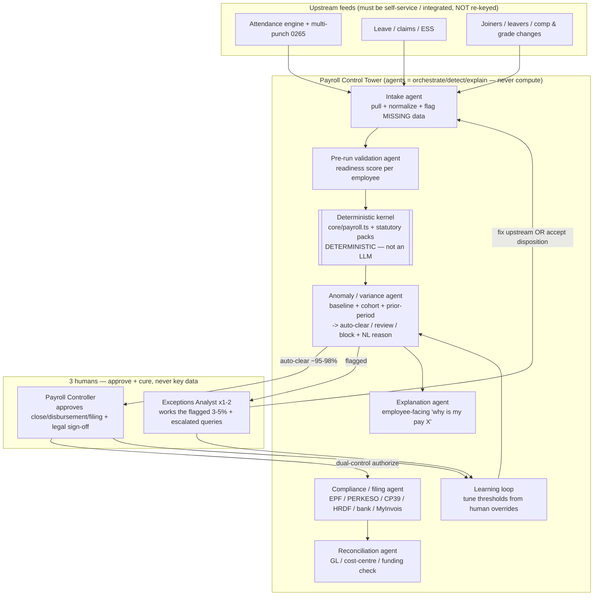
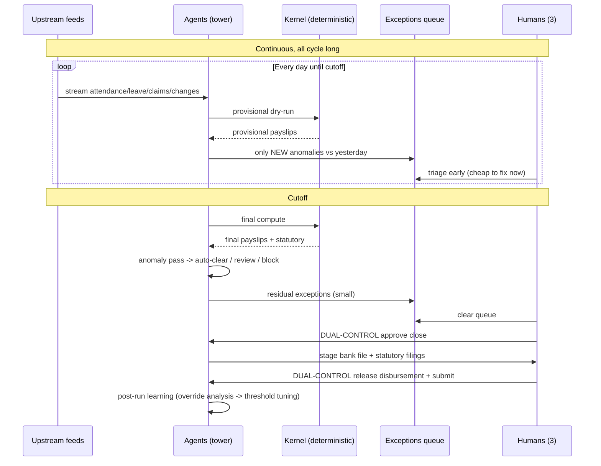

# ADR-0074 — Autonomous Payroll Control Tower (closed-loop, exception-driven payroll)

Status: Proposed — **operating model SUPERSEDED by [ADR-0083](0083-hr-operations-control-plane.md)**
(strategy / target architecture — NOT a build order)

> ⚠️ **READ ADR-0083 BEFORE ACTING ON §5's BUILD ORDER OR THE §"reframe" BELOW.** 0083 keeps this
> document's non-negotiable invariant — the LLM never computes the money — and keeps §7's earned-autonomy
> discipline. It supersedes three things: the auto-clear rate as the single north-star number (it is a
> lagging indicator of input quality, and perfecting it can leave headcount unchanged); **item 2**, the
> global confidence dial, replaced by autonomy granted per ACTION TYPE; and **item 7**, whose learning
> target — tuning thresholds from human overrides — teaches the system to stop flagging rather than to fix.
> Items 1, 3, 4, 5 and 6 are built and stand. Item 8 is re-rated UP by 0083.
Date: 2026-07-18
Relates to: ADR-0001 (domain-event log), the finance event-sourcing rule (`FinancialEvent`, root `CLAUDE.md`),
the MY statutory kernel + rules-as-data packs (2C golden tests, ADR-0024/0025/0029/0037), the payroll batch
lifecycle (`core/payroll.ts`: `createBatch → generatePayslips → closeBatch`), ADR-0045 (the improve-loop
scheduled agent), attendance multi-punch (migration 0265).

## Context

The commercial target is an org of ~3,000 headcount (Chin Hin anchor: ~4.5k staff, ~60 entities, deskless)
run by **a maximum of 3 payroll staff** — a ~1000:1 employee-to-operator ratio. Industry baseline is ~1 FTE
per 250–500 employees, i.e. 6–12 people for 3,000. Reaching 3 is best-in-class and is **only** possible if
the system pays the overwhelming majority of people with **zero human touch** and the humans do judgment and
sign-off, not data entry.

This ADR states the **target operating model and architecture** so that subsequent, individually-scoped build
ADRs slot into a coherent whole. It commits us to no code here.

### The reframe: it is an exception-rate problem, not a headcount problem

At a 97% auto-clear rate, ~90 of 3,000 employees need human eyes per cycle (~1.4 per operator per working
day). At 95% it is ~150. Both are trivial for 3 people. **Every design decision below serves one number: the
auto-clear rate, and the mean-time-to-resolve of the exceptions that remain.**

### Non-negotiable invariant: the LLM never computes the money

The arithmetic (EPF/SOCSO/EIS/SKBBK/PCB/HRDF, proration, OT banding) stays in the **existing deterministic,
versioned, golden-byte-identical-tested kernel**. Agents orchestrate, detect, explain, and draft; they never
produce a ringgit figure. This is what makes the ratio defensible to a CFO, an auditor, and PERKESO/LHDN.

## Decision

Adopt a **management-by-exception, continuously-running, human-gated closed loop** — the "Payroll Control
Tower" — layered on the substrate we already have. Agents own the mechanics; the 3 humans own approval and
exception cure.

### 1. Architecture — the control tower

The loop runs **continuously**, not at month-end. A **daily provisional dry-run** surfaces a bad OT entry on
the 4th (when there is time to fix it) instead of on the 28th. This single property is most of what converts
"month-end crunch" into "steady state."

### 2. The monthly cadence (sequence)

### 3. Trust scaffolding — what makes 1000:1 *safe* in a compliance domain

- **Deterministic compute kernel** with **versioned rules-as-data packs** and **golden byte-identical
  regression tests on every pack change** — already built; extend, never bypass. LLMs never touch arithmetic.
- **Confidence-gated autonomy.** Each employee-run scores a confidence; above threshold → auto-clear, below →
  human queue. Threshold starts at "review everything" and rises **only as measured accuracy earns it.**
- **Dual control on irreversible steps.** Batch close, bank-file release, and statutory submission are
  **human-authorized**; the agent prepares, a person releases. (Same discipline the deploy classifier enforces
  elsewhere: agents propose, humans commit irreversible/outward actions.)
- **Immutable audit** via the append-only `DomainEvent`/`FinancialEvent` substrate — every input, computation,
  override, and approval is replayable, who-did-what. This is both the audit trail and the source the
  explanation agent reads from.
- **Segregation of duties preserved** — no agent both computes and releases money; the humans who approve are
  not the source of the numbers.
- **Circuit breaker.** If total run movement exceeds a configured % vs the prior cycle unexpectedly, halt the
  **whole batch** for human review, not just individuals.
- **A named human signs the statutory filings — permanently.** MY legal accountability for
  EPF/SOCSO/PCB/CP8D/EA cannot be delegated to an agent. Design for a standing human sign-off, not its removal.

### 4. What the 3 people actually do (steady state)

1. **Payroll Controller (1)** — owns the cycle calendar; approves close + disbursement + filing; holds legal
   sign-off; reads the run-level variance dashboard.
2. **Exceptions Analyst (1–2)** — works the flagged 3–5%: accept the agent's suggested disposition, or **fix
   the upstream data at source**; handles escalated employee queries the explanation agent could not resolve.

Their role shifts from *doing* payroll to *approving* it and *curing exceptions at the source*.

### 5. Leverage: already-built vs. to-build

**Already have (do not rebuild):** deterministic MY statutory kernel + versioned packs + golden tests;
event-sourced audit (`DomainEvent`/`FinancialEvent`); attendance engine incl. multi-punch (0265); leave /
claims / ESS; batch lifecycle (`createBatch → generatePayslips → closeBatch`); CP39 / PERKESO / bank-file
generators; per-employee input (`payroll_individual_txn`, `setPayrollInput`); and the improve-loop scheduled-
agent infrastructure itself (ADR-0045) — which is *already* a closed build loop; the same pattern applies to
payroll.

**To build, in dependency order:**
1. **Anomaly / variance layer** — the keystone (scoped in §6). Everything downstream keys off it.
2. **Confidence scoring + auto-clear gate** — the autonomy dial.
3. **Daily provisional dry-run scheduler** — reuse the ADR-0045 scheduler.
4. **Exceptions work-queue UI** — the analyst's whole day.
5. **Employee-facing explanation agent** — deflects the query load.
6. **Run-level circuit breaker** — the safety net.
7. **Learning loop** — override analysis → threshold tuning.
8. **Finish MyInvois / e-filing automation** where not done.

### 6. Keystone scope — the Anomaly / Variance layer (Phase 1, read-only, safe to start first)

This is the first concrete build and is **read-only** (no money moves, no schema on the money path), so it is
low-risk to stand up and measure before any autonomy is granted.

- **Inputs:** the provisional/final payslip rows for the cycle + the immutable event trail + prior N cycles.
- **Detectors (deterministic + explainable, LLM only for the narrative):**
  - *Self-baseline* — this employee vs their own trailing median (net, gross, each component); flag z-score
    outliers and new/disappeared components.
  - *Cohort* — vs same grade/department/company norms (catches a mis-keyed rate).
  - *Prior-period delta* — component-level month-over-month movement with a reason candidate attached
    (e.g. "OT +RM820 — 14 approved OT hours this cycle vs 0 last", sourced from the attendance events).
  - *Rule tripwires* — negative net, statutory > cap, missing bank/tax profile, proration mismatch vs
    days-worked, pay with no attendance.
- **Output per employee:** `{ disposition: auto-clear | review | block, score, reasons[] (each linked to a
  source event), suggestedAction }`. The narrative is generated; **the classification is deterministic** from
  thresholds so it is auditable and testable.
- **Substrate:** each anomaly verdict is appended as a `DomainEvent` (`payroll.anomaly.flagged` /
  `.cleared`) so the run is fully replayable and the learning loop has training signal.
- **Explicitly out of scope for Phase 1:** any auto-clear that skips a human (autonomy is a *later* dial),
  bank/statutory changes, and LLM-computed figures.
- **North-star instrumentation from day one:** auto-clear-eligible rate, false-positive rate (human
  overrode "review"), false-negative rate (human caught something not flagged), MTTR per exception.

### 7. The honest path to the ratio (earned, not launched)

- **Crawl** — agents assist; humans review 100%; agent drafts + explains. Measure agreement rate.
- **Walk** — auto-clear the statistically-clean; humans review only flags. Watch false positives.
- **Run** — raise thresholds as accuracy proves out. **The ratio improves as a function of measured trust,
  not a launch decision.**

**Largest risk is garbage-in.** The ratio collapses if attendance/claims are re-keyed by hand. For a deskless
3,000–4,500 org, **attendance capture at scale (biometric/terminal/mobile punch) is the true bottleneck** —
the payroll agent is only as good as its feed. Upstream self-service is a prerequisite, not a nice-to-have.

## Consequences

- **Positive:** a defensible route to ~1000:1; month-end crunch replaced by continuous steady state; every
  payslip explainable to reviewer and employee from the event trail; autonomy that is *measured into
  existence* rather than assumed.
- **Cost / risk:** the anomaly layer's thresholds need real payroll data to tune (cold-start is
  conservative/noisy); the daily dry-run adds compute; statutory sign-off stays human forever (by design);
  MyInvois/PERKESO/EPF format drift must ride the rules-as-data + golden-test discipline.
- **Non-goals:** removing the human sign-off; an LLM that computes pay; a big-bang cutover to full autonomy.

## Metrics (definition of success)

- Auto-clear rate ≥ 95% (target 97–98%).
- Exceptions per 1,000 ≤ 50.
- MTTR per exception < 5 minutes.
- Cost per payslip trending down cycle-over-cycle as the learning loop tightens thresholds.
