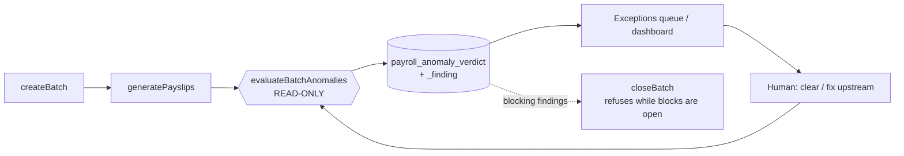

# ADR-0076 — Payroll anomaly layer: detailed design

- **Status:** Proposed (buildable specification — no code written yet)
- **Date:** 2026-07-20
- **Implements:** ADR-0074 §5 item 1 and §6 (the keystone), which committed to no code
- **Builds on:** `core/payroll.ts` (`createBatch` :534 → `generatePayslips` :1810 → `closeBatch` :3443),
  the `DomainEvent` substrate (`db/events.ts` `appendEvent`), rules-as-data (`statutory_ruleset`),
  attendance multi-punch (0265)

## 1. Why this document exists

ADR-0074 set the target operating model: management-by-exception payroll, ~1000:1 employee-to-operator, LLMs
never compute money. It deliberately stopped short of design. This ADR is the design for the first
buildable layer, at the level of detail needed to hand to a build round.

### The fact that reshaped the plan

The demo server currently holds **3 payroll batches / 15 payslips / 6 distinct employees**. ADR-0074 said the
anomaly thresholds would be "cold-start conservative/noisy". That was too gentle. There is **no payroll
history to calibrate against at all**.

This is not a blocker to building — it is a constraint that dictates *what* to build and in what order. The
four detector families in ADR-0074 §6 have different data appetites, and shipping them together would mean
shipping two that cannot work:

| Detector family | Data required | Buildable today |
| --- | --- | --- |
| Rule tripwires | none | **yes** |
| Prior-period delta | 1 prior cycle | **yes** (degrades cleanly at cycle 1) |
| Self-baseline (z-score) | ~6–12 cycles per employee | no |
| Cohort norms | enough headcount per grade/dept | no |

**Decision: split ADR-0074's Phase 1 into 1a (no history) and 1b (needs history).** Everything in this
document is designed so 1b slots in later without reopening 1a.

## 2. Architecture

### 2.1 Where it hooks into the payroll lifecycle



`evaluateBatchAnomalies` runs **after** `generatePayslips` (figures must exist) and is **idempotent** — it can
be re-run any number of times on an open batch, superseding prior verdicts. It writes only to its own tables.
It **never** mutates a payslip, a batch total, or anything on the money path.

`closeBatch` gains one guard: refuse while unresolved `block` verdicts exist. That is the only change to
existing payroll code in Phase 1a, and it is additive — a batch with no verdict rows behaves exactly as today,
so existing behaviour and the golden tests are untouched.

### 2.2 Component decomposition

```
core/payroll-anomaly.ts
  ├── registry            detectors declared with their data requirements
  ├── gatherContext()     one batched read per run — no N+1 per employee
  ├── evaluate()          pure: context → Finding[]        (DETERMINISTIC, no LLM)
  ├── resolveDisposition()pure: Finding[] → disposition    (DETERMINISTIC, no LLM)
  ├── persist()           verdict + findings + DomainEvent
  └── narrate()           OPTIONAL, LLM, additive prose only — see §2.6
```

### 2.3 The detector contract

```ts
type DataRequirement = {
  priorCycles: number;        // 0 = works on a brand-new client's first run
  cohortMinSize?: number;     // detector self-disables below this
};

type Finding = {
  detectorId: string;
  severity: 'block' | 'review' | 'info';
  facts: Record<string, string | number>;  // the numbers that triggered it
  sourceEventIds: string[];                // provenance into DomainEvent
  suggestedAction: string;                 // i18n key, not prose
};

type Detector = {
  id: string;
  requires: DataRequirement;
  evaluate(ctx: DetectorContext): Finding[];   // PURE. No I/O. No LLM. No clock.
};
```

`evaluate` being pure and synchronous is the load-bearing property: it makes every detector trivially unit
testable with a literal context object, and it makes the classification reproducible from stored inputs
during an audit.

### 2.4 Coverage transparency — the answer to the no-data problem

Every detector declares `requires`. The engine evaluates only those whose requirement is met and records the
rest as **skipped, with the reason**, on the verdict row.

This matters more than it looks. The failure mode to avoid is a statistical detector silently returning "no
findings" on a client with two cycles of history, which is indistinguishable from "checked and clean". A
verdict must be able to say *"auto-clear, but 2 of 6 detectors could not run yet"* — so a 100% auto-clear rate
in month one reads as thin coverage rather than a clean bill of health.

### 2.5 Disposition is derived, not scored

```
any finding severity 'block'  → block
any finding severity 'review' → review
otherwise                     → auto-clear
```

**Phase 1a deliberately has no confidence score.** ADR-0074 §3 called for confidence-gated autonomy; a
"confidence" number implies a calibrated probability, and with no history any number we emit would be
decoration. The `score` column exists (nullable) and stays NULL until 1b has distributions to compute it
from. Populating it early would invite exactly the false trust the whole design is meant to avoid.

### 2.6 Where the LLM is, and is not

The LLM produces **only** the human-readable narrative attached to an already-classified finding — turning
`{detectorId: 'ot-spike', facts: {delta: 820, hours: 14, priorHours: 0}}` into *"Overtime is RM820 higher
than last month; 14 approved OT hours were recorded this cycle versus none last cycle."*

- Classification, severity, and disposition are computed before `narrate()` is called and are never revised
  by it.
- A narrative failure or timeout degrades to the structured facts. It is never on the critical path.
- No ringgit figure is ever produced by the model — every number in the prose is interpolated from `facts`.

## 3. Data model

Three new tables. None sits on the money path; all cascade from their batch.

**`payroll_anomaly_verdict`** — one row per (batch, employment), superseded on re-run
```
id, tenant_id, batch_id FK, employment_id FK,
disposition            text  -- auto_clear | review | block
score                  numeric NULL   -- stays NULL until Phase 1b (see §2.5)
detectors_run          jsonb  -- ids evaluated
detectors_skipped      jsonb  -- [{id, reason}] — coverage transparency (§2.4)
computed_at            timestamptz
superseded_at          timestamptz NULL  -- re-run history kept, never deleted
resolved_by_user_id    NULL, resolved_at NULL,
resolution             text NULL  -- accepted | fixed_upstream | false_positive
resolution_note        text NULL
UNIQUE (batch_id, employment_id) WHERE superseded_at IS NULL
```

**`payroll_anomaly_finding`** — one row per detector hit
```
id, tenant_id, verdict_id FK CASCADE, detector_id, severity,
facts jsonb, source_event_ids jsonb, suggested_action text, narrative text NULL
```

**`payroll_anomaly_config`** — thresholds as DATA, per tenant/company
```
id, tenant_id, company_id NULL, detector_id, enabled, params jsonb,
effective_from, created_by_user_id, created_at, archived_at
```

Thresholds live in the database, mirroring `statutory_ruleset`, for one reason: **calibration must not
require a deploy.** Tuning a threshold during a client's first live cycles is a config change, versioned and
audited, not a code release.

RLS on all three: tenant-scoped read, admin/payroll-role write. `resolution` fields are writable only by the
resolving role.

### Events

- `payroll.anomaly.evaluated` (aggregate `payroll-batch`) — run summary: counts by disposition, coverage
- `payroll.anomaly.flagged` (aggregate `payslip`) — per employee, with findings
- `payroll.anomaly.resolved` (aggregate `payslip`) — human disposition + who + why

Per root `CLAUDE.md` substrate discipline, every state-changing method appends. The per-payslip verdict rows
are the audit record for the evaluation itself, so re-runs that produce an identical verdict skip the event
(documented inline) to avoid flooding the log on a daily dry-run.

## 4. Detector catalog

### Phase 1a — tripwires (`priorCycles: 0`)

| id | Severity | Condition | Suggested action |
| --- | --- | --- | --- |
| `negative-net` | block | `net_pay < 0` | Review deductions; net pay cannot be negative |
| `zero-net-with-pay` | review | `net_pay = 0` and `gross_pay > 0` | Deductions consumed all pay — confirm intentional |
| `statutory-over-cap` | block | any statutory component > its pack ceiling | Statutory pack mismatch — do not file |
| `missing-bank-profile` | block | payable, no valid bank profile | Capture bank details before disbursement |
| `missing-tax-profile` | review | no `employee_statutory_my` row | PCB may be wrong without a tax profile |
| `pay-without-attendance` | review | pay > 0, zero attendance and zero approved leave | Confirm the employee actually worked |
| `proration-mismatch` | review | `days_worked` inconsistent with period and joiner/leaver dates | Verify hire/termination dates |
| `duplicate-employment-pay` | block | same person paid twice in one period across employments | Confirm concurrent employment is intended |

Chosen because each catches an error that is *materially embarrassing in front of a client* — negative pay,
paying into a missing account, over-contributing EPF — and none needs a single day of history.

### Phase 1a — prior-period delta (`priorCycles: 1`, self-disables on cycle 1)

| id | Severity | Condition |
| --- | --- | --- |
| `net-swing` | review | net moved more than `params.netSwingPct` (default 30%) vs prior cycle |
| `component-appeared` | review | a component non-zero this cycle, absent in the prior cycle |
| `component-vanished` | review | a component present last cycle, absent now |

Defaults are **conservative placeholders, explicitly untuned** — labelled as such in the seed config so
nobody mistakes 30% for an empirically derived number.

### Phase 1b — statistical (deferred, needs history)

`self-baseline-zscore` (~6–12 cycles per employee), `cohort-outlier` (needs grade/dept density). Specified
here only so the contract accommodates them: both fit the same `Detector` interface and declare their
requirement, so enabling them later is a registry entry plus a config row.

### Run-level circuit breaker (`priorCycles: 1`)

Total batch net movement beyond `params.batchSwingPct` (default 15%) vs the prior cycle → the **whole batch**
blocks, not individuals. Catches a global mis-key (wrong pack version, wrong period) that per-employee
detectors would rate as unremarkable because everyone moved together.

## 5. Instrumentation — the point of Phase 1a

The ADR-0074 success metric is auto-clear ≥95%. **Nobody currently knows the baseline**, because nothing
measures it. Phase 1a ships the counters even though early numbers will be small and dull:

| Metric | Definition |
| --- | --- |
| Auto-clear rate | `auto_clear / total verdicts` per batch |
| Coverage | `detectors_run / (detectors_run + detectors_skipped)` — guards against §2.4's false clean |
| Flagged per 1,000 | `(review + block) / total × 1000` |
| False-positive rate | `resolution = 'false_positive' / total flagged` |
| False-negative rate | issues found by a human on an `auto_clear` verdict — needs a "raise exception" path in the queue, so **Phase 1a must include the field even though the UI comes later** |
| MTTR | median `resolved_at − computed_at` for flagged verdicts |

Without the false-negative path designed in from the start it cannot be backfilled, and the metric that
matters most for granting autonomy would be permanently unmeasurable.

## 6. Calibration strategy

Three routes; only the first is engineering, and it is the weakest.

1. **Synthetic harness** — run the real kernel over generated employees across N cycles with controlled
   variance, then plant known faults and assert detection against that ground truth. Proves the detectors
   *work*. Says **nothing** about real-world thresholds; synthetic variance is a guess about the shape of the
   distribution, which is precisely the unknown.
2. **Historical registers from the client** (even anonymized) — the only route to defensible thresholds
   before go-live. A commercial ask, not a build task.
3. **Shadow-run** — detectors read-only through the client's first real cycles, collecting the distribution
   with autonomy at zero. This is ADR-0074's "crawl" and is the realistic answer.

**No amount of building substitutes for 2 or 3.** Any claim of a 95% auto-clear rate before one of them has
happened is unfounded, and should not be made to a client.

## 7. Test strategy

- **Detector unit tests** — pure `evaluate()` against literal contexts; one test per detector for fire, no-fire,
  and boundary. Fast, no database.
- **Engine integration** — batch → generate → evaluate against a seeded tenant, asserting verdict rows,
  skipped-detector recording, idempotent re-run, and event emission.
- **`closeBatch` guard** — refuses with open blocks; unchanged when no verdicts exist (protects existing
  behaviour and the golden byte-identical statutory tests).
- **Synthetic harness** (§6.1) as a regression corpus with planted faults.
- **RLS** — cross-tenant read/write denial on all three tables, per existing convention.

Now viable per-round: the suite runs in ~4 minutes after ADR-0075.

## 8. Build sequence

| # | Slice | Depends on | Notes |
| --- | --- | --- | --- |
| 1 | Schema + RLS + config seed | — | 3 tables, thresholds as data |
| 2 | Engine + tripwire detectors + events | 1 | The keystone; read-only |
| 3 | `closeBatch` block guard | 2 | Only touch to existing payroll code |
| 4 | Prior-period detectors + circuit breaker | 2 | Self-disable at cycle 1 |
| 5 | Metrics read layer | 2 | Baseline recording starts here |
| 6 | Exceptions queue UI | 2, 5 | The analyst's day; needs real verdicts to design against |
| 7 | Daily provisional dry-run | 2 | Reuse the ADR-0045 scheduler |
| 8 | Synthetic harness | 2 | Can run parallel to 4–7 |

Then, gated on real data: Phase 1b statistical detectors → confidence scoring → auto-clear autonomy dial →
learning loop. **Autonomy is the last thing built, not the first.**

## 9. Open decisions (needed before build)

1. **Calibration route** (§6) — is client history obtainable, or is shadow-run the plan? Changes whether 1b
   is schedulable at all.
2. **Blocking severity at go-live** — should `block` genuinely prevent `closeBatch` on day one, or warn only
   until thresholds are trusted? Recommendation: block for the tripwires (they are unambiguous bugs), warn
   for everything statistical.
3. **Who resolves** — does the Exceptions Analyst role need a distinct permission from payroll admin?
   ADR-0074 §3 requires segregation of duties; this is where it becomes concrete.
4. **Daily dry-run cost** — a provisional run for 3,000 employees daily has real compute cost; needs a
   measured estimate before committing to the cadence.

## Consequences

**Positive.** A read-only layer that cannot move money, works on a client's very first cycle, catches the
embarrassing failures immediately, and starts recording the baseline that every later autonomy claim depends
on. The detector contract accommodates the statistical work without rework.

**Costs / risks.** Untuned defaults will generate false positives in early cycles — mitigated by config-not-code
thresholds and by shipping the FP counter from day one. The daily dry-run cadence is unpriced (open decision
4). The largest risk is unchanged from ADR-0074 and is not solved here: **garbage-in from re-keyed attendance
in a deskless workforce.** No anomaly layer compensates for a bad feed; it only makes the badness visible
sooner.

**Non-goals for this ADR.** Any autonomy or auto-clear that skips a human; LLM-computed figures; bank or
statutory format changes; removing the permanent human statutory sign-off.
