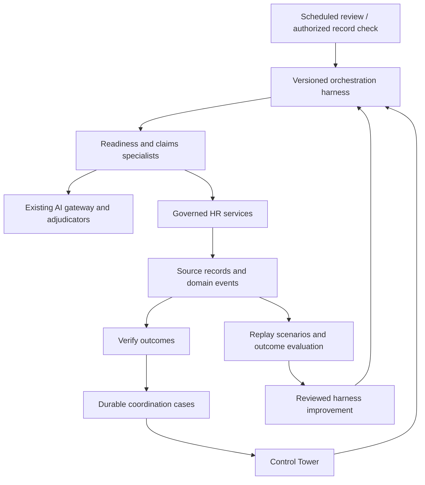

# ADR-0104: Central HR orchestration and the Control Tower

Date: 2026-10-13
Status: Initial implementation in review

## Understanding

The product should enable a small HR team to complete more work with less manual handling.
The owner requested a central orchestrator connected to the existing HR engine, an evolving
engineering harness, and consolidation of the AI Control Tower.

## Decision and graph impact

Use one logical orchestration layer in the existing application. Keep the current provider gateway
and governed HR services. The Control Tower is its operator workspace. Execution remains scoped to
one tenant and the caller's authorized employments; a central coordinator has no cross-tenant authority.

Ownership:

| Concept | Authoritative owner |
| --- | --- |
| Employment, compensation, bank and statutory facts | Existing HR engine |
| Money, entitlements, policy, authorization | Existing deterministic services |
| Coordination state and reopen count | `hr_orchestration_case` |
| State-transition history and check receipts | `domain_event` |
| AI proposal, adjudication, human disposition | Existing `agent_proposal` ledger |
| Model choice and credentials | Existing AI gateway/configuration |
| Automation enablement | Existing tenant settings |
| Operations UI | Existing `/control-tower` routes |

A case references an employment and readiness gap. It stores no duplicate bank, identity, salary,
document or employee-name values. RLS follows current employment permissions, including transfers.
Hard deletion of an employment removes its coordination rows; existing domain-event retention applies.

## Initial implemented loop

The existing scheduled review calls `runHrOrchestrator`. It observes readiness, runs the existing
readiness-nudge and claims-triage specialists under their existing switches, and observes readiness
again. Notification projection remains in the scheduled runner. An independent specialist failure
does not suppress the other specialist and is reported as a failed run.

The runner drains up to fifty notification pages of one thousand events each, using the existing
committed cursor. This prevents case-history events from delaying reminders behind a single page.
Hitting that bound is recorded as incomplete work in the job result. An uncertain page is not retried
inside the pass; the next invocation resumes from the committed cursor.

Readiness cases have four states:

- `needs_input`: the employee can submit the missing information through an existing self-service path.
- `needs_review`: HR must review and update the source record.
- `verified`: the engine positively observed that this particular gap no longer exists.
- `inactive`: the employment was positively observed to have ended. This is not credited as a fix.

Disappearance from a scoped query never proves completion. Unsupported gap types remain unchanged.
A recurring gap reopens the same case, increments its reopen count and records a new event. Each
transition and its evidence event commit together. Concurrent reconciliation is serialized before
reading the source. Refreshing the Tower performs this observation only; it never sends a reminder.

Verification currently proves field presence or that the field is no longer required (for example,
cash payment removes the bank-account requirement). It does not prove that an entered account or
statutory identifier is accurate. The UI explicitly distinguishes this from substantive HR validation.

Reminders use committed events as their durable effect receipts, with an atomic cooldown check.
A failed best-effort proposal write cannot cause a duplicate reminder on retry. Provider calls remain
outside that transaction. Notification creation, email relay acceptance and employee receipt remain
separate outcomes; a reminder is never treated as task completion.

## Control Tower consolidation

Keep the existing routes and provide shared navigation: Overview, Employee data, Payroll exceptions,
Approvals, Automation and How it works. Lead the overview with the scoped work queue, responsible
party, next action, explicit refresh and recorded observation time. Retain payroll and AI quality
metrics in an expandable section. Keep agent configuration and approval actions in their existing
governed screens. Show a visible count when the overview is limited to 50 issues.

## Harness engineering

`core/orchestrator-harness.ts` versions the initial coordination policy. Deterministic replay scenarios
and database integration tests must cover unknown observations, termination, reopens, overlapping
runs, unavailable telemetry, switched-off agents, and cross-company/cross-tenant access.

The enhancement cycle is: capture failure/outcome → build a redacted replay case → change one
versioned policy/tool/prompt → compare against the previous version → run security and regression
checks → reviewed rollout → monitor real outcomes and rollback if needed. Acceptance of an AI
suggestion alone is not success. Measure human handling time, verified completion, reopened work,
missed deadlines and model/operating cost. Unknown savings remain unknown.

## Next increments and explicit limits

Prioritize by measured manual handling time and repeat volume, then by whether the engine can verify
the outcome. The initial opportunity review is:

| Area | AI-assisted work to reduce handling | Evidence that closes the loop | Position in this implementation |
| --- | --- | --- | --- |
| Employee data | Explain missing information and request corrections | Source gap removed or requirement no longer applies | Durable cases plus existing reminder specialist |
| Claims | Identify missing evidence and ask a targeted question | Employee submission and the existing claim decision | Existing triage specialist coordinated; claim lifecycle stays in its engine |
| Payroll | Explain anomalies and propose supported corrections | Governed approval, recalculation and subsequent outcome checks | Existing payroll queues consolidated; evaluator schedule retained |
| Employee questions | Answer from authorized policy and personal records | Answer usefulness or confirmed completion through a governed action | Existing assistant; action orchestration is a future increment |
| Onboarding and offboarding | Coordinate documents, tasks and follow-ups | Each owning service confirms its task result | Future orchestration adapter; access decisions retain approval |
| Attendance and leave | Explain exceptions and collect missing context | Approved correction reflected in the owning service | Future orchestration adapter |
| Compliance | Assemble evidence and chase configured deadlines | Required evidence accepted by the responsible reviewer | Future orchestration adapter; no invented statutory rules |

Measure net human minutes per verified case, including employee and manager effort, rework and
escalations. Pair this with completion time, overdue work and AI operating cost. Headcount savings
cannot be inferred from the number of messages sent or model calls made.

This initial slice is a deterministic coordinator of existing AI specialists. It does not yet provide
a general-purpose model planner or a universal durable execution runtime. Payroll's anomaly sweep
retains its existing schedule and appears in the same Tower. The following are future increments,
not claimed capabilities:

1. Named assignees, due dates and escalation rules tied to configured HR policies.
2. Expanded employee submissions and document extraction with engine-side validation.
3. Typed action registry with per-action authorization, budgets, preconditions and effect receipts.
4. Model-assisted plan selection within that registry; every proposed plan is validated before execution.
5. Durable step leases/checkpoints, approval-bound resumes, explicit reconciliation for uncertain
   external effects, and a dead-letter queue. A timeout is not permission to repeat an external action.
6. Attendance, lifecycle and compliance adapters, followed by external systems through governed tools.
7. Versioned model evaluations and controlled rollout using measured workload outcomes.

The initial workflow re-observes source state each pass. It does not claim automatic plan generation,
automatic model improvement, universal exactly-once delivery, or autonomous HR decisions.

## Challenges and assumptions

Assumption: centralization means a shared control plane inside the established stack, with the option
to move workers behind the same contracts later. No separate framework or new provider is required.

Risk: missing fields can be made present without becoming correct. Keep the distinction visible and
extend the engine's validation where verified business rules support doing so.

Risk: a notification is a handoff, not completion. Only positive source evidence changes a case to
verified; human time and recipient effort are included when measuring savings.

Decision: retain human authority for consequential HR decisions. Prompts and model confidence cannot
expand permissions, change pay logic, grant access, or override required approval.

References: [existing north star](../architecture/north-star.md), ADR-0083, ADR-0084,
[OpenAI on harness engineering](https://openai.com/index/harness-engineering/), and
[Anthropic on long-running harnesses](https://www.anthropic.com/engineering/effective-harnesses-for-long-running-agents).
