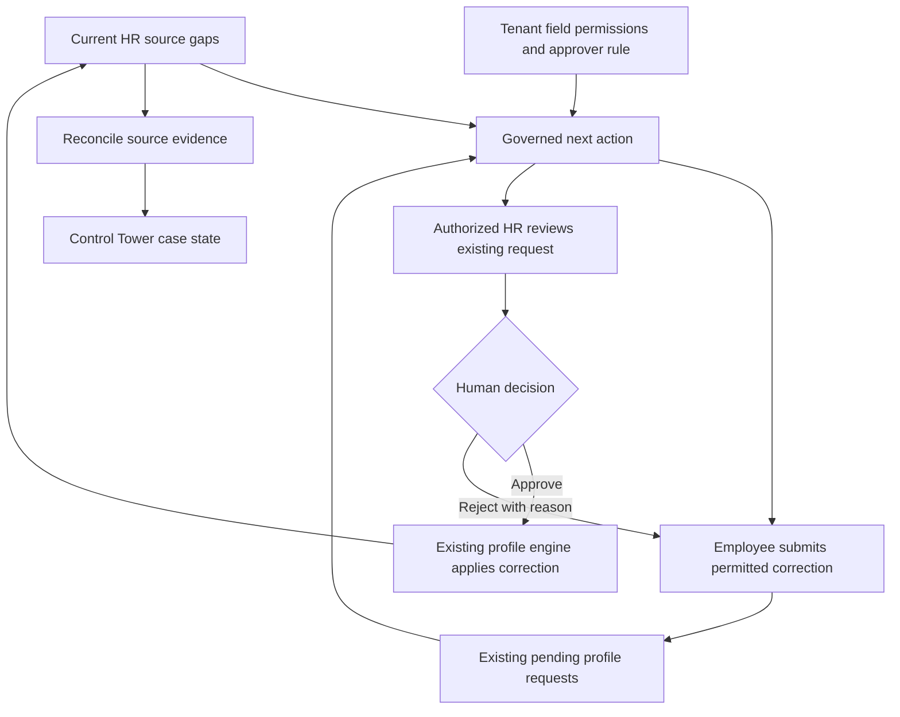

# ADR-0111: Approval-aware readiness corrections

> Decision record at its recorded date; implementation/status observations are historical. Verify current source and later amendments. [Branch/release policy](../REPOSITORY-AND-ENVIRONMENTS.md) governs operations.

Date: 2026-10-13
Status: Accepted — next increment of ADR-0109

## Understanding and evidence

The owner requested the next AI increment after the central orchestrator and consolidated Control Tower.
The useful next step is to reduce HR's collection and follow-up work. The existing request engine already
accepts employee bank, identity, tax, EPF and SOCSO corrections, subject to tenant field permissions and
human approval. The previous nudge routing offered employee action only for bank details. It also did
not recognize a pending correction, so an employee could continue being chased while HR held the work.

## Decision and graph

Use a closed, deterministic action catalogue above the existing engine, shared by the orchestrator,
My Profile and readiness reminders. A model may draft a bounded reminder; it cannot select tools,
apply records, approve requests, compute pay or declare completion.

| Fact / responsibility | Owner |
| --- | --- |
| Missing facts and payroll readiness rules | Existing readiness engine |
| Requestable keys, forms and writable targets | Existing profile request declaration and engine |
| Allowed fields and approver category | Existing tenant settings |
| Proposed values and human decision | Existing profile change request |
| Submission eligibility and next step | Derived action catalogue; no stored copy |
| Completion, reopen count, check history | Existing orchestration cases and domain events |
| Reminder delivery and preferences | Existing notification pipeline |

A permitted missing field yields `submit_correction` and an existing My Profile form link.
A relevant pending request yields `review_submission`, an HR owner and an approval link only for a
viewer whose role, approver category and self relationship permit review. Compensation, locked fields
and a missing statutory-profile row yield `review_record`. The latter prerequisite matters because
the existing approval engine cannot apply statutory patches without that source row.

Bank changes require both bank name and account number, matching the request engine's atomic pair.
Either IC or passport can address the existing identity gap. Pending matching reads nonblank string
field names and request IDs only; proposed values never enter the coordinator or model. Requests are
matched to the exact employment and its person, under existing RLS. Personal tasks additionally
filter by the calling person's ID. No employee access to administrative case records is introduced.

## Lifecycle and failure behavior

Pending is open work, never successful correction. Existing `needs_input` and `needs_review` states
are sufficient; there is no migration or second approval system. Approval becomes verified only when
the readiness source gap disappears. Rejection resumes employee work on the same case. A closure
followed by a source regression reopens through the existing harness. Termination remains inactive,
not success. Checking records does not send reminders.

Pending corrections are excluded before model drafting and reminder cooldown checks. A draft cache
is per gap and audience, since HR and employee instructions differ. After drafting, the reminder
transaction rechecks the current gap, pending requests, field permissions and tenant kill switch.
A changed action is suppressed and counted. Existing advisory locks and domain-event receipts still
deduplicate concurrent reminder sweeps. This does not cancel notifications already committed before
a later submission, nor provide a universal durable workflow runtime.

My Profile reads source-derived guidance and degrades to an unavailable message on read failure.
If action settings cannot be resolved, the Control Tower retains observed cases with unavailable
action guidance; it does not substitute a guessed permission.
The Control Tower reads the current pending action alongside the case's last observation timestamp;
its case counters still reflect the last explicit or scheduled reconciliation. Existing request forms
remain the authority and can reject a request if policy changes after the guidance was rendered.
Human decisions retain their existing service guards, audit events and rejection reasons.

## Harness and acceptance

The harness version advances to `readiness-v2`. Replay coverage includes permitted versus locked
fields, bank-pair and identity alternatives, absent statutory profiles, pending/approved/rejected
transitions, self/group review eligibility, blank and irrelevant proposals, tenant/company/person
boundaries, form deep links, and source/policy/submission/switch changes during drafting. Provider
calls in these scenarios are mocked; no real credential or model is needed.

Representative browser journeys must prove employee form submission, persisted pending guidance,
authorized HR approval and rejection, source-based verification, restricted fields, mobile layout,
six locales and absence of browser/render errors before the final release gate.

## Tradeoffs and next boundary

This increment reuses proven forms and approval transactions, with no new database state to synchronize.
It avoids broad model-selected execution until there are measured outcomes and tested action contracts.
Per-employment source revalidation adds reads to opted-in reminder runs; batches still bound initial
reads, model calls are shared by gap/audience, and the existing effect cap and cooldown remain.
The run records awaiting-review and changed-before-send counts. These measure routing and suppressed
chasing, not hours saved or headcount reductions. Those require observed workload baselines.

Later increments can add measured completion times, targeted collection across a whole onboarding
case, approved additional action types and replay-driven harness improvements. No automatic hiring,
pay, performance, disciplinary or termination decisions are added here. Tenant switches stay opt-in.
