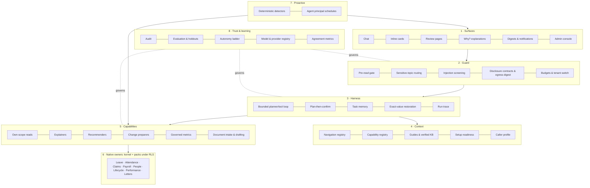

# ADR-0170 — Teras: the AI operating architecture

> Decision record at its recorded date. Implementation and status notes are historical; verify current source and later amendments. The [branch and release policy](../REPOSITORY-AND-ENVIRONMENTS.md) governs operations.

- **Status:** **Proposed draft for the owner (1 November 2026).** Not accepted. Nothing here authorises a disclosure change, deployment or production contact.
- **Number:** provisional. Reconcile at merge: PR126 holds 0167, and ADR-0169 is also provisional.
- **Name:** "Teras" is a working name, pending the owner's choice and a trademark search (§9).
- **Builds on and keeps:**
  - [ADR-0169](0169-assistant-context-harness-and-disclosure-repivot.md): its five layers, the §5.1 privacy/legal review gate, and phases A–D;
  - [ADR-0084](0084-propose-adjudicate-learn.md): models propose, deterministic services adjudicate;
  - [ADR-0151](0151-orchestrator-action-layer-and-system-learning.md): prepared, human-confirmed actions;
  - [ADR-0116](0116-central-ai-inventory-and-allowances.md): inventory and allowances;
  - [ADR-0117](0117-embedded-hr-authentication.md): identity.
- **Adds:** the capabilities that the [capability review](../reviews/assistant-ai-native-capability-review-2026-11.md) found worth adopting, plus the HR-specific capabilities no surveyed product has. It also states the whole system as one architecture with a named owner per part.
- **Evidence:** the capability review (about 130 journeys by access type, 16 AI-native products), the [phase-1 review](../reviews/assistant-conversational-phase1-2026-10.md) §10–§16, and draft PR 170.

## 1. Why one architecture

AI already exists in several places:
- the production Assistant (closed grammar, 12 reads, 7 cards);
- governed analytics (`/analytics`);
- the payroll anomaly narrator and hypotheses;
- pay-rule drafting;
- personnel import mapping;
- performance drafting (off);
- readiness and approval chasers (off);
- the Control Tower agent pages.

Each has its own entry point, gate and switch. ADR-0169 redesigns conversation only.

Without one architecture, every new AI feature reinvents its own:
- authorisation;
- disclosure;
- budget;
- audit;
- evaluation.

Every one of those is a place a privacy or security defect can enter. **Teras is the single path every model call, tool, suggestion and agent run goes through.**

## 2. Principles (invariants)

1. **Native owners are the truth.** The model never computes money, entitlements, dates or eligibility, never decides permissions, and is never a record of HR fact.
2. **Acts as the person, never wider.** Every read runs as the caller under tenant row-level security. There is no chat "service account". Automation runs as the explicit agent principal with its own grants and audit.
3. **People decide sensitive outcomes.** Changes complete on their own review pages. Pay, employment status and access never auto-apply at any autonomy level.
4. **Minimum necessary to the provider.** Each tool's fields are disclosed under a reviewed contract. Identifiers never leave. Figures go out as bands or placeholders and are restored locally. Small groups are suppressed **only** where the person could not read every row behind the figure, and **always** for what leaves to the provider.
5. **Deterministic gates before probabilistic ones.** These checks are code that runs before the model sees anything:
   - privacy;
   - sensitive topics;
   - overrides;
   - attachments;
   - budgets;
   - eligibility.

   Prompts and memory are advisory, never a guarantee.
6. **Untrusted by default.** Employee text, records, knowledge-base content and tool output are fenced as data, never instructions.
7. **Every run is explainable.** What was read, why something was suggested, and what the person decided are stored with the review and the audit row.
8. **No judgements about individuals.** The model is never asked to infer attitude, sentiment, flight risk or performance from communications.
9. **Measured before shipped.** Hard gates are asserted per turn and never averaged into quality. Holdout suites are release gates.

## 3. The layers

Status key: **Prod** = in production; **Branch** = built on PR 170, fictional data only, not imported by production; **Build** = to build; **Review** = blocked on the ADR-0169 §5.1 privacy/legal review.

### 3.1 Surfaces: where people meet Teras

| Component | What the person gets | Status | Owner / note |
| --- | --- | --- | --- |
| Chat | Plain-language questions in six interface languages | Prod (closed grammar), Branch (tool-using) | `core/assistant.ts`; production stays closed until the review |
| Inline cards | A pre-filled, system-checked summary with one review step | Prod: 7 cards. **Build:** apply leave, decide leave, cancel approved leave first | `lib/ai/assistant-action-proposal-hints.ts` |
| Review pages | The only place a change completes | Prod | Registry review routes |
| **"Why?" explanations** | "Why is my PCB higher?", "Why 14 days?", "Why was I marked late?", answered from the system's own calculation | Owners exist, not yet Assistant tools: `explainStatutory` (`core/statutory-explain.ts`), `explainAttendanceDay` (`core/attendance-explain.ts`), entitlement explanation (`core/read.ts`). **Build** | No vendor surveyed documents this |
| Digests and notifications | A daily "what needs you": approvals waiting, setup gaps, deadlines | Detectors and chasers exist, off by default. **Build** | Approval queue (`core/approvals-inbox.ts`), readiness |
| Admin console | Switches, allowances, providers, agents, runs | Prod (`/control-tower/agents/*`) | Add the agent registry and agreement view (§3.8) |

### 3.2 Guard: decides what may happen before the model sees anything

| Component | Status | Note |
| --- | --- | --- |
| Pre-read gate: no private reads for other-person, override and attachment turns | Branch (`lib/product-context/request-gate.ts`) | en/ms/zh/vi; **Tamil and Thai need a native-speaker review** |
| **Sensitive-topic routing**: harassment, grievance, medical, self-harm, termination go to the HR contact or case route with no reads, and an override is logged | **Build** | Deterministic category, like the gate (ServiceNow, Intercom pattern) |
| **Workplace-harms rule**: no inference about individuals | **Build** (rule + corpus tests) | Microsoft pattern; principle 8 |
| Injection screening: log-only per tenant first, block when false positives are known | Build | Override patterns exist; tool-output fencing is the weakest point today |
| Disclosure contracts per tool and field; identifier denylist | **Review** | Closed contracts and source digests exist for current provider paths (`lib/ai/provider-*`) |
| Egress digest gate | Prod | `scripts/ai-provider-data-source-manifest.mjs`, `scripts/ai-agent-source-manifest.mjs` |
| Budgets, allowances and switches | Prod for features (ADR-0116, `core/ai-management.ts`); per-turn budgets in the probe only | Per-tenant opt-in for option 2 disclosure: **Build** |

### 3.3 Harness: runs a turn safely (ADR-0169 phase C)

| Component | Status | Note |
| --- | --- | --- |
| Bounded planner/tool loop with per-step authorisation, step/token/time/spend budgets, repeat-call guard, no blank replies, truncation retry | Prod for the closed loop (`core/assistant.ts`: budget gate, turn loop, dispatch, audit row); Branch for the tool-using loop (probe only) | Becomes product code behind a switch that stays off |
| **Plan-then-confirm**: multi-step work (onboard a cohort, year-end leave) becomes an editable plan of review pages | **Build** | Claude Code / Cursor pattern; each step still confirmed |
| Task memory: goal, selections, pending question, completed reads, open reviews; re-authorised every turn; erasable with the transcript | Build | Never HR truth |
| Exact-value restoration: the model sees placeholders or bands, and the person sees exact figures they may read | Build | Principle 4 |
| Run trace: reads, reasons and suggestion, stored with the review | Build | Attio, Ramp, Legora pattern; extends the existing audit row |

### 3.4 Context: what Teras knows about the product, never the codebase

| Component | Status |
| --- | --- |
| Navigation registry (from the sidebar sources, with a drift test) | Branch (`lib/product-context/destinations.ts`) |
| Capability registry: every read, context tool and action, with effect, audience and sensitivity | Branch (`core/product-context/tools.ts`) |
| Guides | Branch (`product_guidance`) |
| **Verified knowledge**: HR marks articles verified; Teras prefers and cites them | **Build**; the tenant KB disclosure rule is **Review** |
| Setup readiness: payroll, records, leave health, holidays, attendance, onboarding | Branch (`core/product-context/setup-readiness.ts`, `module-readiness.ts`) |
| Further readiness from existing owners: entitlement coverage, logins pending, letter settings, leave generation | Build. Claims setup has **no owner** yet |
| Caller profile: role, scope and modules, never a grant | Branch |

### 3.5 Capabilities: typed tools over native owners

| Kind | Examples | Status |
| --- | --- | --- |
| Own-scope reads | Leave, payslip, claims, profile, team leave, approval queue | Prod 12 + Branch approval queue |
| **Explainers** | Statutory deductions, attendance day, entitlement | Owners Prod; tools **Build** |
| **Recommenders** | Approver card: *recommend approve / needs review / recommend reject*, from native checks (balance, overlap, coverage, policy version); the model only words it; "needs review" is the default | **Build** (Ramp pattern) |
| Change preparers | Every human-confirmed registry action, pre-filled, rejected when fields are missing | Prod (registry + review pages); Branch (suggest any action) |
| **What-if previews** | "If Annual Leave becomes 16 days, who is affected?", using native dry runs | **Build**, only where a native preview exists |
| **Compliance watch** | Holiday minimum (exists), statutory filing deadlines, rule expiry, in plain language | **Build** on deterministic detectors |
| **Policy versus configuration** | Handbook text compared with configured leave and claims rules; differences shown, never auto-configured | Later; **Review** (document disclosure) |
| Governed metrics | Workforce, leave, attendance, claims trends as bands with person-count thresholds | Prod on `/analytics` (`core/ai-*-analysis.ts`); Assistant access is **Review** (touches approved digests) |
| Document intake | Spreadsheet mapping → preview → apply (personnel mapping exists); receipt → draft claim | Mapping Prod; extension Build; receipts **Review** |
| Drafting | Letters through the letters approval workflow; performance drafting (exists, off) | Letters Build; **Review** |

### 3.6 Native owners

These are the kernel and packs (`packs/<pack>/service`), under RLS, with effective dates and audit. Teras adds no business logic here. Where a needed owner is missing (for example claims setup readiness), it is built in the owning pack, never in Teras.

### 3.7 Proactive: work Teras starts

| Component | Status |
| --- | --- |
| Deterministic detectors: payroll anomalies, readiness, approval and document chasers | Prod, mostly **off** by default |
| Agent principal: scheduled, never makes changes, own grants and audit | Prod for chasers |
| Plain-language schedules ("every Monday, tell me who has not submitted claims") | Later; only over detectors that already exist |

### 3.8 Trust and learning

| Component | Status |
| --- | --- |
| Audit of every tool call | Prod (closed loop); extend with the run trace |
| Behaviour scoring, reviewed corpus, overclaim and invented-link checks, adversarial and conversation holdouts | Branch probe; holdouts Prod |
| **Agent registry**: register, activate, deactivate and archive each agent per tenant, plus a report of actions a person could be offered but cannot complete; delegates get an actor class | **Build** (Workday pattern) |
| **Autonomy ladder** per action and tenant: show / pre-fill / auto-apply, only for low-risk reversible steps | Later |
| **Agreement metrics**: how often people accept Teras' suggestions and recommendations, from audit data with no new disclosure | Build (ADR-0084 learn) |
| Model and provider registry, zero retention, residency | Prod for configuration; provider terms and residency are **Review** |

## 4. A turn, end to end

1. **Surface.** The person asks in chat, or opens a card or a "Why?".
2. **Guard.** Deterministic checks run in order:
   - tenant switch, grant and budget;
   - sensitive-topic routing;
   - override, attachment and other-person gate;
   - injection screening.

   Each decides which tools are offered, if any.
3. **Harness.** The model receives the question, the caller profile and only the permitted tool specs. Each tool call is authorised as the caller and dispatched to a native owner. Output is fenced as untrusted and disclosed under its contract, with figures as placeholders or bands.
4. **Harness.** The reply is checked deterministically:
   - not blank;
   - no invented links;
   - no claim that a change was made;
   - no identifiers.

   Exact figures the person may see are restored locally.
5. **Surface.** The answer, a card, or a plan. A change goes to its review page, where the person confirms and the native owner adjudicates.
6. **Trust.** The trace is stored with the audit row and review. The decision feeds the agreement metrics.

## 5. What Teras will not do

- Infer attitude, sentiment, flight risk or performance from messages.
- Offer free-form SQL or "chat with the database".
- Auto-apply pay, employment-status or access changes.
- Calculate money, entitlements or dates.
- Treat memory as HR truth, or keep it longer than the transcript.
- Send identifiers, or exact small-group figures, to a provider.

## 6. Delivery order

Every step is built on fictional data behind a switch that stays off until the ADR-0169 §5.1 review passes. Release order stays with the Orchestrator.

| Step | Content | Needs the review? |
| --- | --- | --- |
| 0 | Usage-data check, to order steps 2–5 by measured frequency | No |
| 1 | Harness as product code: gate, budgets, fencing, exact-value restoration, task memory, trace, tenant switch | No (built and tested on fictional data; switched on only after the review) |
| 2 | Cards: apply leave, decide leave, cancel approved leave | No |
| 3 | Sensitive-topic routing; workplace-harms rule | No |
| 4 | "Why?" explainers; go-live setup co-pilot on readiness | No |
| 5 | Approver recommendations; daily digest; agent registry | No |
| 6 | Governed metrics, receipts, letter drafting, spreadsheet intake, verified KB, policy-versus-configuration | **Yes** |
| 7 | Pilot with one consenting tenant (ADR-0169 phase D) | **Yes**, plus legal sign-off |

Acceptance for each step follows ADR-0169 §6. In addition, every new capability ships with hard-gate tests, and with corpus turns for each access type it serves.

## 7. Consequences and risks

- **One path.** One path means one place to secure and one to audit. Existing AI features migrate behind the Guard and Trust layers over time. Until they do, each keeps its own gate, and an inventory test must list which path each feature uses.
- **More owners.** Readiness, explainer and recommender tools mean more owners to keep consistent. The mitigation is one projection per fact, the pattern of `core/leave-config-health-input.ts`, plus drift tests.
- **Usefulness depends on the review.** The real usefulness gains (ADR-0169 measurements) depend on option 2 disclosure, which is still under review. Without it, steps 1–5 still improve cards, explanations and readiness through deterministic paths, but the conversation ceiling stays near the closed protocol's.
- **Inherited risks** from ADR-0169 §4: prompt injection, model drift, over-trust, cost at real traffic, and registry drift.

## 8. Unknowns

- How often each journey actually happens.
- Tenant acceptance of disclosure.
- Production model, cost and latency.
- Whether the Assistant's decision sources admit covering delegates.
- Malaysian legal requirements specific to AI in employment. This needs the privacy/legal reviewer.

## 9. Name

**Working name: Teras** (Malay: *core*, the heartwood of a tree). It says what the architecture is: the one core every AI feature runs through, rooted in the system's own truth. It is short, reads naturally in Malay and English, and is easy to say in the other interface languages.

| Candidate | Finding (quick web search, 1 November 2026; not a trademark search) |
| --- | --- |
| **Teras** | No AI or HR product found under this name |
| Nadi (Malay: pulse) | No exact match; close to "Nadia", an AI work coach (Valence) used in HR |
| Akal (Malay: reason) | Used by a Malaysia-listed AI solutions company |
| Onyx (current branch codename) | An established open-source enterprise AI search product (onyx.app); avoid as a public name |
| Amanah (trust) | Strong meaning, but it is also the name of a Malaysian political party; avoid |

Before adopting a name: a MyIPO and international trademark search, a domain check, and a native-speaker check of meaning in each interface language.
