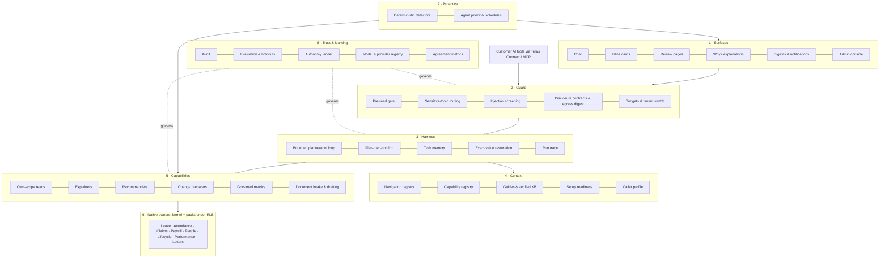

# ADR-0170 — Teras: the AI operating architecture

> Decision record at its recorded date. Implementation and status notes are historical; verify current source and later amendments. The [branch and release policy](../REPOSITORY-AND-ENVIRONMENTS.md) governs operations.

- **Status:** **Proposed; the §11.3 changes and revised delivery order were accepted by the owner on 1 November 2026 ("Accept all").** The name (§9) and formal acceptance of the record as a whole remain open. Nothing here authorises a disclosure change, deployment or production contact; the ADR-0169 §5.1 privacy/legal review still gates any real data reaching a model.
- **Number:** provisional. Reconcile at merge: PR126 holds 0167, and ADR-0169 is also provisional.
- **Name:** "Teras" is a working name, pending the owner's choice and a trademark search (§9).
- **Builds on and keeps:**
  - [ADR-0169](0169-assistant-context-harness-and-disclosure-repivot.md): its five layers, the §5.1 privacy/legal review gate, and phases A–D;
  - [ADR-0084](0084-propose-adjudicate-learn.md): models propose, deterministic services adjudicate;
  - [ADR-0151](0151-orchestrator-action-layer-and-system-learning.md): prepared, human-confirmed actions;
  - [ADR-0116](0116-central-ai-inventory-and-allowances.md): inventory and allowances;
  - [ADR-0117](0117-embedded-hr-authentication.md): identity.
- **Adds:** the capabilities that the [capability review](../reviews/assistant-ai-native-capability-review-2026-11.md) found worth adopting, plus the HR-specific capabilities no surveyed product has. It also states the whole system as one architecture with a named owner per part.
- **Evidence:** the capability review (about 130 journeys by access type, 16 AI-native products), the [phase-1 review](../reviews/assistant-conversational-phase1-2026-10.md) §10–§16, and draft PR 170.

## 1. Why one architecture

AI already exists in several places:
- the production Assistant (closed grammar, 12 reads, 7 cards);
- governed analytics (`/analytics`);
- the payroll anomaly narrator and hypotheses;
- pay-rule drafting;
- personnel import mapping;
- performance drafting (off);
- readiness and approval chasers (off);
- the Control Tower agent pages.

Each has its own entry point, gate and switch. ADR-0169 redesigns conversation only.

Without one architecture, every new AI feature reinvents its own:
- authorisation;
- disclosure;
- budget;
- audit;
- evaluation.

Every one of those is a place a privacy or security defect can enter. **Teras is the single path every model call, tool, suggestion and agent run goes through.**

## 2. Principles (invariants)

1. **Native owners are the truth.** Whatever computes money, entitlements, dates or eligibility must be deterministic, versioned and replayable; a model may propose, never compute the figure of record. The model never decides permissions and is never a record of HR fact.
2. **Acts as the person, never wider.** Every read runs as the caller under tenant row-level security. There is no chat "service account". Automation runs as the explicit agent principal with its own grants and audit.
3. **People decide, unless they delegate.** Changes complete on their own review pages. **By default nothing is delegated.** An AI agent completes work only under a mandate a person has explicitly granted, within that person's own authority (§3.10). Pay, employment status and access are never delegable.
4. **Minimum necessary to the provider.** Each tool's fields are disclosed under a reviewed contract. Identifiers never leave. Figures go out as bands or placeholders and are restored locally. Small groups are suppressed **only** where the person could not read every row behind the figure, and **always** for what leaves to the provider.
5. **Deterministic gates before probabilistic ones.** These checks are code that runs before the model sees anything:
   - privacy;
   - sensitive topics;
   - overrides;
   - attachments;
   - budgets;
   - eligibility.

   Prompts and memory are advisory, never a guarantee.
6. **Untrusted by default.** Employee text, records, knowledge-base content and tool output are fenced as data, never instructions.
7. **Every run is explainable.** What was read, why something was suggested, and what the person decided are stored with the review and the audit row.
8. **No judgements about individuals.** The model is never asked to infer attitude, sentiment, flight risk or performance from communications.
9. **Measured before shipped.** Hard gates are asserted per turn and never averaged into quality. Holdout suites are release gates.

## 3. The layers

**Presentation view (owner feedback, 1 November 2026: the eight parts below are too many to explain).** For customers and the team, the same architecture is shown as five layers on one foundation:

| Shown as | Contains (engineering parts below) |
| --- | --- |
| 1. Interfaces | Surfaces (§3.1) and Connect (§3.9) |
| 2. Agentic harness | Harness (§3.3), with the LLM inside |
| 3. Context and knowledge | Context (§3.4) |
| 4. HR capabilities | Capabilities (§3.5) and Proactive (§3.7) |
| 5. HR system of record | Native owners (§3.6) |
| Foundation: Trust and governance | Guard (§3.2), Trust and learning (§3.8), mandates (§3.10) and the outcome record (§3.11) |

The engineering parts stay separate where safety depends on it. The Guard is code that runs before the model and cannot be skipped by it. The system of record is the only place money and permissions are decided. Elsewhere they may share packages.

Status key: **Prod** = in production; **Branch** = built on PR 170, fictional data only, not imported by production; **Build** = to build; **Review** = blocked on the ADR-0169 §5.1 privacy/legal review.

### 3.1 Surfaces: where people meet Teras

| Component | What the person gets | Status | Owner / note |
| --- | --- | --- | --- |
| Chat | Plain-language questions in six interface languages | Prod (closed grammar), Branch (tool-using) | `core/assistant.ts`; production stays closed until the review |
| Inline cards | A pre-filled, system-checked summary with one review step | Prod: 7 cards. **Build:** apply leave, decide leave, cancel approved leave first | `lib/ai/assistant-action-proposal-hints.ts` |
| Review pages | The only place a change completes | Prod | Registry review routes |
| **"Why?" explanations** | "Why is my PCB higher?", "Why 14 days?", "Why was I marked late?", answered from the system's own calculation | Owners exist, not yet Assistant tools: `explainStatutory` (`core/statutory-explain.ts`), `explainAttendanceDay` (`core/attendance-explain.ts`), entitlement explanation (`core/read.ts`). **Build** | No vendor surveyed documents this |
| Digests and notifications | A daily "what needs you": approvals waiting, setup gaps, deadlines | Detectors and chasers exist, off by default. **Build** | Approval queue (`core/approvals-inbox.ts`), readiness |
| Admin console | Switches, allowances, providers, agents, runs | Prod (`/control-tower/agents/*`) | Add the agent registry and agreement view (§3.8) |

### 3.2 Guard: decides what may happen before the model sees anything

| Component | Status | Note |
| --- | --- | --- |
| Pre-read gate: no private reads for other-person, override and attachment turns | Branch (`lib/product-context/request-gate.ts`) | en/ms/zh/vi; **Tamil and Thai need a native-speaker review** |
| **Sensitive-topic routing**: harassment, grievance, medical, self-harm, termination go to the HR contact or case route with no reads, and an override is logged | **Build** | Deterministic category, like the gate (ServiceNow, Intercom pattern) |
| **Workplace-harms rule**: no inference about individuals | **Build** (rule + corpus tests) | Microsoft pattern; principle 8 |
| Injection screening: log-only per tenant first, block when false positives are known | Build | Override patterns exist; tool-output fencing is the weakest point today |
| Disclosure contracts per tool and field; identifier denylist | **Review** | Closed contracts and source digests exist for current provider paths (`lib/ai/provider-*`) |
| Egress digest gate | Prod | `scripts/ai-provider-data-source-manifest.mjs`, `scripts/ai-agent-source-manifest.mjs` |
| Budgets, allowances and switches | Prod for features (ADR-0116, `core/ai-management.ts`); per-turn budgets in the probe only | Per-tenant opt-in for option 2 disclosure: **Build** |

### 3.3 Harness: runs a turn safely (ADR-0169 phase C)

| Component | Status | Note |
| --- | --- | --- |
| Bounded planner/tool loop with per-step authorisation, step/token/time/spend budgets, repeat-call guard, no blank replies, truncation retry | Prod for the closed loop (`core/assistant.ts`: budget gate, turn loop, dispatch, audit row); Branch for the tool-using loop (probe only) | Becomes product code behind a switch that stays off |
| **Plan-then-confirm**: multi-step work (onboard a cohort, year-end leave) becomes an editable plan of review pages | **Build** | Claude Code / Cursor pattern; each step still confirmed |
| Task memory: goal, selections, pending question, completed reads, open reviews; re-authorised every turn; erasable with the transcript | Build | Never HR truth |
| Exact-value restoration: the model sees placeholders or bands, and the person sees exact figures they may read | Build | Principle 4 |
| Run trace: reads, reasons and suggestion, stored with the review | Build | Attio, Ramp, Legora pattern; extends the existing audit row |

### 3.4 Context: what Teras knows about the product, never the codebase

| Component | Status |
| --- | --- |
| Navigation registry (from the sidebar sources, with a drift test) | Branch (`lib/product-context/destinations.ts`) |
| Capability registry: every read, context tool and action, with effect, audience and sensitivity | Branch (`core/product-context/tools.ts`) |
| Guides | Branch (`product_guidance`) |
| **Verified knowledge**: HR marks articles verified; Teras prefers and cites them | **Build**; the tenant KB disclosure rule is **Review** |
| Setup readiness: payroll, records, leave health, holidays, attendance, onboarding | Branch (`core/product-context/setup-readiness.ts`, `module-readiness.ts`) |
| Further readiness from existing owners: entitlement coverage, logins pending, letter settings, leave generation | Build. Claims setup has **no owner** yet |
| Caller profile: role, scope and modules, never a grant | Branch |

### 3.5 Capabilities: typed tools over native owners

| Kind | Examples | Status |
| --- | --- | --- |
| Own-scope reads | Leave, payslip, claims, profile, team leave, approval queue | Prod 12 + Branch approval queue |
| **Explainers** | Statutory deductions, attendance day, entitlement | Owners Prod; tools **Build** |
| **Recommenders** | Approver card: *recommend approve* or *needs review* (never *reject*, owner decision 2 November 2026, §3.15), from native checks (balance, overlap, coverage, policy version); the model only words it; "needs review" is the default | **Build** (Ramp pattern) |
| Change preparers | Every human-confirmed registry action, pre-filled, rejected when fields are missing | Prod (registry + review pages); Branch (suggest any action) |
| **What-if previews** | "If Annual Leave becomes 16 days, who is affected?", using native dry runs | **Build**, only where a native preview exists |
| **Compliance watch** | Holiday minimum (exists), statutory filing deadlines, rule expiry, in plain language | **Build** on deterministic detectors |
| **Policy versus configuration** | Handbook text compared with configured leave and claims rules; differences shown, never auto-configured | Later; **Review** (document disclosure) |
| Governed metrics | Workforce, leave, attendance, claims trends as bands with person-count thresholds | Prod on `/analytics` (`core/ai-*-analysis.ts`); Assistant access is **Review** (touches approved digests) |
| Document intake | Spreadsheet mapping → preview → apply (personnel mapping exists); receipt → draft claim | Mapping Prod; extension Build; receipts **Review** |
| Drafting | Letters through the letters approval workflow; performance drafting (exists, off) | Letters Build; **Review** |

### 3.6 Native owners

These are the kernel and packs (`packs/<pack>/service`), under RLS, with effective dates and audit. Teras adds no business logic here. Where a needed owner is missing (for example claims setup readiness), it is built in the owning pack, never in Teras.

### 3.7 Proactive: work Teras starts

| Component | Status |
| --- | --- |
| Deterministic detectors: payroll anomalies, readiness, approval and document chasers | Prod, mostly **off** by default |
| Agent principal: scheduled, never makes changes, own grants and audit | Prod for chasers |
| Plain-language schedules ("every Monday, tell me who has not submitted claims") | Later; only over detectors that already exist |

### 3.8 Trust and learning

| Component | Status |
| --- | --- |
| Audit of every tool call | Prod (closed loop); extend with the run trace |
| Behaviour scoring, reviewed corpus, overclaim and invented-link checks, adversarial and conversation holdouts | Branch probe; holdouts Prod |
| **Agent registry**: register, activate, deactivate and archive each agent per tenant, plus a report of actions a person could be offered but cannot complete; delegates get an actor class | **Build** (Workday pattern) |
| Autonomy | Replaced by **mandates** (§3.10): no autonomy unless a person delegates |
| **Agreement metrics**: how often people accept Teras' suggestions and recommendations, from audit data with no new disclosure | Build (ADR-0084 learn) |
| Model and provider registry, zero retention, residency | Prod for configuration; provider terms and residency are **Review** |

### 3.9 Connect: customers' own AI tools (proposed, owner interest 1 November 2026)

**What it is.** An MCP (Model Context Protocol) server, *Teras Connect*. A customer's own AI tool could ask the HR system questions and prepare changes **as the signed-in person**, through the same Guard, capabilities and audit. Examples of such tools: Microsoft Copilot, Claude, ChatGPT Enterprise, Glean. Surveyed products ship this pattern (Glean MCP; Darwinbox claims an HCM MCP server; vendor statements, capability review §4).

**Facts today:**
- No MCP server or third-party API token flow exists.
- ADR-0082 deferred outbound MCP to a later "governed tool gateway".
- The mobile API verifies bearer tokens from the legacy WorkOS adapter (`lib/mobile-api/jwt.ts`), while the authentication direction is embedded HR login (ADR-0117).

**The key difference from chat.** Through MCP, Teras sees **tool calls, not the person's question**. The question-based pre-read gate cannot run. The customer's model plans the turn, and its answers go to the customer's own AI provider. So Connect must be safe **per tool call**, whatever the question was.

| Concern | Design |
| --- | --- |
| Who is calling | OAuth authorisation on the embedded HR login with MFA (ADR-0117), per person, short-lived and revocable tokens bound to one tenant and one registered client. No shared API keys; no service-account reads. The MCP specification's OAuth-based authorisation profile is to be verified against its current version at design time |
| Who allows it | Off by default. A group administrator enables Connect per tenant and per **named client app** (allowlist), chooses which tool groups each app gets, and can revoke at once. Each person can see and revoke their own connections |
| What it can do | The same capability registry, filtered by the person's access: own-scope reads, context, explainers and change **preparation**. Preparation returns a link to the product's review page. **Connect never completes a change**: confirmation happens in the HR system under its own login and MFA, so an outside model cannot approve, submit or pay anything |
| What it returns | Minimum fields per tool, under a published per-tool, per-field contract the customer can assess. Identifiers (IC, passport, bank, tax numbers) never leave. Sensitive groups are **off by default** and need an explicit tenant switch per app: pay, medical and leave reasons, other people's records, analytics |
| Untrusted text | Employee-entered text (claim descriptions, notes) is returned as clearly marked data, never as instructions, so it cannot steer the customer's model. Teras treats every incoming argument as untrusted |
| Abuse | Per-person, per-tool rate limits; no bulk or list-everyone tools; scraping-pattern detection; every call audited with the client app, tool, arguments' shape and result size |
| Responsibility | The customer chooses to send its employees' data to its own AI vendor. Under PDPA the employer is the data user. Teras' terms, the data processing addendum and the per-tool contract must say so, and this needs **its own legal review** (separate from ADR-0169 §5.1, which covers Teras' own provider) |
| Quality and safety tests | A conformance suite runs the adversarial and conversation holdouts, injection attempts in returned data, and cross-tenant and cross-person attempts through Connect before any tenant can enable it |

**Not exposed through Connect:** configuration writes, bulk exports, payroll runs, other people's records (until a separate decision), and governed metrics (until the §5.1 review).

### 3.10 Mandates: people delegate jobs to AI agents (owner decision, 1 November 2026)

**Owner decision.** Users may delegate jobs to AI agents. **By default there is no delegation:** an agent acts only when a person delegates. This answers the question every AI-native system must answer: *under what authority did the agent act?* The answer is always a mandate, a named person's explicit, limited and revocable grant, recorded before the agent acts.

**Facts this builds on:**
- Human approval delegation exists. A delegate is scoped by module and task type, and nobody may decide their own request except a super admin (`core/approvals.ts`, `app/delegations`).
- Automation already runs as an explicit agent principal with its own grants and audit (`SessionContext.agentPrincipal`).
- Every change has a registry action and a review route whose native service adjudicates it.

**Two kinds of job:**

| Kind | Examples | What the agent may do |
| --- | --- | --- |
| **Work jobs** (prepare, never complete) | "Every month, prepare payroll inputs and tell me what is missing." "Chase incomplete claims in my team." "Draft onboarding tasks for each new hire." "Send me a Monday summary of who is away." | Read, prepare drafts and review items, send reminders the person could send. Nothing is completed: the person (or another mandate) confirms |
| **Decision jobs** (complete within conditions) | "Approve my team's leave of 2 days or less when the balance covers it and team coverage stays above the minimum." | Complete the action through the same native service and review path the person would use, only when every condition passes |

**Rules:**
1. **Off by default.** No job runs without a mandate.
2. **Two keys.** This is a recommendation, for enterprise customers. The tenant administrator chooses which job types can be delegated at all, with ceilings (default: none enabled). A person then delegates within that. The employer sets policy and the person chooses.
3. **You can only delegate what you can do.** The agent's authority is the intersection of the grantor's **current** authority and the mandate's limits. It is re-checked at every run, so if the grantor loses a role, goes on leave or leaves, the mandate stops.
4. **Conditions are code, never the model.** Balance, overlap, coverage, policy and amount checks are evaluated by native owners. The model may word the summary but never decides whether a condition passed. If anything is unusual, missing or fails, the job **falls back to the person** as "needs review".
5. **Never delegable:**
   - pay amounts, payroll close or reprocess;
   - employment status (hire, confirm, terminate);
   - access, roles and permissions;
   - anything irreversible;
   - deciding the grantor's own requests (the existing self-approval ban).
6. **Bounded.** Every mandate carries a scope (whose items), limits (size, count per day), a validity period (with a maximum, then renewal), and a notification choice (each action, or a daily summary).
7. **Revocable at once,** by the grantor, their manager where policy allows, or an administrator. There is a tenant-wide stop switch.
8. **Earned.** A decision job type becomes available to delegate only after the tenant's own data shows people accept that suggestion at a high rate over enough cases. The threshold is set by the owner; it is not chosen here.
9. **One agent identity per mandate,** shown as acting *for* the grantor, never *as* them, so every record says who delegated and which agent acted.
10. **Undo** where the action is reversible, for a set window, through the native service.

**Legal note.** Automated decisions about employees are regulated in some jurisdictions (for example, rules on solely automated decisions with significant effects). Low-impact approvals within the person's own rules are expected to be the lowest-risk case, but specialist review is required before decision jobs ship, and per country if we go international.

### 3.11 Outcome record: how every AI result came about

Every AI run, suggestion, prepared item and mandate action writes one **outcome record**. It is stored with the audit trail and shown on the review page, to the grantor and to administrators:

| Field | Why |
| --- | --- |
| Run id, time, tenant, company | Locate it |
| Who asked, or which mandate (id and version) and grantor | **Authority**: under what authority it happened |
| Agent identity | Who acted |
| What was read: tool names and record references (not the data) | **Basis**: what it looked at |
| Rule and policy versions used by each native check, with each check's result | **Constraints**: which rules applied |
| Model, provider, instruction-set and tool-catalogue versions | **Replay**: why the AI suggested this, later |
| What was suggested, prepared or done | **Outcome** |
| The person's decision, or the mandate's automatic completion, and any undo | **Accountability** |

Data stays in the native owners; the record holds references and versions, and follows audit retention. A customer-facing view summarises outcome records:
- what the AI did;
- how often people accepted its suggestions, by job type;
- what each mandate did.

This view is the evidence for rule 8 above, and for audits.

### 3.12 Improvement engine: how every layer keeps getting better (owner request, 1 November 2026)

**Goal.** Improving Teras should be routine, not a project. The system finds its own gaps, proposes the fix, scaffolds it and proves it. People approve what changes behaviour. The Guard never changes itself.

**Foundations that already exist:**
- the feedback improvement loop (`scripts/improve/`: feedback item → plain-language plan → approved build);
- the Control Tower agreement and reversal view (`core/control-tower.ts`), which already refuses to report a flattering acceptance rate before outcomes are tested;
- ADR-0114 impact-aware release and learning;
- the GitHub Actions evaluation probe, reviewed corpus and holdouts;
- drift tests that fail when the sidebar gains a page the navigation registry lacks.

**The loop:**
1. **Signals.** Outcome records (§3.11) collect:
   - suggestions accepted, rejected or reversed;
   - "no tool or action for this" replies;
   - "no guide found" replies;
   - fallbacks to "needs review";
   - guard blocks;
   - ratings and feedback board items.
2. **Triage (automated).** Signals are clustered and classified as a missing piece of context, a missing capability, a harness defect, a guard gap or an interface gap. They are ranked by how many people and which roles they affect. This is the usage data the capability review lacked.
3. **Proposal (automated, human-approved).** Each cluster becomes a feedback board item with a drafted plan through the existing improve loop. A person approves or rejects it.
4. **Build (scaffolded).** Kits make the common fixes cheap (below).
5. **Verify (automated).** The evaluation suites run on GitHub Actions: corpus, holdouts, conformance, hard gates. A change that fails a hard gate cannot ship.
6. **Release and measure.** Release goes through the staging queue. Acceptance is measured again, closing the loop.

**What each layer gets:**

| Layer | Automated | People decide |
| --- | --- | --- |
| **Context and knowledge** | Registries generated from source with drift tests, so a new page, action or setting cannot ship without its AI metadata. A **definition of done** for every product feature: registry entry, guide section, readiness check if it needs setup, and corpus turns, enforced in CI. "No guide found" clusters produce a drafted guide. Stale-article detection when the rule behind it changes | Approving drafted guides; HR marking articles verified |
| **Capabilities** | A **capability kit**: declaring a native owner, its permission and its projection generates the tool spec, card, review link and corpus turns. Every capability **inherits the standard contract tests** (acts as the person, no identifiers, other-person refusal, no overclaim, minimum fields). Unmet-request clusters ranked by role | Which capability to build; each new delegable job type (§3.10) |
| **Harness** | Every instruction or model change is versioned and runs the full suite. A **model upgrade is a comparison report**: new model against current, same suites, cost and latency. Shadow runs on fictional data | Switching models or instructions, from the report |
| **Interfaces** | A new channel is an adapter onto the same Guard and Harness, and reuses the Connect conformance suite | Opening a channel to a tenant |
| **Guards** | The attack library grows: holdouts, injection corpora, and patterns seen in log-only screening. Ratchet tests fail any change that loosens a rule without a recorded review, the way the repository's import allowlists only shrink | **Every** guard change; disclosure changes need fresh approval (ADR-0169 §5.1) |

**Privacy of the loop itself.** Improvement signals contain personal data.
- What leaves a tenant for product improvement is counts, categories and tool names, never question text or records, unless the tenant opts in.
- Even then, a real question becomes a test case only after it is rewritten as fictional and a person approves it.
- The test corpus stays fictional.

**What the engine never does:**
- change a guard;
- widen a permission or a disclosure contract;
- enable a delegable job type;
- release without the evaluation suites passing.

### 3.13 Agent families and one management surface (owner question, 1 November 2026)

The Assistant is the visible part. Behind it run detectors, chasers, narrators and, later, mandated jobs. Today they are managed in several places (feature switches, Control Tower sections, module settings, the orchestrator). They become **one registry with one contract**, shown on one page.

**Five families.** Every automated worker belongs to exactly one:

| Family | What it does | Model's role | Examples (existing or planned) |
| --- | --- | --- | --- |
| **Watchers** | Deterministic detectors that raise findings | Wording only | Payroll anomalies, readiness gaps, holiday minimum, rule expiry, compliance deadlines |
| **Chasers** | Send reminders a person could send | Wording only | Approval, document, clock and lifecycle chasers; readiness nudges |
| **Preparers** | Work-job mandates: prepare, draft, summarise; complete nothing | Plans within the mandate; wording | Payroll-input preparation, onboarding task drafts, weekly summaries, daily digest |
| **Deciders** | Decision-job mandates: complete an action when every native condition passes | None in the decision; wording of the record | Small leave approvals within conditions (after legal review and acceptance evidence) |
| **Explainers** | On demand: explain a native result | Wording from native facts | Statutory deductions, entitlement, attendance day, anomaly narration |

**One contract for all five:** a deterministic trigger (schedule, event or request); a declared read scope from the semantic model; a declared effect (none, notify, prepare, complete-under-mandate); the authority it runs under (tenant switch, or a mandate id); an outcome record per run; a per-tenant switch, off by default; the tenant-wide stop switch; and acceptance and reversal metrics. A worker that cannot state all of these is not registered and cannot run.

**One surface.** The Control Tower (`/control-tower/agents/*`) becomes that page: every registered worker with its family, owner, switch, last run, what it read and did, and its acceptance and reversal rates (the existing agreement view, extended). Mandates appear there as rows with their grantor. The exportable agent registry for customers' own control towers (§11.3 change 6) is generated from the same list.

### 3.14 Owner decisions on signing and rule versions (1 November 2026)

**Proposal signing secret.** A new, dedicated secret used only to sign proposal objects (`TERAS_PROPOSAL_SECRET`, as built in step 0b), never derived from another secret:
- a separate secret per environment, so a staging proposal can never verify in production;
- stored in the existing private secret store as configuration, never in source or the repository;
- rotatable without downtime: verification accepts the current and the previous key for a short overlap, and issuing uses only the current one.

**Rule versions.** Two owners, one convention:
- **Statutory rules** (EPF, SOCSO, EIS, PCB, holiday minimums) are maintained by the product team as code in the country packs, and each release publishes their version. Customers never upload them.
- **Company policy** (leave types, entitlement tables, eligibility, approval chains, claim limits) is configured by the customer's administrators on the existing setup screens. Every edit creates a new dated version automatically; entitlement tables already do, and the other owners gain the same label.
- Native checks return the version they used, and the outcome record (§3.11) stores it, so a result can say which company rule and which statutory schedule applied. Delivered with step 5a.
- A company handbook upload is only ever compared against the configuration (§3.5 policy versus configuration), never applied.

### 3.15 Build decisions taken under delegated authority (1 November 2026)

The owner delegated ordinary design questions to the coordinating session ("go with the best recommendation; only extra-sensitive questions come to me"). Questions on disclosure to a provider, legal notice and retention, and anything that widens access stay with the owner or the reviewers. Decisions taken:

| Question (step) | Decision |
| --- | --- |
| Approve-leave proposals: prepared only when the person's own words ask to approve and exactly one request is pending (2) | Accepted. With several pending, the harness lists them and asks which; it never picks one |
| Approver card shows balance now, not after (2) | Show balance now plus the days requested. A post-approval figure comes only when the leave owner publishes a deterministic projection (backlog); the model never computes it |
| Approved-leave cancellation: own Assistant review and custody (2) | Not now. The native cancellation request with its normal approval is sufficient; revisit with usage data |
| Card labels English only (2) | Translated with production wiring, through the existing six-language messages |
| Delegates admitted by the decision source but untested (2) | Add a covering-delegate test at integration |
| Mandate run identity: controlled as the agent principal, reads under the grantor's freshly resolved authority (5a) | Accepted: this is "for, never as" (§3.10 rule 3 and 9) |
| Revocation by the grantor's manager (5a) | Built with the agent registry in step 5, where tenant policy allows |
| Task memory erased per login on transcript retirement (5a) | Accepted for now; a conversation id is added when production wiring exists |
| Customer-facing outcome summary and export (5a) | Built in step 5 with the agent registry |
| Notice wording and retention of outcome records (5a) | **Reserved for the privacy reviewer.** Default stays `not_given` and audit retention |
| Entitlement and payslip explanation figures as bands, including the person's own payslip (4) | Accepted. The model sees bands; the exact figure the person may see is restored locally from the native owner |
| `module_work.data` pay figures banded (4) | Accepted |
| Co-pilot description to name pending logins (4) | Yes, in the next spec description change, measured by the next run |
| `mf-entitlement-why` reviewed ideal still requires the balances read (4) | Add the entitlement explainer as an accepted alternative read; the original corpus stays unchanged |
| Fold `ENTITY_FIELD_EXTENSIONS` into `entities.ts`, widen `EntityId` (4) | At integration, after step 2 is merged in |
| Leave generation run volumes are tenant-wide (4) | Backlog: a company-scoped run owner in the leave pack |
| Holdouts used as ratchet inputs become "seen" (1) | Accepted for harness invariants. A fresh, unseen holdout set is authored by a separate session with no access to the corpus or code, as an interim for ADR-0169 §6; a human-written set remains required before pilot |
| Spend up about 25% (1) | Accepted; revisit if a later spec version grows it further |
| Destination registry too narrow (1) | Settled in step 4: every page the caller's role may open is linkable, pinned by a drift test |
| Sensitive-topic categories a tenant may switch off (3) | Self-harm and crisis: never. Others: only through an audited override by a group administrator. The setting is built with production wiring |
| Approver recommendation outcomes (5); **owner decision, 2 November 2026** | The AI **never recommends rejecting** a request. Outcomes are *recommend approve* or *needs review*. A blocking rule failure shows as *needs review* with the failed rule and its version; the approver decides |
| Connect identifiers via opaque per-client handles (0b) | **Reserved for the Connect legal review** (§3.9) |

## 4. A turn, end to end

1. **Surface.** The person asks in chat, or opens a card or a "Why?".
2. **Guard.** Deterministic checks run in order:
   - tenant switch, grant and budget;
   - sensitive-topic routing;
   - override, attachment and other-person gate;
   - injection screening.

   Each decides which tools are offered, if any.
3. **Harness.** The model receives the question, the caller profile and only the permitted tool specs. Each tool call is authorised as the caller and dispatched to a native owner. Output is fenced as untrusted and disclosed under its contract, with figures as placeholders or bands.
4. **Harness.** The reply is checked deterministically:
   - not blank;
   - no invented links;
   - no claim that a change was made;
   - no identifiers.

   Exact figures the person may see are restored locally.
5. **Surface.** The answer, a card, or a plan. A change goes to its review page, where the person confirms and the native owner adjudicates.
6. **Trust.** The trace is stored with the audit row and review. The decision feeds the agreement metrics.

## 5. What Teras will not do

- Infer attitude, sentiment, flight risk or performance from messages.
- Offer free-form SQL or "chat with the database".
- Act without a mandate, or delegate pay, employment status, access or anything irreversible.
- Calculate money, entitlements or dates.
- Treat memory as HR truth, or keep it longer than the transcript.
- Send identifiers, or exact small-group figures, to a provider.

## 6. Delivery order

> Superseded in part by the accepted order in §11.3 (1 November 2026). Steps below keep their numbers; §11.3 inserts 0b, amends 1, 2, 5a and 7, and moves Connect alongside 5a.

Every step is built on fictional data behind a switch that stays off until the ADR-0169 §5.1 review passes. Release order stays with the Orchestrator.

| Step | Content | Needs the review? |
| --- | --- | --- |
| 0 | Usage-data check, to order steps 2–5 by measured frequency | No |
| 1 | Harness as product code: gate, budgets, fencing, exact-value restoration, task memory, trace, tenant switch | No (built and tested on fictional data; switched on only after the review) |
| 2 | Cards: apply leave, decide leave, cancel approved leave | No |
| 3 | Sensitive-topic routing; workplace-harms rule | No |
| 4 | "Why?" explainers; go-live setup co-pilot on readiness | No |
| 5 | Approver recommendations; daily digest; agent registry | No |
| 5a | Outcome record, then **work-job mandates** (prepare, chase, summarise; nothing completed) | No |
| 5c | Improvement engine: signal triage onto the feedback board, capability kit with inherited contract tests, definition-of-done CI check, model comparison report | No |
| 5b | **Decision-job mandates**, per job type, once acceptance data qualifies it | Legal review of automated decisions |
| 6 | Governed metrics, receipts, letter drafting, spreadsheet intake, verified KB, policy-versus-configuration | **Yes** |
| 6a | Teras Connect, read and prepare only, behind the tenant and app allowlist, after the Guard and capability registry are product code | Its own legal review (§3.9), and the conformance suite |
| 7 | Pilot with one consenting tenant (ADR-0169 phase D) | **Yes**, plus legal sign-off |

Acceptance for each step follows ADR-0169 §6. In addition, every new capability ships with hard-gate tests, and with corpus turns for each access type it serves.

## 7. Consequences and risks

- **One path.** One path means one place to secure and one to audit. Existing AI features migrate behind the Guard and Trust layers over time. Until they do, each keeps its own gate, and an inventory test must list which path each feature uses.
- **More owners.** Readiness, explainer and recommender tools mean more owners to keep consistent. The mitigation is one projection per fact, the pattern of `core/leave-config-health-input.ts`, plus drift tests.
- **Usefulness depends on the review.** The real usefulness gains (ADR-0169 measurements) depend on option 2 disclosure, which is still under review. Without it, steps 1–5 still improve cards, explanations and readiness through deterministic paths, but the conversation ceiling stays near the closed protocol's.
- **Inherited risks** from ADR-0169 §4: prompt injection, model drift, over-trust, cost at real traffic, and registry drift.

## 8. Unknowns

- How often each journey actually happens.
- Tenant acceptance of disclosure.
- Production model, cost and latency.
- Whether the Assistant's decision sources admit covering delegates.
- Malaysian, and later other countries', legal requirements for AI and automated decisions in employment. This needs the privacy/legal reviewer.
- The acceptance threshold and minimum case count that qualify a decision job for delegation.

## 9. Name

**Owner direction (1 November 2026):** an international name, not a Malay one. "Teras" stays only as the working label in this file until a name is chosen; the file will be renamed then.

**What the name must do:**
1. Say what the system is: a trusted core that acts for people within the authority they give it, anchored to the record.
2. Be pronounceable across the interface languages and internationally.
3. Not be a person's name (a human persona encourages over-trust, ADR-0169 §4, and invites gender assumptions).
4. Have no clash with an AI, HR or workplace product, in particular none in agent governance or security.
5. Work as platform and prefix: "X Connect", "Ask X", "X mandate".

**Checked (web searches, 1 November 2026; not a trademark search):**

| Name | Meaning and fit | Finding |
| --- | --- | --- |
| **Steward** | One who manages on another's behalf with a duty of care; "stewardship" is the word the market already uses for agent governance. Fits "acts for the person, never as them" and mandates exactly | **No AI or HR product found.** Risks: a common English word (harder to register); other classes use it (a US hospital operator, aviation crew) |
| **Tiller** | The handle that steers; the person at the tiller decides. Short | No AI platform found; small unrelated startups. A personal-finance product of the same name is believed to exist (not checked here) |
| **Lodestar** | The guiding star | Two small unrelated companies (data annotation; a 2026 learning startup spelled "L0destar") |
| Mooring | What holds a ship fast; "moored to the record" | Nothing in AI; the word is weaker as a brand and the root has historical baggage |
| Ballast | What keeps a vessel stable | Clean, but also means dead weight |
| Charter | A grant of bounded authority (close to mandate) | Crowded: an "agentic execution platform" (Charter Global), New Charter Technologies, and a major US telecom |
| Custodian | Holds on another's behalf | Crowded, and a direct concept clash: "custodian-kernel" is an authority layer for AI agents; Custodian Labs; Cloud Custodian |
| Regent | Governs in the name of the rightful authority | Taken: Regent AI Security |
| Tenet | A guiding principle | Taken: Tenet Security (AI agent security) |
| Arbiter | The one who decides | Taken: Arbiter AI (healthcare), Arbiter (security) |
| Trellis, Fulcrum, Tessera, Keystone, Plinth, Rootstock, Verity, Mainstay | Structural or truth metaphors | All taken by AI or software products |
| Teras, Kemudi, Suluh, Nadi, Rakan, Nakhoda, Akal, Onyx, Amanah | Earlier Malay and codename candidates | Withdrawn by owner direction (international name) or clashing (§9 history in git) |

**Owner feedback (1 November 2026):** Steward reads as a back-seat name; the architecture should be named for what it makes possible, not for its safeguards. Second pass, forward-looking candidates:

| Name | Meaning and fit | Finding |
| --- | --- | --- |
| **Volition** | The power of acting by one's own will. "By your volition": the agent acts because, and only because, a person willed it, which is the mandate model stated as momentum rather than restraint. Forward, active, international | **No AI or HR product found.** Volition Capital is an investor (different class). A video-game studio of that name closed in 2023; its word mark covers game software only, status to be confirmed at USPTO |
| **Volent** (coined, from volition) | Same idea in a coined form that registers more easily | No exact match; near names exist (Veloent marketing, Volant algorithms) |
| Traverse | Crossing ground; moving through | Taken: Traverse (RL environments, YC W26), Traverse Automation, a TRAVERSE AI trademark |
| Vantis | Coined, from vantage | Taken: Vantis (Hong Kong consultancy, HRMS); near Vanti, Vantiq |
| Emissary | Sent out with authority to act for you | Taken by several AI companies |
| Kairos | The right moment to act | Crowded (eight companies) |
| Proxima | The next; the nearest star | Crowded |
| Vela | The sail; motion from harnessed force | Taken: Vela OS, Vela (YC W26), others |
| Stride | Forward motion | Taken: Stride (agents), Stride.AI |

**Owner feedback (1 November 2026):** keep looking; one or two syllables. Third pass, short forward-looking words:

| Name | Meaning and fit | Finding |
| --- | --- | --- |
| **Prow** (1) | The front of a ship: the part that cuts ahead and meets the water first. Forward by definition; recalls "prowess". "Prow Connect", "Prow mandate", "Ask Prow" | **No AI or HR product found**, on two searches. Near names are different words (Prowler.io, Prowly) |
| **Forth** (1) | "Go forth", "set forth", "bring forth": outward and ahead | Nearly clean (a small dev shop, ForthClover; a 1970s programming language). Homophone of "fourth", which will cause confusion in speech |
| **Volo** (2) | Latin: "I will", also "I fly". Will plus motion | Several small services firms named Volo; a sports-league app |
| Spur | To urge forward | Taken: two AI companies (QA agents; support agents) |
| Bound | "Bound for" and "within bounds": forward, and limited, in one word | Crowded (an audience platform, AIBound, Boundly) |
| Wend | To make one's way | Too close to Wendi AI (an HR tool) and a thin "Wend AI" listing |
| Vane | Points the way | Taken: an open-source answering engine |
| Deed | An act done; a signed instrument of authority | Crowded (getdeed.ai, DeedAI) |
| Writ | Authority to act | Too close to Writer (a large enterprise AI company) |
| Elan | Vigour, momentum | Elan1.ai, ELAI |
| Soar, Deft | Upward motion; skill | Taken (Soar Technology; Onton, formerly Deft, and others) |

**Owner feedback (1 November 2026):** keep looking. Fourth pass: short words from other languages meaning "forward", and coined forms.

| Name | Meaning and fit | Finding |
| --- | --- | --- |
| **Fram** (1) | Norwegian: *forward*. The name of Nansen's polar ship, built to be held by the ice and still come through. One syllable, said the same way in every interface language | **No AI or HR product found**, on two searches. Frame AI is a different word. An automotive filter brand of the same name is believed to exist (different class; not checked here) |
| **Vorn** (1) | German: *at the front*. Reads as coined to non-German speakers | **No match found** |
| Vamo (2) | From Spanish *vamos*, "let's go" | Nearly clean: a ticketing app and an AI consultancy called VAMOS |
| Avan (2) | From *avant*, forward | Crowded with near names (Avant Technologies, Avanade, Avahi) |
| Vello (2) | From velocity | Taken: vello.ai |
| Ando (2) | Spanish: *I go* | Taken: Ando, a messaging platform for people and AI agents ($20M, 2026) |
| Onda (2) | Wave | Taken: Onda (hospitality AI), Ona (formerly Gitpod) |
| Arvo (2) | Finnish: *value* | Taken: Arvo AI, Arvo (healthcare), Arvo (fitness) |
| Kivo (2) | Coined | Taken, including an HR payroll product (Kivo.ai) |

**Owner brief (1 November 2026):** a name that takes everything in, accepts everything, yet stays firm on its principles and security. Fifth pass, on that brief: enclosures that are open and still protected.

| Name | Meaning and fit | Finding |
| --- | --- | --- |
| **Atoll** (2) | A ring of reef that lets the whole ocean in and keeps the lagoon calm: open to everything, firm at the edge, still inside. The closest single word to the brief | **No exact match.** Near names in the same space: Atolio (private enterprise AI search) and Atollogy; a trademark search must weigh Atolio |
| **Hull** (1) | Holds everything aboard and stays watertight | Nearly clean: an older customer-data product of the same name; a UK city |
| Fold (1) | "Within the fold": everyone welcome, yet enclosed | No exact match (Refold AI is near), but "to fold" also means to give up; avoid |
| Haven (2) | Safe harbour | Taken: several AI companies, including a $15M "digital twin" startup |
| Harbor (2) | Every ship may enter; calm water inside | Taken: Harbor (insurance and risk controls for AI agents, $10M, October 2026) and an open-source agent registry |
| Cove (1) | Sheltered inlet | Taken: Cove (Sequoia-backed; team hired by Microsoft, 2026) and others |
| Vessel (2) | Holds everything | Taken: Vessel (investor-relations AI) |
| Ambit (2) | Everything within one's authority | Taken: Ambit AI (conversational AI) |
| Holon (2) | A whole that contains, and is contained | Crowded and unclear |
| Gamut (2) | The whole range | Taken: Gamut, an AI agent platform |

**Recommendation on this brief.** **Atoll.** It is the one word found that says all three things at once: open to everything, firm at the boundary, calm within. Two syllables, and the word exists in most languages. The trademark search must look hard at Atolio, which is close in both spelling and field. Alternate: **Hull**. Fram, Prow and Vorn stay on record from the forward-looking passes; a final choice may combine the two briefs (for example a coined word), which is work for a naming professional.

**No "OS" suffix (1 November 2026).** The owner found "Atoll OS" awkward. The name stands alone and the prose describes it ("the AI operating architecture", "built on X"); features take the name as a prefix (X Connect, X mandates, Ask X). Reasons: §11.1 found every "AI OS" on the market to be a control plane plus a shell and the vocabulary scan rated every "OS" label as hype, so the suffix invites the agent-washing test this record applies to itself; and the strongest brands surveyed (Attio, Glean, Agentforce, Palantir AIP, Workday Illuminate) stand alone. If a suffix is ever wanted, names ending in a hard consonant carry it (Fram, Hull, Vorn); Atoll and Prow do not.

**Before adopting any name:** MyIPO, USPTO, EUIPO and SIPO (China) searches in the software and SaaS classes; domain and app-store checks; a native-speaker check of meaning in all six interface languages; a check against the final list of markets.

## 10. Futures: is this the future, or a benchmark of today? (owner question, 1 November 2026)

**Honest answer.** The capability review (§4 of that document) benchmarked today's products, and the five-layer presentation mirrors current vendor pages. Mandates (§3.10), the outcome record (§3.11) and the improvement engine (§3.12) look further ahead. This section records the scenarios considered and the moves that hold under all of them. Scenarios are analysis, not forecasts: confidence is medium on direction and low on timing.

### 10.1 The premise: "no system, direct AI to database"

Delete the application and keep a database and a model. Four things are missing on day one, and they are the system:
1. **Rules.** Statutory and entitlement rules live in code, not tables. Payroll must be reproducible, so they must stay deterministic and versioned.
2. **Permissions** enforced where a model cannot argue past them (row-level security, service checks).
3. **Record integrity:** effective dates, audit history, one owner per fact.
4. **Accountability:** who authorised, on what basis, verifiable afterwards.

So the future is not "no system"; it is **no application shell**. The system of record with rules, policy and audit is the product; AI is how people reach it. The layers have different half-lives:

| Layer | Outlook | Design consequence |
| --- | --- | --- |
| Interfaces | Perishable: customers' own agents and generated UI take over much of it | Headless first: every surface is a renderer of the same objects |
| Harness | Commoditising: model vendors ship harnesses (managed agents, agent SDKs) | Keep ours thin and swappable; invest in the contracts around it, not the loop |
| Context and knowledge | Durable content, changing form | Keep it as data the product generates, not hand-written prompts |
| Capabilities | Hand-written tools give way to governed views and actions | Build the governed query layer, not twelve more tools |
| Guards, trust and governance | Gains value as intelligence gets cheap | The moat |
| System of record and rules | The product itself | Make rules readable, citable and versioned |

### 10.2 Scenarios (1 to 3 years)

| Scenario | What changes | What we would regret | No-regret move |
| --- | --- | --- | --- |
| **A. Agent-first enterprise.** Employees use one company agent (Copilot, Claude, ChatGPT, Glean); vertical products become governed services behind MCP | Our chat and cards become secondary; our value is governed HR tools and the record | Building a rich proprietary chat UI that nobody opens | **Proposal objects** (§10.3) confirmable from any surface; Connect becomes a primary interface, not a bolt-on |
| **B. Direct AI to data.** Models write queries and code on the fly; schema plus policy is the product | Hand-written tools look like a bottleneck | Twelve bespoke tools and nothing underneath | **Governed query layer:** views with field-level disclosure and RLS, which any model may query; rules as code the model can read and cite |
| **C. Generated software per tenant.** Each customer gets generated screens on a shared trusted kernel | The pack kernel matters more; screens matter less | Hard-coding screens as the only way to confirm | Kernel and packs stay the owners; confirmation is an API, not a page |
| **D. Regulation bites.** AI-in-employment rules, automated-decision rules, PDPA enforcement | Verifiability becomes mandatory, not a feature | Shipping delegation without an outcome record | Outcome record first, mandates second; in-boundary model path (ADR-0169 option 3) as cost falls |
| **E. Slow enterprise.** HR buys suites; AI stays a feature for years | Nothing dissolves soon | Betting the product on AI | Product works fully without AI; AI off is a supported state |

What holds across all five: the system of record, rules as code, authorisation, audit, the outcome record, mandates, and governed tools and Connect. What varies: interfaces and the harness. Invest in the first set; keep the second thin.

### 10.3 Design-for-change moves (added to the delivery order)

1. **Proposal objects.** A prepared change is a durable, signed object (what, for whom, by which authority, with which checks and rule versions). Chat cards, review pages, the mobile app and a customer's agent are all renderers of it; confirmation is an API call under the person's login. Cards (step 2) are built this way from the start.
2. **Governed query layer.** Capabilities are governed views and actions with per-field disclosure contracts and RLS, not hand-written tools. The capability kit (§3.12) generates tools from them. This is the safe version of "direct AI to database": AI to governed views, never raw tables.
3. **Rules as readable code.** Statutory, entitlement and policy rules become declarative, versioned and citable where they are not already (the bounded pay formula builder, ADR-0168, is a start), so the AI explains by citing the rule, and the outcome record names its version.
4. **Thin, swappable harness.** The loop is small; the contracts (gate, budgets, fencing, exact-value restoration, trace) are the investment. A model or vendor-harness swap is a comparison report, not a rewrite.
5. **Headless first.** Every surface, including our own, goes through the same Guard and the same proposal objects. Connect is designed with chat, not after it.
6. **In-boundary model path.** Keep the ability to run a model inside the deployment boundary. It dissolves the provider-egress question that no HR vendor surveyed answers for Malaysia, and it keeps option 3 of ADR-0169 open.
7. **AI-off is a supported state.** Every journey remains possible without AI, so scenario E costs nothing and failures degrade safely.

### 10.4 Second pass: challenging the plan above

- **Who is the customer in scenario A?** If the company agent is the interface, we may be selling to an agent platform, and seat-based pricing may not survive. Not decided here; flagged for the owner.
- **If statutory rules become open, machine-readable data**, the domain-knowledge moat shrinks. What remains is the trusted ledger, the outcome record, mandates and each customer's own history. Those compound; plan to make them the product.
- **"The model never computes money" is a reproducibility rule, not a capability claim.** If models become reliable enough to compute, the rule survives as: whatever computes must be deterministic, versioned and replayable. A model may propose a figure; a deterministic engine verifies it. Restated in §2 principle 1 in those terms.
- **Guards may use models, but never as the sole gate.** Classification (sensitive topics, injection) can use a model in log-first mode; authorisation and disclosure remain deterministic.
- **Disclosure changes shape with in-boundary models.** Then the question becomes model memory and logs rather than egress. The disclosure contract should be written to cover both.
- **This review has a shelf life.** Re-run it every six months, or when any trigger fires: a customer asks to connect their own agent; a model vendor ships an HR-specific agent; in-boundary model cost falls below provider cost; an employment-AI regulation is announced in a target market.

Nothing in this section authorises a disclosure change, deployment or production contact.

## 11. Market check: US and China, FDE, and the vocabulary (1 November 2026)

A research pass over US and China platforms, standards, HR vendors, regulation, Forward Deployed Engineering and the forum vocabulary. Full report with a URL per claim, each labelled vendor-stated, independently reported, policy text or unverified: `RESUME/AI-DEV-CLAUDE-EVIDENCE-20261031/ai-os-us-china.md`. Three claims below were re-checked at source; the rest are the report's. Primary pages that could not be fetched are listed in its §(f).

### 11.1 What both markets converged on (facts, as reported)

- **Same shape everywhere:** a vendor-managed harness underneath, an enterprise "control tower" (agent identity, registry, kill switch, audit) on top, and a governed data layer between agents and data. Every product sold as an "AI OS" (Windows agentic OS, Agent 365, Gemini Enterprise, DingTalk Agent OS, Kingdee Lingee, HarmonyOS 7, StepFun Step AOS) is a control plane plus a shell, not an operating system.
- **Harness is commoditising** (Claude Managed Agents, OpenAI AgentKit/Frontier, Tencent ADP, Kingdee Lingee, Databricks Agent Bricks). **Re-checked at source:** Anthropic's documentation states Managed Agents is not eligible for zero data retention or HIPAA because sessions persist transcripts, including with self-hosted sandboxes. A vendor harness is therefore out of scope for personal HR data until retention terms change.
- **Standards settled:** MCP (foundation-hosted; authorization profile revised 2026-07-28 on OAuth 2.1 and protected resource metadata; client-registration details conflict across secondary sources and must be read from the normative text), A2A, MCP Apps and A2UI for generative UI, Agent Skills and AGENTS.md for packaged context. HR peers already expose MCP servers (Glean, Deel; Rippling reported).
- **Governed data for agents:** Snowflake agents cannot query raw tables; Databricks enforces catalog permissions per request; Palantir binds agents to Ontology permissions. The unit of context is a declared semantic or ontology model, not a list of tools.
- **Agent identity is a product category** (Entra Agent ID, Google Agent Identity, Okta, Workday ASOR). **No vendor surveyed implements a person-granted, scoped, revocable mandate.** Google's AP2 independently uses signed "mandates" for agent payments.
- **China:** frontier open weights deployed privately on day one (DeepSeek V4 at an SOE; Huawei openPangu open-sourced), while Alibaba's flagship went closed and API-only; licence and provenance are now part of model selection. HR verticals: Beisen (reported 300+ FDEs, large AI contract growth), Moka agents, Kingdee Lingee, Yonyou BIP. DingTalk markets "silicon-based employees" with badges and permissions. PIPL art. 24 constrains solely automated decisions.
- **Regulation:** EU Annex III employment obligations moved to 2 December 2027; California and Colorado ADMT rules take effect 1 January 2027; NYC LL144 enforcement found weak; Malaysia's AI Governance Bill was in consultation (July 2026) with employment named high-risk.
- **Contrarian signals:** Gartner forecasts over 40% of agentic projects cancelled by end-2027 and widespread "agent washing"; an MIT report found 95% of pilots with no P&L impact; the MCP security incidents reported all came from tool-metadata injection and over-broad permissions; China's regulator issued a security guide after the OpenClaw agent-runtime craze.
- **Vocabulary (27 terms in the report's glossary):** substance clusters around harness engineering, context engineering, Agent Skills, agent identity, generative UI and agent runtimes. "Agentic mesh", generic "AgentOS", "model-native", "digital employee" and every "OS" label are hype or rebranding. **Re-checked:** Step-Agentic OS is StepFun's agent-native phone OS, announced 13 July 2026 with an agent and a phone brand; details are company claims.

### 11.2 Verdict on this draft

**Ahead of both markets (principle):** mandates; explainers and recommenders from native checks; the outcome record with rule versions; Guard before model; AI-off; the improvement engine closing the loop to a human-approved backlog (nobody surveyed does this; nobody validates it either).

**Behind both markets (form):**
- no MCP server or OAuth client flow while HR peers ship one;
- registries are flat lists where the market's unit of context is a declared semantic model with lineage;
- no packaged "how to use Teras" for external agents (Agent Skills, AGENTS.md);
- agent identity is internal only;
- the harness is still probe code;
- no tested in-boundary model.

### 11.3 Changes adopted (ranked by the report; **accepted by the owner, 1 November 2026**)

| # | Change | Where | Review needed |
| --- | --- | --- | --- |
| 1 | **The signed proposal object plus its mandate is the universal unit** of every surface and of Connect; "mandate" becomes public vocabulary (consistent with AP2; check customer-material confusion) | Interfaces, Harness, Trust | Object: no. Its fields over Connect: yes (§3.9) |
| 2 | **A declared semantic model replaces the flat registries:** entities, relations, measures, per-field disclosure, RLS scope, rule version, audience, sensitivity, generated from source with drift tests. The capability kit, Connect tool specs, guides and corpus turns are generated from it | Context, Capabilities, Improvement engine | No |
| 3 | **Connect moves earlier**, in parallel with step 5a: read and prepare only, on the MCP 2026-07-28 authorization profile over the embedded login, per-app allowlist, no bulk tools, fenced output, injection corpus run against returned data; with a generated Agent Skill and AGENTS.md "Using Teras" pack | Interfaces, Guard | **Yes** (§3.9 legal review) |
| 4 | **Harness as an engineered, versioned artifact:** a harness spec file; model and instruction changes only through the comparison report; an engineering ratchet where every guard block, failed holdout and incident becomes a permanent test; vendor-managed harnesses excluded for personal data while they persist transcripts | Harness, Trust | No |
| 5 | **Outcome record gains two fields:** human involvement (none / reviewed / decided) and notice given to the affected person; a customer-facing agent registry and outcome summary export; evaluate OpenTelemetry GenAI conventions for the trace (unverified; read the spec) | Trust | Light: notice wording and retention |
| 6 | **Agent-identity interoperability:** register Connect client apps and our agent principals in customers' Entra Agent ID or Google Agent Identity where present, as an adapter; every mandate expressed as delegated, never autonomous; never auto-link identities (ADR-0117) | Trust, Interfaces | No, confirm no new personal data leaves |
| 7 | **Context packaged as portable artifacts** (Agent Skills, guide bundles) generated from the semantic model and verified KB for our harness, Connect clients and an in-boundary model alike; product knowledge only, tenant KB stays behind its disclosure rule | Context | Product: no. Tenant KB: yes |
| 8 | **In-boundary model path funded and tested now**, with a licence and provenance gate in the model registry and a Malaysia residency plan; the disclosure contract rewritten to cover memory and logs, not only egress | Harness, Trust | **Yes** |
| 9 | **Step 7 (pilot tenant) is an FDE engagement bound to the kit** (§11.4) | Capabilities, Improvement engine | No |
| 10 | **Positioning:** "needs review by default" stated as a feature against "resolve, not route"; Gartner's agent-washing test applied to our own claims (genuinely agentic: mandates with native checks; workflow: chasers and digests); "delegate, never employee" language; the "digital employee" frame rejected | Documentation | No |
| 11 | **Stated non-goals:** computer-use agents over our own UI, and free-form SQL; GUI-automation requests go to Connect | Interfaces | No |
| 12 | Rules as readable code stays, ranked after 1–3 (no external validation either way) | System of record | No |

**Revised delivery order (accepted; supersedes §6 where they differ):**
- 0: usage data; **0b: semantic model over the twelve existing reads and three cards; proposal objects**.
- 1: harness as product code **with its spec file and ratchet**, behind a switch that stays off.
- 2: the three leave cards **as proposal objects**.
- 3 to 5 unchanged (sensitive topics and harms rule; explainers and setup co-pilot; recommendations, digest, agent registry).
- 5a: outcome record **with the two new fields**, then work-job mandates. **5b** decision-job mandates after legal review. **5c** improvement engine. **Connect read-only in parallel with 5a** after its legal review.
- 6 unchanged (needs §5.1). **8** in-boundary model path after review.
- 7: pilot tenant **as an FDE engagement** (§11.4).

### 11.4 Forward Deployed Engineering: where it fits and whether it changes the product

**What it is (reported):** engineers embedded with a customer who map real workflows and data, build integrations, evaluations and per-customer agents, and feed what they learn back into the product. Palantir's model, now adopted at scale by the AI labs and enterprise agent companies, by Beisen in China, and through partner ecosystems at Kingdee and Yonyou. No audited margin evidence exists; the critique is "consulting in disguise", with feedback that dies as tickets and equity not shared.

**Where an FDE works in Teras:** Context and knowledge (tenant guides, verified KB, readiness checks), Capabilities through the capability kit, mandate job types and ceilings per tenant, and the improvement engine's signals and corpus turns. **Never** the Guard and never the native owners: an FDE may add a capability declaration, a guide or a corpus turn, not a guard exception or a disclosure widening (the same rule that binds the improvement engine).

**Does it change the product?** It benefits the multi-tenant, self-serve model on two conditions:
1. FDE output is semantic-model declarations, guides, readiness checks, corpus turns and mandate ceilings **in the shared codebase, never per-tenant code**. The capability kit and the definition-of-done check are the enforcement: they are what makes FDE work productisable, which no surveyed vendor describes.
2. Small tenants self-serve through the setup co-pilot; enterprise tenants get time-boxed FDE (ours) or partner "FDE-lite" (the Kingdee and Yonyou pattern, cheaper for Malaysia and ASEAN), measured by acceptance metrics in the outcome record. No services P&L before the kit exists.

### 11.5 Triggers for the next review

The §10.4 triggers, plus: the Malaysia AI Governance Bill is tabled; any HR vendor ships decision-job delegation (none found); each MCP or A2A specification release (now roughly quarterly).

Nothing in this section authorises a disclosure change, deployment or production contact.
