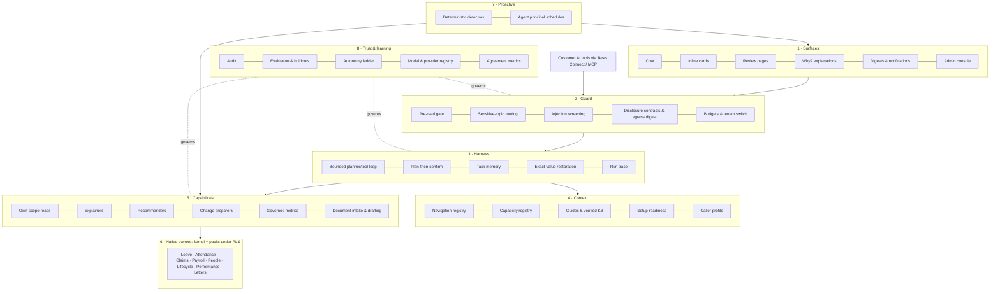

# ADR-0170 — Teras: the AI operating architecture

> Decision record at its recorded date. Implementation and status notes are historical; verify current source and later amendments. The [branch and release policy](../REPOSITORY-AND-ENVIRONMENTS.md) governs operations.

- **Status:** **Proposed draft for the owner (1 November 2026).** Not accepted. Nothing here authorises a disclosure change, deployment or production contact.
- **Number:** provisional. Reconcile at merge: PR126 holds 0167, and ADR-0169 is also provisional.
- **Name:** "Teras" is a working name, pending the owner's choice and a trademark search (§9).
- **Builds on and keeps:**
  - [ADR-0169](0169-assistant-context-harness-and-disclosure-repivot.md): its five layers, the §5.1 privacy/legal review gate, and phases A–D;
  - [ADR-0084](0084-propose-adjudicate-learn.md): models propose, deterministic services adjudicate;
  - [ADR-0151](0151-orchestrator-action-layer-and-system-learning.md): prepared, human-confirmed actions;
  - [ADR-0116](0116-central-ai-inventory-and-allowances.md): inventory and allowances;
  - [ADR-0117](0117-embedded-hr-authentication.md): identity.
- **Adds:** the capabilities that the [capability review](../reviews/assistant-ai-native-capability-review-2026-11.md) found worth adopting, plus the HR-specific capabilities no surveyed product has. It also states the whole system as one architecture with a named owner per part.
- **Evidence:** the capability review (about 130 journeys by access type, 16 AI-native products), the [phase-1 review](../reviews/assistant-conversational-phase1-2026-10.md) §10–§16, and draft PR 170.

## 1. Why one architecture

AI already exists in several places:
- the production Assistant (closed grammar, 12 reads, 7 cards);
- governed analytics (`/analytics`);
- the payroll anomaly narrator and hypotheses;
- pay-rule drafting;
- personnel import mapping;
- performance drafting (off);
- readiness and approval chasers (off);
- the Control Tower agent pages.

Each has its own entry point, gate and switch. ADR-0169 redesigns conversation only.

Without one architecture, every new AI feature reinvents its own:
- authorisation;
- disclosure;
- budget;
- audit;
- evaluation.

Every one of those is a place a privacy or security defect can enter. **Teras is the single path every model call, tool, suggestion and agent run goes through.**

## 2. Principles (invariants)

1. **Native owners are the truth.** The model never computes money, entitlements, dates or eligibility, never decides permissions, and is never a record of HR fact.
2. **Acts as the person, never wider.** Every read runs as the caller under tenant row-level security. There is no chat "service account". Automation runs as the explicit agent principal with its own grants and audit.
3. **People decide, unless they delegate.** Changes complete on their own review pages. **By default nothing is delegated.** An AI agent completes work only under a mandate a person has explicitly granted, within that person's own authority (§3.10). Pay, employment status and access are never delegable.
4. **Minimum necessary to the provider.** Each tool's fields are disclosed under a reviewed contract. Identifiers never leave. Figures go out as bands or placeholders and are restored locally. Small groups are suppressed **only** where the person could not read every row behind the figure, and **always** for what leaves to the provider.
5. **Deterministic gates before probabilistic ones.** These checks are code that runs before the model sees anything:
   - privacy;
   - sensitive topics;
   - overrides;
   - attachments;
   - budgets;
   - eligibility.

   Prompts and memory are advisory, never a guarantee.
6. **Untrusted by default.** Employee text, records, knowledge-base content and tool output are fenced as data, never instructions.
7. **Every run is explainable.** What was read, why something was suggested, and what the person decided are stored with the review and the audit row.
8. **No judgements about individuals.** The model is never asked to infer attitude, sentiment, flight risk or performance from communications.
9. **Measured before shipped.** Hard gates are asserted per turn and never averaged into quality. Holdout suites are release gates.

## 3. The layers

**Presentation view (owner feedback, 1 November 2026: the eight parts below are too many to explain).** For customers and the team, the same architecture is shown as five layers on one foundation:

| Shown as | Contains (engineering parts below) |
| --- | --- |
| 1. Interfaces | Surfaces (§3.1) and Connect (§3.9) |
| 2. Agentic harness | Harness (§3.3), with the LLM inside |
| 3. Context and knowledge | Context (§3.4) |
| 4. HR capabilities | Capabilities (§3.5) and Proactive (§3.7) |
| 5. HR system of record | Native owners (§3.6) |
| Foundation: Trust and governance | Guard (§3.2), Trust and learning (§3.8), mandates (§3.10) and the outcome record (§3.11) |

The engineering parts stay separate where safety depends on it. The Guard is code that runs before the model and cannot be skipped by it. The system of record is the only place money and permissions are decided. Elsewhere they may share packages.

Status key: **Prod** = in production; **Branch** = built on PR 170, fictional data only, not imported by production; **Build** = to build; **Review** = blocked on the ADR-0169 §5.1 privacy/legal review.

### 3.1 Surfaces: where people meet Teras

| Component | What the person gets | Status | Owner / note |
| --- | --- | --- | --- |
| Chat | Plain-language questions in six interface languages | Prod (closed grammar), Branch (tool-using) | `core/assistant.ts`; production stays closed until the review |
| Inline cards | A pre-filled, system-checked summary with one review step | Prod: 7 cards. **Build:** apply leave, decide leave, cancel approved leave first | `lib/ai/assistant-action-proposal-hints.ts` |
| Review pages | The only place a change completes | Prod | Registry review routes |
| **"Why?" explanations** | "Why is my PCB higher?", "Why 14 days?", "Why was I marked late?", answered from the system's own calculation | Owners exist, not yet Assistant tools: `explainStatutory` (`core/statutory-explain.ts`), `explainAttendanceDay` (`core/attendance-explain.ts`), entitlement explanation (`core/read.ts`). **Build** | No vendor surveyed documents this |
| Digests and notifications | A daily "what needs you": approvals waiting, setup gaps, deadlines | Detectors and chasers exist, off by default. **Build** | Approval queue (`core/approvals-inbox.ts`), readiness |
| Admin console | Switches, allowances, providers, agents, runs | Prod (`/control-tower/agents/*`) | Add the agent registry and agreement view (§3.8) |

### 3.2 Guard: decides what may happen before the model sees anything

| Component | Status | Note |
| --- | --- | --- |
| Pre-read gate: no private reads for other-person, override and attachment turns | Branch (`lib/product-context/request-gate.ts`) | en/ms/zh/vi; **Tamil and Thai need a native-speaker review** |
| **Sensitive-topic routing**: harassment, grievance, medical, self-harm, termination go to the HR contact or case route with no reads, and an override is logged | **Build** | Deterministic category, like the gate (ServiceNow, Intercom pattern) |
| **Workplace-harms rule**: no inference about individuals | **Build** (rule + corpus tests) | Microsoft pattern; principle 8 |
| Injection screening: log-only per tenant first, block when false positives are known | Build | Override patterns exist; tool-output fencing is the weakest point today |
| Disclosure contracts per tool and field; identifier denylist | **Review** | Closed contracts and source digests exist for current provider paths (`lib/ai/provider-*`) |
| Egress digest gate | Prod | `scripts/ai-provider-data-source-manifest.mjs`, `scripts/ai-agent-source-manifest.mjs` |
| Budgets, allowances and switches | Prod for features (ADR-0116, `core/ai-management.ts`); per-turn budgets in the probe only | Per-tenant opt-in for option 2 disclosure: **Build** |

### 3.3 Harness: runs a turn safely (ADR-0169 phase C)

| Component | Status | Note |
| --- | --- | --- |
| Bounded planner/tool loop with per-step authorisation, step/token/time/spend budgets, repeat-call guard, no blank replies, truncation retry | Prod for the closed loop (`core/assistant.ts`: budget gate, turn loop, dispatch, audit row); Branch for the tool-using loop (probe only) | Becomes product code behind a switch that stays off |
| **Plan-then-confirm**: multi-step work (onboard a cohort, year-end leave) becomes an editable plan of review pages | **Build** | Claude Code / Cursor pattern; each step still confirmed |
| Task memory: goal, selections, pending question, completed reads, open reviews; re-authorised every turn; erasable with the transcript | Build | Never HR truth |
| Exact-value restoration: the model sees placeholders or bands, and the person sees exact figures they may read | Build | Principle 4 |
| Run trace: reads, reasons and suggestion, stored with the review | Build | Attio, Ramp, Legora pattern; extends the existing audit row |

### 3.4 Context: what Teras knows about the product, never the codebase

| Component | Status |
| --- | --- |
| Navigation registry (from the sidebar sources, with a drift test) | Branch (`lib/product-context/destinations.ts`) |
| Capability registry: every read, context tool and action, with effect, audience and sensitivity | Branch (`core/product-context/tools.ts`) |
| Guides | Branch (`product_guidance`) |
| **Verified knowledge**: HR marks articles verified; Teras prefers and cites them | **Build**; the tenant KB disclosure rule is **Review** |
| Setup readiness: payroll, records, leave health, holidays, attendance, onboarding | Branch (`core/product-context/setup-readiness.ts`, `module-readiness.ts`) |
| Further readiness from existing owners: entitlement coverage, logins pending, letter settings, leave generation | Build. Claims setup has **no owner** yet |
| Caller profile: role, scope and modules, never a grant | Branch |

### 3.5 Capabilities: typed tools over native owners

| Kind | Examples | Status |
| --- | --- | --- |
| Own-scope reads | Leave, payslip, claims, profile, team leave, approval queue | Prod 12 + Branch approval queue |
| **Explainers** | Statutory deductions, attendance day, entitlement | Owners Prod; tools **Build** |
| **Recommenders** | Approver card: *recommend approve / needs review / recommend reject*, from native checks (balance, overlap, coverage, policy version); the model only words it; "needs review" is the default | **Build** (Ramp pattern) |
| Change preparers | Every human-confirmed registry action, pre-filled, rejected when fields are missing | Prod (registry + review pages); Branch (suggest any action) |
| **What-if previews** | "If Annual Leave becomes 16 days, who is affected?", using native dry runs | **Build**, only where a native preview exists |
| **Compliance watch** | Holiday minimum (exists), statutory filing deadlines, rule expiry, in plain language | **Build** on deterministic detectors |
| **Policy versus configuration** | Handbook text compared with configured leave and claims rules; differences shown, never auto-configured | Later; **Review** (document disclosure) |
| Governed metrics | Workforce, leave, attendance, claims trends as bands with person-count thresholds | Prod on `/analytics` (`core/ai-*-analysis.ts`); Assistant access is **Review** (touches approved digests) |
| Document intake | Spreadsheet mapping → preview → apply (personnel mapping exists); receipt → draft claim | Mapping Prod; extension Build; receipts **Review** |
| Drafting | Letters through the letters approval workflow; performance drafting (exists, off) | Letters Build; **Review** |

### 3.6 Native owners

These are the kernel and packs (`packs/<pack>/service`), under RLS, with effective dates and audit. Teras adds no business logic here. Where a needed owner is missing (for example claims setup readiness), it is built in the owning pack, never in Teras.

### 3.7 Proactive: work Teras starts

| Component | Status |
| --- | --- |
| Deterministic detectors: payroll anomalies, readiness, approval and document chasers | Prod, mostly **off** by default |
| Agent principal: scheduled, never makes changes, own grants and audit | Prod for chasers |
| Plain-language schedules ("every Monday, tell me who has not submitted claims") | Later; only over detectors that already exist |

### 3.8 Trust and learning

| Component | Status |
| --- | --- |
| Audit of every tool call | Prod (closed loop); extend with the run trace |
| Behaviour scoring, reviewed corpus, overclaim and invented-link checks, adversarial and conversation holdouts | Branch probe; holdouts Prod |
| **Agent registry**: register, activate, deactivate and archive each agent per tenant, plus a report of actions a person could be offered but cannot complete; delegates get an actor class | **Build** (Workday pattern) |
| Autonomy | Replaced by **mandates** (§3.10): no autonomy unless a person delegates |
| **Agreement metrics**: how often people accept Teras' suggestions and recommendations, from audit data with no new disclosure | Build (ADR-0084 learn) |
| Model and provider registry, zero retention, residency | Prod for configuration; provider terms and residency are **Review** |

### 3.9 Connect: customers' own AI tools (proposed, owner interest 1 November 2026)

**What it is.** An MCP (Model Context Protocol) server, *Teras Connect*. A customer's own AI tool could ask the HR system questions and prepare changes **as the signed-in person**, through the same Guard, capabilities and audit. Examples of such tools: Microsoft Copilot, Claude, ChatGPT Enterprise, Glean. Surveyed products ship this pattern (Glean MCP; Darwinbox claims an HCM MCP server; vendor statements, capability review §4).

**Facts today:**
- No MCP server or third-party API token flow exists.
- ADR-0082 deferred outbound MCP to a later "governed tool gateway".
- The mobile API verifies bearer tokens from the legacy WorkOS adapter (`lib/mobile-api/jwt.ts`), while the authentication direction is embedded HR login (ADR-0117).

**The key difference from chat.** Through MCP, Teras sees **tool calls, not the person's question**. The question-based pre-read gate cannot run. The customer's model plans the turn, and its answers go to the customer's own AI provider. So Connect must be safe **per tool call**, whatever the question was.

| Concern | Design |
| --- | --- |
| Who is calling | OAuth authorisation on the embedded HR login with MFA (ADR-0117), per person, short-lived and revocable tokens bound to one tenant and one registered client. No shared API keys; no service-account reads. The MCP specification's OAuth-based authorisation profile is to be verified against its current version at design time |
| Who allows it | Off by default. A group administrator enables Connect per tenant and per **named client app** (allowlist), chooses which tool groups each app gets, and can revoke at once. Each person can see and revoke their own connections |
| What it can do | The same capability registry, filtered by the person's access: own-scope reads, context, explainers and change **preparation**. Preparation returns a link to the product's review page. **Connect never completes a change**: confirmation happens in the HR system under its own login and MFA, so an outside model cannot approve, submit or pay anything |
| What it returns | Minimum fields per tool, under a published per-tool, per-field contract the customer can assess. Identifiers (IC, passport, bank, tax numbers) never leave. Sensitive groups are **off by default** and need an explicit tenant switch per app: pay, medical and leave reasons, other people's records, analytics |
| Untrusted text | Employee-entered text (claim descriptions, notes) is returned as clearly marked data, never as instructions, so it cannot steer the customer's model. Teras treats every incoming argument as untrusted |
| Abuse | Per-person, per-tool rate limits; no bulk or list-everyone tools; scraping-pattern detection; every call audited with the client app, tool, arguments' shape and result size |
| Responsibility | The customer chooses to send its employees' data to its own AI vendor. Under PDPA the employer is the data user. Teras' terms, the data processing addendum and the per-tool contract must say so, and this needs **its own legal review** (separate from ADR-0169 §5.1, which covers Teras' own provider) |
| Quality and safety tests | A conformance suite runs the adversarial and conversation holdouts, injection attempts in returned data, and cross-tenant and cross-person attempts through Connect before any tenant can enable it |

**Not exposed through Connect:** configuration writes, bulk exports, payroll runs, other people's records (until a separate decision), and governed metrics (until the §5.1 review).

### 3.10 Mandates: people delegate jobs to AI agents (owner decision, 1 November 2026)

**Owner decision.** Users may delegate jobs to AI agents. **By default there is no delegation:** an agent acts only when a person delegates. This answers the question every AI-native system must answer: *under what authority did the agent act?* The answer is always a mandate, a named person's explicit, limited and revocable grant, recorded before the agent acts.

**Facts this builds on:**
- Human approval delegation exists. A delegate is scoped by module and task type, and nobody may decide their own request except a super admin (`core/approvals.ts`, `app/delegations`).
- Automation already runs as an explicit agent principal with its own grants and audit (`SessionContext.agentPrincipal`).
- Every change has a registry action and a review route whose native service adjudicates it.

**Two kinds of job:**

| Kind | Examples | What the agent may do |
| --- | --- | --- |
| **Work jobs** (prepare, never complete) | "Every month, prepare payroll inputs and tell me what is missing." "Chase incomplete claims in my team." "Draft onboarding tasks for each new hire." "Send me a Monday summary of who is away." | Read, prepare drafts and review items, send reminders the person could send. Nothing is completed: the person (or another mandate) confirms |
| **Decision jobs** (complete within conditions) | "Approve my team's leave of 2 days or less when the balance covers it and team coverage stays above the minimum." | Complete the action through the same native service and review path the person would use, only when every condition passes |

**Rules:**
1. **Off by default.** No job runs without a mandate.
2. **Two keys.** This is a recommendation, for enterprise customers. The tenant administrator chooses which job types can be delegated at all, with ceilings (default: none enabled). A person then delegates within that. The employer sets policy and the person chooses.
3. **You can only delegate what you can do.** The agent's authority is the intersection of the grantor's **current** authority and the mandate's limits. It is re-checked at every run, so if the grantor loses a role, goes on leave or leaves, the mandate stops.
4. **Conditions are code, never the model.** Balance, overlap, coverage, policy and amount checks are evaluated by native owners. The model may word the summary but never decides whether a condition passed. If anything is unusual, missing or fails, the job **falls back to the person** as "needs review".
5. **Never delegable:**
   - pay amounts, payroll close or reprocess;
   - employment status (hire, confirm, terminate);
   - access, roles and permissions;
   - anything irreversible;
   - deciding the grantor's own requests (the existing self-approval ban).
6. **Bounded.** Every mandate carries a scope (whose items), limits (size, count per day), a validity period (with a maximum, then renewal), and a notification choice (each action, or a daily summary).
7. **Revocable at once,** by the grantor, their manager where policy allows, or an administrator. There is a tenant-wide stop switch.
8. **Earned.** A decision job type becomes available to delegate only after the tenant's own data shows people accept that suggestion at a high rate over enough cases. The threshold is set by the owner; it is not chosen here.
9. **One agent identity per mandate,** shown as acting *for* the grantor, never *as* them, so every record says who delegated and which agent acted.
10. **Undo** where the action is reversible, for a set window, through the native service.

**Legal note.** Automated decisions about employees are regulated in some jurisdictions (for example, rules on solely automated decisions with significant effects). Low-impact approvals within the person's own rules are expected to be the lowest-risk case, but specialist review is required before decision jobs ship, and per country if we go international.

### 3.11 Outcome record: how every AI result came about

Every AI run, suggestion, prepared item and mandate action writes one **outcome record**. It is stored with the audit trail and shown on the review page, to the grantor and to administrators:

| Field | Why |
| --- | --- |
| Run id, time, tenant, company | Locate it |
| Who asked, or which mandate (id and version) and grantor | **Authority**: under what authority it happened |
| Agent identity | Who acted |
| What was read: tool names and record references (not the data) | **Basis**: what it looked at |
| Rule and policy versions used by each native check, with each check's result | **Constraints**: which rules applied |
| Model, provider, instruction-set and tool-catalogue versions | **Replay**: why the AI suggested this, later |
| What was suggested, prepared or done | **Outcome** |
| The person's decision, or the mandate's automatic completion, and any undo | **Accountability** |

Data stays in the native owners; the record holds references and versions, and follows audit retention. A customer-facing view summarises outcome records:
- what the AI did;
- how often people accepted its suggestions, by job type;
- what each mandate did.

This view is the evidence for rule 8 above, and for audits.

### 3.12 Improvement engine: how every layer keeps getting better (owner request, 1 November 2026)

**Goal.** Improving Teras should be routine, not a project. The system finds its own gaps, proposes the fix, scaffolds it and proves it. People approve what changes behaviour. The Guard never changes itself.

**Foundations that already exist:**
- the feedback improvement loop (`scripts/improve/`: feedback item → plain-language plan → approved build);
- the Control Tower agreement and reversal view (`core/control-tower.ts`), which already refuses to report a flattering acceptance rate before outcomes are tested;
- ADR-0114 impact-aware release and learning;
- the GitHub Actions evaluation probe, reviewed corpus and holdouts;
- drift tests that fail when the sidebar gains a page the navigation registry lacks.

**The loop:**
1. **Signals.** Outcome records (§3.11) collect:
   - suggestions accepted, rejected or reversed;
   - "no tool or action for this" replies;
   - "no guide found" replies;
   - fallbacks to "needs review";
   - guard blocks;
   - ratings and feedback board items.
2. **Triage (automated).** Signals are clustered and classified as a missing piece of context, a missing capability, a harness defect, a guard gap or an interface gap. They are ranked by how many people and which roles they affect. This is the usage data the capability review lacked.
3. **Proposal (automated, human-approved).** Each cluster becomes a feedback board item with a drafted plan through the existing improve loop. A person approves or rejects it.
4. **Build (scaffolded).** Kits make the common fixes cheap (below).
5. **Verify (automated).** The evaluation suites run on GitHub Actions: corpus, holdouts, conformance, hard gates. A change that fails a hard gate cannot ship.
6. **Release and measure.** Release goes through the staging queue. Acceptance is measured again, closing the loop.

**What each layer gets:**

| Layer | Automated | People decide |
| --- | --- | --- |
| **Context and knowledge** | Registries generated from source with drift tests, so a new page, action or setting cannot ship without its AI metadata. A **definition of done** for every product feature: registry entry, guide section, readiness check if it needs setup, and corpus turns, enforced in CI. "No guide found" clusters produce a drafted guide. Stale-article detection when the rule behind it changes | Approving drafted guides; HR marking articles verified |
| **Capabilities** | A **capability kit**: declaring a native owner, its permission and its projection generates the tool spec, card, review link and corpus turns. Every capability **inherits the standard contract tests** (acts as the person, no identifiers, other-person refusal, no overclaim, minimum fields). Unmet-request clusters ranked by role | Which capability to build; each new delegable job type (§3.10) |
| **Harness** | Every instruction or model change is versioned and runs the full suite. A **model upgrade is a comparison report**: new model against current, same suites, cost and latency. Shadow runs on fictional data | Switching models or instructions, from the report |
| **Interfaces** | A new channel is an adapter onto the same Guard and Harness, and reuses the Connect conformance suite | Opening a channel to a tenant |
| **Guards** | The attack library grows: holdouts, injection corpora, and patterns seen in log-only screening. Ratchet tests fail any change that loosens a rule without a recorded review, the way the repository's import allowlists only shrink | **Every** guard change; disclosure changes need fresh approval (ADR-0169 §5.1) |

**Privacy of the loop itself.** Improvement signals contain personal data.
- What leaves a tenant for product improvement is counts, categories and tool names, never question text or records, unless the tenant opts in.
- Even then, a real question becomes a test case only after it is rewritten as fictional and a person approves it.
- The test corpus stays fictional.

**What the engine never does:**
- change a guard;
- widen a permission or a disclosure contract;
- enable a delegable job type;
- release without the evaluation suites passing.

## 4. A turn, end to end

1. **Surface.** The person asks in chat, or opens a card or a "Why?".
2. **Guard.** Deterministic checks run in order:
   - tenant switch, grant and budget;
   - sensitive-topic routing;
   - override, attachment and other-person gate;
   - injection screening.

   Each decides which tools are offered, if any.
3. **Harness.** The model receives the question, the caller profile and only the permitted tool specs. Each tool call is authorised as the caller and dispatched to a native owner. Output is fenced as untrusted and disclosed under its contract, with figures as placeholders or bands.
4. **Harness.** The reply is checked deterministically:
   - not blank;
   - no invented links;
   - no claim that a change was made;
   - no identifiers.

   Exact figures the person may see are restored locally.
5. **Surface.** The answer, a card, or a plan. A change goes to its review page, where the person confirms and the native owner adjudicates.
6. **Trust.** The trace is stored with the audit row and review. The decision feeds the agreement metrics.

## 5. What Teras will not do

- Infer attitude, sentiment, flight risk or performance from messages.
- Offer free-form SQL or "chat with the database".
- Act without a mandate, or delegate pay, employment status, access or anything irreversible.
- Calculate money, entitlements or dates.
- Treat memory as HR truth, or keep it longer than the transcript.
- Send identifiers, or exact small-group figures, to a provider.

## 6. Delivery order

Every step is built on fictional data behind a switch that stays off until the ADR-0169 §5.1 review passes. Release order stays with the Orchestrator.

| Step | Content | Needs the review? |
| --- | --- | --- |
| 0 | Usage-data check, to order steps 2–5 by measured frequency | No |
| 1 | Harness as product code: gate, budgets, fencing, exact-value restoration, task memory, trace, tenant switch | No (built and tested on fictional data; switched on only after the review) |
| 2 | Cards: apply leave, decide leave, cancel approved leave | No |
| 3 | Sensitive-topic routing; workplace-harms rule | No |
| 4 | "Why?" explainers; go-live setup co-pilot on readiness | No |
| 5 | Approver recommendations; daily digest; agent registry | No |
| 5a | Outcome record, then **work-job mandates** (prepare, chase, summarise; nothing completed) | No |
| 5c | Improvement engine: signal triage onto the feedback board, capability kit with inherited contract tests, definition-of-done CI check, model comparison report | No |
| 5b | **Decision-job mandates**, per job type, once acceptance data qualifies it | Legal review of automated decisions |
| 6 | Governed metrics, receipts, letter drafting, spreadsheet intake, verified KB, policy-versus-configuration | **Yes** |
| 6a | Teras Connect, read and prepare only, behind the tenant and app allowlist, after the Guard and capability registry are product code | Its own legal review (§3.9), and the conformance suite |
| 7 | Pilot with one consenting tenant (ADR-0169 phase D) | **Yes**, plus legal sign-off |

Acceptance for each step follows ADR-0169 §6. In addition, every new capability ships with hard-gate tests, and with corpus turns for each access type it serves.

## 7. Consequences and risks

- **One path.** One path means one place to secure and one to audit. Existing AI features migrate behind the Guard and Trust layers over time. Until they do, each keeps its own gate, and an inventory test must list which path each feature uses.
- **More owners.** Readiness, explainer and recommender tools mean more owners to keep consistent. The mitigation is one projection per fact, the pattern of `core/leave-config-health-input.ts`, plus drift tests.
- **Usefulness depends on the review.** The real usefulness gains (ADR-0169 measurements) depend on option 2 disclosure, which is still under review. Without it, steps 1–5 still improve cards, explanations and readiness through deterministic paths, but the conversation ceiling stays near the closed protocol's.
- **Inherited risks** from ADR-0169 §4: prompt injection, model drift, over-trust, cost at real traffic, and registry drift.

## 8. Unknowns

- How often each journey actually happens.
- Tenant acceptance of disclosure.
- Production model, cost and latency.
- Whether the Assistant's decision sources admit covering delegates.
- Malaysian, and later other countries', legal requirements for AI and automated decisions in employment. This needs the privacy/legal reviewer.
- The acceptance threshold and minimum case count that qualify a decision job for delegation.

## 9. Name

**What the name must do:**
1. Say what the system is: the trusted core every AI feature runs through, with people in control.
2. Read naturally in Malay and English, and be pronounceable in the other interface languages.
3. Not be a person's name. A human persona encourages over-trust (ADR-0169 §4), and it invites assumptions about the assistant's gender.
4. Have no clash with an AI, HR or Malaysian technology product.
5. Work for both the platform ("built on Teras") and the features ("Teras Connect", "Ask Teras").

**Shortlist** (quick web searches on 1 November 2026; **not a trademark search**):

| Name | Meaning and fit | Clash found |
| --- | --- | --- |
| **Teras** | Malay: *core*, the heartwood of a tree. The one core every AI feature runs through, rooted in the system's own records. Works as a platform name | None found for an AI or HR product. Near names are different words (Tera AI, robotics; TeraGen, marketing) |
| **Kemudi** | Malay: *rudder*. The rudder steers, but the helmsman decides, which matches "models propose, people decide". Strong metaphor | None found |
| **Suluh** | Malay: *torch*. Lights the way: guidance, "Why?" explanations. Better for an assistant than for a platform | None found (Sulu.ai is a near-miss) |
| Nadi | Malay: *pulse* | Close to Nadia, an AI work coach used in HR (Valence) |
| Rakan | Malay: *companion, colleague* | Used by the National AI Office's agriculture AI (Rakan Tani) and RakanMET |
| Nakhoda | Malay: *ship's captain* | Nakhoda AI, a Malaysian compliance AI (Otonoco) |
| Akal | Malay: *reason* | A Malaysia-listed AI solutions company |
| Keel | English | Close to Keelzo, an AI recruiting product |
| Onyx | Current branch codename | Onyx, an open-source enterprise AI search product |
| Amanah | Trust | Also the name of a Malaysian political party |

**Recommendation.** **Teras** for the AI operating architecture and brand ("Teras Connect", "Ask Teras"). Kemudi is a close second if the owner prefers the steering metaphor over the core metaphor.

Before adopting either:
- a MyIPO and international trademark search in the software classes;
- a domain and app-store check;
- a native-speaker check of meaning and connotation in all six interface languages.
