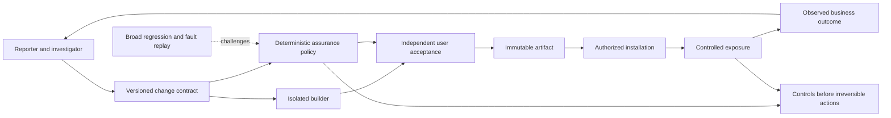

# Continuous assurance and controlled delivery

**Status:** Proposed replacement architecture; advisory prototype implemented, live adoption unqualified.
**Date:** 17 November 2026, Asia/Kuala_Lumpur.
**Deciders:** Repository owner for operating policy; authorized HR/payroll/security owners for business invariants and sensitive decisions.
**Scope:** Issue intake and reporter dialogue through implementation, independent verification, installation, exposure and confirmed outcome.

## Decision

Replace the universal full-gate release process with continuous assurance and controls at the points where harm can occur. A release should answer “may this artifact operate with these capabilities and this exposure?” A payroll finalization should answer a separate question about exact authorized business inputs and results. A reporter's approval answers a question about intended behavior, not permission to release or access private data.

The architectural target is no universal full-suite barrier on every ordinary change. Retain specific blocking controls where harm cannot be prevented, observed or recovered through other means. Broad regression becomes an independent audit and a fallback for unbounded impact, rather than the sole definition of quality. Unknown reach does not become permission to expose code.

The owner's request authorizes developing a replacement. It does not establish that the replacement works or authorize a production installation. The shadow prototype neither consumes release evidence nor replaces the active installer. Promotion to operating authority requires the qualification below; current production authorization remains separate.

## Why replace the process

A full suite is an imperfect sensor. It may contain valuable protections, duplicated observations, weak assertions, environment-sensitive failures and expensive checks unrelated to a change. Treating all of these as the same global barrier couples unrelated work and encourages agents to optimize for a green run.

The stronger unit of progress is an independently demonstrated user outcome with its business invariants preserved. The stronger unit of safety is a capability boundary: an experiment without payment credentials cannot accidentally send a payment; a disabled UI flag with payment credentials still can. Checks remain necessary to prove the boundary and its production integration.

This is an ai-hr design inference. Primary sources support the ingredients, not a claim that any named developer uses this exact architecture or that deleting gates is universally safe.

## Principles from primary sources

| Source | What it supports | Design consequence |
| --- | --- | --- |
| [Lauren Tan/pstack correct skill][pstack] | Prefer preventing repeated mistakes through architecture, then types/lint, behavioral tests and finally documentation. | Remove dangerous capabilities and competing state owners before writing more agent instructions. |
| [Matt Pocock triage][triage] and [TDD][tdd] | Preserve facts and unresolved questions; reproduce defects; test public behavior using independent expected results. | An issue is a durable dialogue plus executable acceptance, not a paragraph handed to a coding agent. |
| [DORA test automation][dora] | Continuous developer-owned feedback, reliable acceptance tests and ongoing improvement of suites. | Quality is work throughout delivery; “the tests run nightly” is not a replacement for acceptance. |
| [Google SRE canarying][canary] | Evaluate limited exposure against representative signals; canaries have shared failure domains and side-effect risks. | Use progressive exposure only where its assumptions hold. Data disclosure and payment mistakes need protection before effects. |
| [GitHub Scientist][scientist] | Execute control and candidate and compare while returning the control result. | Shadow comparison is useful, but candidate side effects must be prevented separately. |
| [PostgreSQL RLS][rls] | Row policies have important owner, privileged-role and operation exceptions. | Tenant isolation must include real roles and privileged paths; a type or RLS declaration alone is insufficient. |
| [TigerBeetle deterministic simulation][simulation] | Controlled faults and replay can test real state machines against explicit invariants. | Apply replay and fault sequences to narrow kernels; do not build a distributed-system simulator around the entire web application. |
| [Task-cache inputs][cache] and [regression selection safety research][selection] | Reuse and selection depend on complete, valid assumptions. | File size, import reach and earlier green results cannot establish safety on their own. |

## Operating model

These are responsibilities, not a request for eight services. Start with the existing feedback database as the issue owner, GitHub as the source/check/PR system, one small operator worker and existing private artifact/installation storage. Do not introduce Kafka, Kubernetes, a second tracker or a commercial CI platform to make this diagram real.

### Reporter dialogue and readiness

The investigator first reads existing discussion and authorized evidence and inspects the reported behavior. It asks the smallest remaining business question, identifies itself as an agent and retains facts already established. Waiting for a reporter consumes no builder slot. A response resumes diagnosis; it does not automatically approve new scope.

The change contract records the scenario, affected actors and tenant/company scope, independently expected behavior, reproduction or explicit reproduction gap, exclusions, acceptance criteria, effects, dependency assumptions, recovery strategy and observation signals. Each material scope change creates a new revision. Approval names that revision. A deterministic service rejects implementation claims against stale approval.

Reporter approval is required for intended scope. Triage policy, scoped tool permissions, business-owner decisions and deployment authorization are distinct. Reporter text and attachments cannot grant credentials or override policy. Start automated discussion through the authenticated in-product channel after its standing policy is commissioned; do not mirror private HR data into public GitHub issues.

### Reliable agent execution

Use a durable job record with tenant, issue/cycle/revision, run ID, state, attempt budget, lease token/generation, lease expiry, heartbeat and source baseline. Claim an eligible job atomically. Completion checks the current token and revision in the same transaction. A stale worker cannot publish over a newer owner. A database outbox owns wakeups and reporter delivery with deduplication. No assumption of exactly-once network delivery is necessary.

The builder receives the approved contract, scoped source access, disposable fixtures and a bounded budget. It does not receive reporter-posting, privileged production database, installation or payment credentials. Prompt injection in task content cannot expand tool authority. Cancellation, contest or replan invalidates its token; already delivered side effects require explicit reconciliation, not pretending they never happened.

The verifier uses the contract and original report, not just the author's summary or generated tests. It exercises the actual surface with an authorized fixture and independently established expectations. The verdict records artifact/source, environment, scope, evidence and limitations. Changed behavior invalidates affected verdicts. Separate agent context improves independence but does not establish an independent correctness oracle.

### Verification chosen by potential harm

| Effect | Primary evidence or constraint | Position |
| --- | --- | --- |
| Presentation | Rendered interaction, relevant accessibility, independent reporter journey | During development and before exposure |
| Private reads | Real-role denial and tenant-isolation cases, ordered results/counts, realistic query shape | Before exposure; enforced at every read |
| Business writes | Authorized command boundary, invariants, concurrency, idempotency, audit | Before exposure; enforced at every command |
| Money calculation | Approved worked examples, statutory/rounding boundaries, isolated differential replay | Before exposure |
| Payroll/payment finalization | Reconciliation and human authorization of exact versioned inputs/results; durable operation identity | Before the irreversible action |
| Access changes | Negative isolation cases and constrained grant/revocation paths | Before exposure and each grant |
| Schema changes | Restricted-owner populated upgrade, grants, old/new compatibility, restore or forward repair | Before installation/effects |
| Messages, filing and destructive operations | Recipient/operation authorization, effect preview, outbox/idempotency, recoverability limits | Before the irreversible action |

The classifier is not an LLM confidence score. Effect inventory and dependency reach need independent verification against the complete diff, configuration, schema, runtime and privileged call paths. One change may have several effects; obligations combine and cannot cancel one another. Unknowns trigger discovery and broader evidence or a hold, not a guessed low-risk path.

### Reduce the amount that must be trusted

Develop pure calculation and state-transition seams where they pay for observed risks. Supply explicit versions of rule inputs, time and randomness. Generate sequences such as draft, revise, approve, retry, revoke and resume; assert invariants after each step and retain failing seeds. Use domain-reviewed properties: statutory rounding and negative adjustments make simplistic arithmetic identities unsafe.

Make irreversible effects available only through narrow authorized adapters. Shadow execution has no effect credentials and cannot write to the live database, send mail, generate a live bank submission or mutate shared caches. Use authorized immutable fixtures or isolated snapshots with real retention controls. Returning the old result while the candidate executes does not provide this isolation.

Modularity is a delivery feature. Establish enforceable boundaries around sensitive kernels so a display-only change cannot acquire a new money or access capability through a shared helper. Remain a modular application where that is sufficient; independent microservices are not a prerequisite.

### Artifact installation, exposure and observation

Compile/package one identified artifact for a compatible environment and promote those exact bytes. Record source, build, runtime, dependencies, schema/rule/configuration assumptions and installation arrival. If environments need different compile-time values, either redesign those values as runtime configuration or produce separately identified artifacts; never pretend one tested artifact is another.

Installing code does not automatically activate its behavior. Internal cohorts and controlled rollout are appropriate only after shared effects, queries, module initialization and resource consumption are bounded. Each exposure policy records the cohort/control, meaningful business and service signals, minimum observation requirements, stop conditions, recovery mechanism, owner and expiry. Insufficient samples or an unexercised monthly workflow means inconclusive, not PASS.

Privacy and financial correctness are not availability error budgets. A fast rollback cannot undo disclosure, filing or payment. Keep hard pre-effect controls where harm is irreversible. Schema changes generally need compatibility and forward repair, rather than reliance on toggles or code rollback.

### Evidence and broad regression

Evidence is a scoped fact, not an interchangeable green badge. Record what was observed, producer identity, source/artifact, full inputs, runtime/schema/configuration, criteria revision, producing environment and invalidators. Only deterministic checks with complete input identity are candidates for reuse. Mutable database state, external APIs and production behavior are not reusable merely because the Git SHA matches.

Run broad regression as a continuous challenger to the policy and as a conservative fallback for unresolved impact. It may also block adoption where its failures reveal an uncontained risk. A periodic full suite is not permission to ship irreversible harm before its result arrives. Preserve original failures and classify their causes; retrying until green is not evidence of reliability.

Audit the tests themselves: replay historical defects, introduce representative faults, inspect meaningful business assertions and examine defects that escaped all checks. Mutation scores support diagnosis, not a universal target. Retire redundant checks only after their claims have a better owner or their value is disproved within an explicitly bounded scope.

## State and authority contracts

| Record | Owner | Important invariant |
| --- | --- | --- |
| Issue, conversation and approved revision | Existing feedback service | Answers retain actor/scope; revised scope cannot inherit old approval. |
| Job and lease | New small execution coordinator | One current owner per issue revision; stale completion refuses. |
| Change contract and effect inventory | Investigator plus independent scope reviewer | Model output proposes; it cannot authenticate its own reach or authority. |
| Verification observation | Check producer / independent verifier | Immutable original result with exact subjects and inputs. |
| Exposure decision | Deterministic policy plus authorized operator | Evidence and granted capabilities match the actual artifact and target. |
| Business finalization | Existing authorized domain service | Deployment/agent success cannot substitute for human business authority. |
| Outcome and board milestones | Release coordinator and feedback service | Read back actual target and item cycle; merged, installed, exposed and accepted remain distinct. |

## Alternatives and trade-offs

| Option | Benefit | Cost / limitation | Decision |
| --- | --- | --- | --- |
| Speed up the existing full gate | Lowest immediate migration effort | Preserves global coupling and green-run incentives | Not the target |
| Remove the gate and rely on canaries | Very short pre-release path | Cannot contain irreversible harm or rare/unobserved workflows | Reject |
| Agent judgment plus an independent reviewer | Flexible and easy to start | Correlated assumptions; neither reviewer is a runtime boundary | Use for investigation, not authority |
| New monorepo/cache/build platform first | Mature task graph and reuse tooling | Does not establish business correctness or effect isolation | Defer until a measured need |
| Continuous assurance with constrained effects | Verification matches risk; ordinary changes can avoid unrelated barriers | Requires enforceable boundaries, sound evidence and real observability | Chosen target |

There is no supported speedup estimate yet. This approach may initially cost more while boundaries and evidence are established. Its success criterion is faster demonstrated outcomes with lower or equal business harm and less operator toil.

## Executable first slice

[`scripts/delivery/assurance-plan.mjs`](../../scripts/delivery/assurance-plan.mjs) is a dependency-free advisory prototype. It takes a change contract, combines effect obligations, surfaces stale approval/unknown reach/recovery/signal gaps and never grants release or exposure authority. It is deliberately not a test selector, an evidence verifier, a lease implementation, a production policy compiler or an installer.

Its synthetic example and hosted controls let us challenge refusal behavior and monotonicity: adding an effect cannot remove existing obligations. Even a fully populated proposal remains unauthenticated. This avoids turning a user-supplied “bounded” field into an authorization decision.

The prototype is one falsifiable starting point. Delete or revise it if incident replay shows that its abstraction does not correspond to actual ai-hr failures.

## Qualification and implementation sequence

1. **Model and challenge:** complete this decision, inventory actual harms and acceptance boundaries, and replay historical incidents against the advisory design. Build a held-out defect corpus. Count missed hazards and unnecessary obligations; all severe misses require resolution, not averaging away.
2. **Commission one complete issue path:** pre-plan reporter dialogue, versioned approval, durable fenced job ownership and one isolated builder/verifier. Test duplicate webhooks, lost delivery, lease expiry, reporter edits, cancellation and concurrent claims. Run a synthetic end-to-end case before using an authorized real issue.
3. **Prove one bounded low-risk path:** select a presentation-only change with no new private-data or shared initialization effects. Establish immutable artifact, independent user acceptance, observation and recovery. Run the new policy alongside existing release assurance and examine every disagreement. No blanket “low-risk file” allowlist.
4. **Move safety into boundaries:** isolate calculation/effect adapters; exercise payroll replay, real-role isolation and populated migrations independently. Add controls where harm occurs. Use the same tool route for agents and operators.
5. **Adopt per effect:** once its boundaries, checks and observation are qualified, let that change class use its own evidence instead of the universal full gate. Explicitly supersede obsolete gate rules for that class in one versioned policy. Keep unresolved classes on conservative controls.
6. **Retire the old machinery:** remove the legacy watcher, conflicting builder instructions, duplicate recovery routes and full-gate default only after their responsibilities have an operational owner. Generate concise operator/agent documentation from supported commands and policy; retain a short bootstrap document and archived decisions, not a growing universal prompt.

No preassigned calendar proves completion. Each slice ends with observed operational evidence and a clear removal target. Keep current work and running gates untouched during transition. Production changes still require the separate authorized release.

## Measures and stop conditions

Measure report-to-first-useful-response, repeated clarification questions, approved-revision-to-verified-outcome p50/p95, evidence wait versus execution time, job-minutes per accepted outcome, duplicate/stale jobs, reopens, escaped defects by severity, time to containment, and operator interventions. Preserve “inconclusive” as a first-class result.

Stop expanding autonomy or exposure when there is a severe missed hazard, cross-tenant access, unauthorized effect, stale approval accepted, inability to attribute the actual artifact, or failed recovery. Correct the mechanism and replay the failure before resuming. Do not treat one leak or payment error as an acceptable percentage of successful releases.

## Open implementation questions

- Which representative issue and seeded cohort can establish the first complete path?
- Which effects can the current runtime actually prevent through roles/adapters rather than convention?
- Which existing tests uniquely detected historical severe defects, and which key incidents escaped?
- Which acceptance thresholds and financial properties have independent domain-owner approval?
- Can the current small installation isolate candidate exposure and resource usage, or does the first pilot need a separate disposable instance?

These questions need source/runtime evidence during implementation, not assumptions imported from this design.

[pstack]: https://github.com/cursor/plugins/blob/e1cc03121a0e71129a4fb730d7c5528a0a3e43c8/pstack/skills/correct/SKILL.md
[triage]: https://github.com/mattpocock/skills/blob/5863806dd4e15c63174bee4e7515a4256792ecfa/skills/engineering/triage/SKILL.md
[tdd]: https://github.com/mattpocock/skills/blob/5863806dd4e15c63174bee4e7515a4256792ecfa/skills/engineering/tdd/SKILL.md
[dora]: https://dora.dev/capabilities/test-automation/
[canary]: https://sre.google/workbook/canarying-releases/
[scientist]: https://github.com/github/scientist
[rls]: https://www.postgresql.org/docs/18/ddl-rowsecurity.html
[simulation]: https://tigerbeetle.com/blog/2026-08-20-protocol-aware-dst/
[cache]: https://turborepo.dev/docs/crafting-your-repository/caching
[selection]: https://experts.illinois.edu/en/publications/safety-of-a-smart-classes-used-regression-test-selection-algorith/
