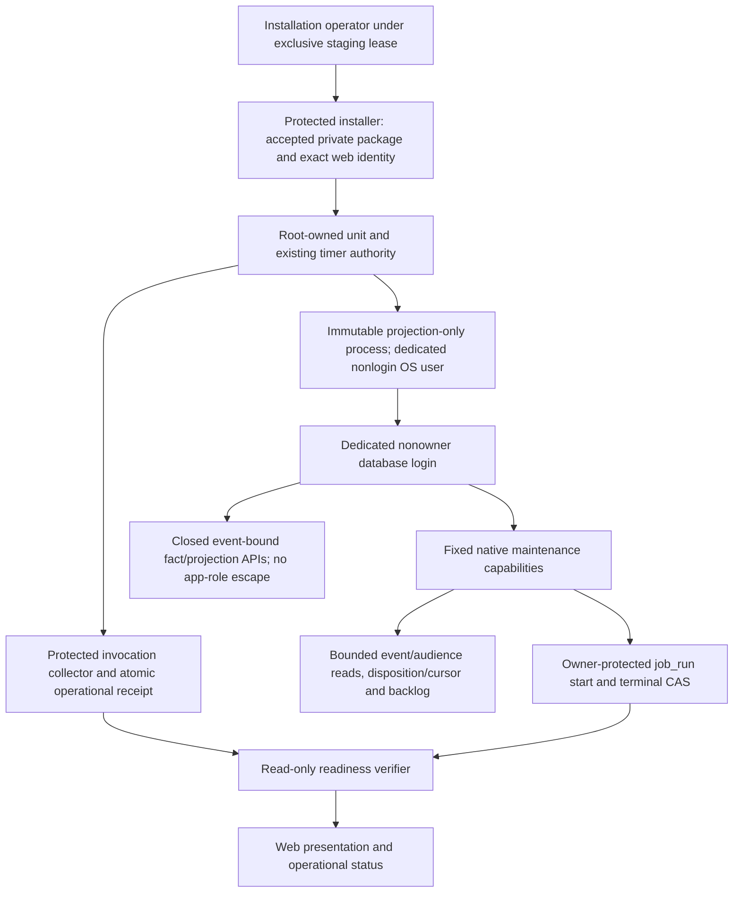

# Notification projection worker: protected commissioning proposal

Status: source audit and proposed design, 7 November 2026. **Not implemented, installed,
commissioned or accepted.** No runtime, browser, database, SMTP or provider check was run for this
proposal. Production remains on hold. Existing page catch-up remains in place.

Audit base: `194215b679a13977decdeca594f4304920d15cf8`. The isolated planning branch is
`codex/notification-worker-commissioning-plan-20261107`. Freshly fetched `main` and `alpha` both
pointed to `4a5a9de8c7c4c7a92dcce5d55a14b736336a87e7` when the branch was created. Those are
source observations, not claims about either installed environment.

## Decision requested from the architecture controller

Approve the design and file ownership before production code. Add a narrow projection-only
entrypoint and a protected package/install/invocation reader using the bank worker's reviewed
immutable-release patterns. Reuse the existing scheduler controller; do not introduce a second
scheduler. Keep the current scheduling prerequisite fail-closed until real installed boundary and
scheduled invocation evidence qualifies.

The controller selected a dedicated nonowner notification maintenance login and small owner-defined
database capabilities. **No SET edge to `ai_hr_app` is allowed**: that would let a compromised worker
forge an administrative GUC context and invoke unrelated writes. The concrete native proposal is
[NOTIFICATION-WORKER-NATIVE-API.md](NOTIFICATION-WORKER-NATIVE-API.md), with an unnumbered SQL review
draft alongside it. The controller owns migration/role/journal allocation. An owner-URL executor is
not the release solution. Do not expose a generic SQL or arbitrary-transaction broker.

## Verified source facts

| Source | Fact and consequence |
| --- | --- |
| `db/migrations/0280_job_run.sql`, `test/job-run-rls.test.ts` | `job_run` is owner-written, app-readable under group-admin RLS. INSERT/UPDATE/DELETE/TRUNCATE are explicitly revoked from `ai_hr_app`. Ordinary web callers cannot forge a stored run. Aggregate metadata cannot contain HR content or tenant names because any tenant's group admin can read the global history. |
| `core/job-run.ts` | Durable start and matching unfinished-run completion CAS exist. An interrupted worker leaves a running row. The row alone does not identify an accepted package, operating-system identity or actual scheduler invocation. |
| `lib/notification-scheduling-evidence.ts` | Projection counters and fresh/backlog health classification exist; `identityVerified` remains zero. `notificationSchedulingPrerequisite` intentionally always refuses because there is no protected accepted-worker verifier. Caller-supplied observations must remain untrusted. |
| `scripts/notification-email-sweep.ts` | Existing combined runner uses `MIGRATION_DATABASE_URL` and also performs Lifecycle, Probation, Contracts, Performance, Letters and email work. Executing it is not projection-only verification authorization. |
| `core/notifications.ts`, `core/notice-projection.ts` | Sweep projection authenticates owner/bypass authority, reads a bounded event batch, Notice audience snapshots and prior projections, then switches to `ai_hr_app` for canonical registry resolution, notification insertion and durable outbox enqueue. It restores the previous role for processing dispositions and cursor update, all in one transaction. |
| `scripts/lib/notification-sweep-role.ts`, `deploy/runner-control/notification-role-prerequisite.sql` | PostgreSQL 16 requires a real login-to-app SET edge. The prerequisite checks native role properties and forbids reverse app-to-owner membership. The application cannot repair this edge. |
| `scripts/lib/notification-projection-backlog.ts` | Backlog uses the same complete native maintenance authority and reads pending processing intent. It does not consume work. |
| `deploy/runner-control/broker.py`, `install.py`, `README.md` | Protected peer-UID and fixed-catalog schedule control exists. Policy `managed=true`, systemd success and schedule revision do not authenticate a worker release or complete runtime configuration. The README explicitly requires independent accepted-package review. |
| `deploy/systemd/bank_import_worker_installer_v2.py`, `bank_import_worker_upgrade_v1.py`, `bank_import_worker_format.py` | Existing patterns authenticate independently pinned package/lock/source/build hashes, safe archive bytes, protected immutable paths, minimal environment, fixed command/user, actual process identity and atomic receipts. First install and upgrade/drain have distinct ownership. Operational receipts explicitly do not establish human journey acceptance. |
| `db/client.ts` | `createDb` defaults to ten connections and also initializes the app pool at import. A dedicated runner must set an explicit total connection budget and prove its import graph does not silently add another pool. |
| `app/shell-notification-center.tsx` | Page catch-up currently uses `skipIfBusy`; it must remain until source qualification and actual installed scheduled-worker proof are accepted. |

`core/notification-jobs.ts` is not present at the audited base; the evidence module above is the actual
owner. No later migration found in this audit adds an app write path to `job_run`.

## Actors and trust boundaries

The root-owned installer authenticates bytes and installation policy; the schedule controller owns
allowed timer changes. The immutable process owns projection orchestration. PostgreSQL, rather than
a TypeScript context or JSON field, owns maintenance permission. The collector binds actual scheduled
invocation identity to the exact native run ID. The web may read sanitized readiness but may not mint
installation/invocation receipts, choose file paths, select SQL, supply schedule tolerances or assert
that its own observation is accepted.

Neither a root-owned receipt file nor an owner-written run is sufficient alone. A receipt can be old;
a run can come from the legacy combined sweep or a different accepted source. Readiness joins both
against the current installed source, build, DB target, capability and scheduler revision.

## Database authority options and proposed minimum change

Moving the owner password into a local daemon helps only if that daemon accepts fixed capability
requests and never lends a connection or accepts SQL/callbacks. Projection currently needs one
transaction around owner reads, app-role registry writes and privileged cursor/disposition writes.
A request/response proxy between independent transactions would break that atomicity. A broker that
simply launches the existing sweep with owner credentials still executes broad owner authority and
SMTP-capable code. Neither is the preferred final boundary.

The selected design keeps privileged database ownership in reviewed SECURITY DEFINER functions,
not in the JavaScript process or an arbitrary-query service. The worker login has no app/owner/platform
membership, SUPERUSER, BYPASSRLS, CREATEROLE, CREATEDB, DDL or direct source-table privileges. It has
USAGE only on its isolated API schema and EXECUTE only on closed capabilities. Withhold `app` schema
USAGE, following the explicit precedent in migration 0525: older helpers there inherit PUBLIC EXECUTE.
Canonical pure recipient/content decisions share a typed read adapter; their fixed data queries and
the existing preparation writes have event-bound native ports. General app-role access is forbidden.

Candidate native capability families for controller review (names and SQL are not allocated here):

1. Enumerate minimal maintenance scope: tenant IDs and standing only, excluding the system tenant.
   Resolve current entitlements through the existing tenant-scoped snapshot query, rather than
   caller-provided entitlement claims or a new interpretation of activation/standing rules.
2. Read a bounded pending-event batch, prior projection keys and complete published Notice snapshots
   for the current tenant/consumer. Acquire the existing tenant advisory transaction lock, validate
   current native authority/standing and retain the same transaction until completion.
3. Finish only that tenant/consumer's processed or ignored event set and monotonic cursor changes,
   retaining the existing duplicate, late-commit, event-receipt and retention semantics. Do not make
   a public arbitrary-event acknowledgment function. The controller must decide how the admitted
   batch is bound within the transaction; caller JSON or a writable temporary table is not proof.
4. Read bounded aggregate pending/oldest backlog with the same tenant/consumer authority.
5. Start and complete **only** the notification projection job key with native run-ID CAS. The worker
   cannot change other jobs, delete history, reopen a terminal run or publish per-tenant/HR data.

All privileged functions must authenticate the actual login, have a safe explicit search path,
revoke PUBLIC and ordinary `ai_hr_app` execution, validate exact tenant/consumer/event relationships,
bound arguments/results and forbid every worker-to-app/owner/platform membership and reverse edge. A SECURITY
DEFINER's `current_user` is not proof of the original caller. Existing owner sweep paths must retain
their current behavior until deliberately migrated; do not weaken the owner assertion to an
arbitrary role-name string. These native changes need hostile-login tests on PostgreSQL 16, not only
the default superuser CI topology.

This is a capability design to review, not an assertion that five complete new SQL APIs or a new
status table are necessary. Reuse reviewed existing functions wherever their real native authority
already satisfies the constraint. A per-run admission binding may require protected state; the
controller must settle that design before allocating schema.

## Narrow runtime and scheduler ownership

The projection-only entrypoint must call the canonical dispatcher and bounded drain/backlog helpers.
It must not import the combined sweep or delivery adapters, or invoke lifecycle mutation, Letter
delivery, notification delivery, SMTP or provider effects. The canonical dispatcher currently imports
recipient resolvers from broad Probation, Contracts and Performance service modules. Audit this
transitive graph and extract canonical read/decision ports without changing semantics, rather than
claiming that a new CLI filename alone isolates effects. Performance reminder recipient resolution
also writes preparation state; preserve it behind the bounded admitted-event capability in the
native API proposal rather than incorrectly treating every resolver as read-only.
Preserve notification/outbox creation: projection-only
means no external delivery, not suppressing a durable outbox row the current semantics require.
Set a bounded database connection total, bounded per-tenant batches, graceful stop between committed
batches, no unbounded backlog loop, and explicit nonzero failure on unavailable run completion.
When time or batch budget is exhausted, record pending work and refuse readiness rather than call a
capped drain healthy. Do not globally mark incomplete tenants complete after cancellation.

The installed scheduler must have exactly one projection owner. The current minute combined sweep
and nightly review backstop must first be inventoried. If projection is split out, retain their
nonprojection duties but explicitly exclude projection only after narrow-worker acceptance. Do not
disable the whole combined job and silently remove lifecycle/email duties, or leave duplicate
projection schedules and claim exclusive ownership. Unit names and catalog mapping need a deliberate
controller-owned migration because `notifications` currently denotes the combined email runner.
No schedule default in `catalog.json` proves the actual installed interval or freshness tolerance.

## Installation, invocation and readiness protocol

Reuse the bank worker archive and installer conventions; specialize the required entrypoint and
effect surface instead of copying the bank-specific service, database assumptions or drain behavior.

1. Build a private immutable package on standard hosted Actions. Independently bind source SHA,
   web build, archive/manifest/package/lock hashes, capability version and runtime ABI. Packages
   contain no environment files, credentials, HR rows or private installation evidence.
2. Under the exclusive staging lease, verify the actual web account, UID, groups, environment
   ownership, executable paths and DB login/target. Unknown, root/shared, web-writable or conflicting
   identities refuse activation. Do not infer this boundary from historical staging notes.
3. Install exact protected bytes to an immutable root-owned release with a dedicated nonlogin
   worker user, minimal private environment, fixed command, no mutable imports/loader overrides or
   unexpected unit hooks/drop-ins. Verify all path ancestors and opened inodes, not just filenames.
   Network policy must deny external delivery/provider egress while permitting the actual database
   connection; database locality is a verified installation fact, not a loopback assumption.
4. Bind the actual timer/service identity, boot ID, systemd invocation ID, unit/command/environment
   fingerprints, accepted release and native run ID. A manual shell run or `systemctl start` success
   is not proof of a timer-triggered invocation. The protected collector must observe the real
   timer trigger and service transition and correlate the admitted run, not trust worker-supplied
   invocation strings. A systemd `InvocationID` alone identifies a service invocation, not its cause.
5. Publish an atomic protected completion receipt only after native terminal CAS, then independently
   read the matching native row and aggregate backlog. A crash between DB completion and receipt
   publication leaves readiness unavailable; reconcile that exact invocation without replaying the
   business batch. A receipt without its matching native completion also refuses.
6. Readiness requires current accepted installation identity, enabled authenticated schedule,
   matching actual invocation/run, valid projection counters and fresh complete work with zero
   observed pending/capped/failed/blocked tenants. Failure, interrupted work, missed invocation,
   later failure, source/DB/schedule mismatch, receipt corruption or unknown state refuses. Never
   choose an older success over a newer relevant failed/running invocation. Restart or schedule
   edits invalidate the old invocation binding until new evidence qualifies.

Readiness is an operational prerequisite for removing page projection, not a reason to hide ordinary
readable pages behind a global Busy response. After commissioning, missed work must generate operator
alerts and visible pending state while presentation remains available. Zero measured backlog at a
snapshot is not a mathematical guarantee against future events, failures or arrival races.

## Proposed file ownership and checkpoints

| Checkpoint | Narrow scope | Required review before proceeding |
| --- | --- | --- |
| This proposal | New architecture document only | Controller approves authority choice, native batch admission, scheduler split and file ownership. |
| Native boundary | Controller-owned new migration/DBA prerequisite and native hostile-role tests; possible minimal updates to `core/notice-projection.ts` and the privileged slices in `core/notifications.ts` | No migration number, role or journal allocation by this planning worker. Existing registry/render/recipient logic stays canonical. |
| Narrow runtime | New `scripts/notification-projection-sweep.ts` and focused helpers/tests; reuse existing bounded drain/backlog/jobRun primitives | Controller owns integration with combined minute/review backstop modes; do not duplicate production logic. |
| Package/install | New notification-specific private package descriptor/helper, protected installer/collector and unit/timer templates | Reuse reviewed bank mechanisms; root review of exact fixed command, identity, artifact handling, rollback/drain and no-egress controls. |
| Read-only verifier | Narrow extension of `lib/notification-scheduling-evidence.ts` plus protected evidence reader and tests | No caller accepted flag; operational evidence authenticated outside web authority. Coordinate any broker/catalog changes with their owner. |
| Hosted qualification | Controller-owned existing focused/release workflow dispatch and authenticated artifacts | No workflow edits by this worker; all app, compiler, runtime, Linux installer and native DB checks on standard hosted Actions. |
| Installed staging commission | Separate installation task under queue/lease after source qualification | Actual identity inventory, safe fictional DB work, scheduled invocation, restart/failure/recovery/alert and source/build arrival proof. Production remains held. |
| Presentation-only conversion | Future explicitly owned page/command change after accepted commissioning | `app/shell-notification-center.tsx` remains untouched here. No removal based solely on source presence or fabricated receipts. |

## Proof matrix

| Proof surface | Required positive evidence and refusal controls |
| --- | --- |
| Package and Linux install | Disposable Linux archive→install→actual fixed service/timer invocation. Reject changed source/build/package/lock/runtime, traversal/symlinks, unsafe parents, mutable dependency/env/loader, unexpected overrides, unknown/shared/root web identity and wrong DB target. Show isolated first-install failure and safe drain/restart/upgrade refusal without destructive cleanup. |
| Invocation binding | Genuine scheduled trigger produces one bound native run. Manual process, forged metadata/receipt/UID claim, unaccepted package, old boot/invocation, stale schedule revision and changed current web identity all refuse. Source deployment or observed process exit alone never passes. |
| Native role boundary | Nonsuperuser login topology; web cannot write job_run or invoke maintenance capabilities; worker cannot become app/owner/platform, bypass RLS, DDL, change other jobs or call arbitrary maintenance. Forged user/tenant/admin GUCs cannot authorize unrelated HR writes or app-schema helper calls. Login identity must be checked independently of SECURITY DEFINER effective user. |
| Atomic semantics | Fictional events produce exactly the current recipients, actions, translated content and outbox intent. Fault before/after each batch commit, terminal CAS and receipt publication; late event commit behind cursor remains pending and later drains exactly once. No cursor/receipt advance on rollback; retention still respects pending intent. |
| Backlog and concurrency | Multi-tenant enabled/scoped/disabled/suspended/closed/system-tenant cases, same-tenant competing projection, mixed legacy/narrow execution, cap exhaustion, backlog increase after an earlier success and graceful stop. Complete scope and zero native pending required for the sampled success; no unbounded pool or loop. |
| Freshness and recovery | Missing/newest failed/newest running/interrupted/stale/future timestamp/wrong capability/wrong source/wrong DB target all refuse. Restart and timer edits require new bound evidence. Force a controlled fictional failure and missed scheduled run; demonstrate received failure/recovery/missed-run alert without SMTP/provider/real HR calls. |
| No external effects | Install/package/runtime fixture cannot call SMTP/providers or unrelated lifecycle/Letter mutation services, including through transitive imports. Preserve canonical recipient decisions, bounded reminder preparation and enqueue semantics. Assert explicit connection totals including module-global client pools and bounded memory/process resources. |
| Browser and load | Keep existing page catch-up until commissioning; then independently verify rendered browser freshness and actions with fictional fixtures. Only qualified exact source proceeds to resource-matched worker tests; zero sampled Busy/crashes/blocking locks is measured evidence, not a universal promise. |

The two pending AI contracts and their original disclosure provenance are untouched. Notification
projection commissioning grants no email/provider permission and no authority to publish private
packages or installation evidence to the public source repository. Public source upload and hosted
dispatch remain controller decisions; this proposal authorizes neither.
