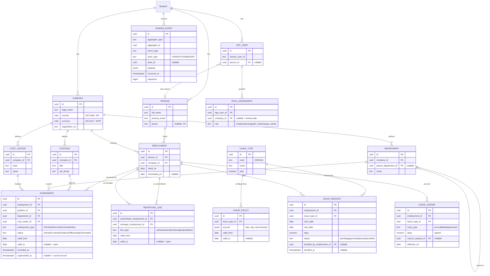

# Domain Model — Slice 0 ("the spine")

This is the data model for the walking skeleton. It realizes
[ADR-0001](../adr/0001-bitemporal-effective-dating.md) (bitemporal),
[ADR-0002](../adr/0002-multitenancy-rls.md) (tenant isolation),
[ADR-0003](../adr/0003-organizational-model.md) (identity + reporting graph), and
[ADR-0006](../adr/0006-event-and-audit-substrate.md) (event log).

**Every table** has `tenant_id uuid NOT NULL` and is governed by RLS. It is omitted from
per-table column lists below for brevity but is always present.

## ERD

## Key entities

- **Person** — global human identity within a tenant; holds PII. The seam for future
  cross-border data siloing.
- **Company** — legal entity (country, currency). Multi-company lives inside one tenant.
- **Employment** — durable Person↔Company relationship. A Person may have several at once.
- **Assignment** — the *effective-dated version* of an Employment (position, department,
  cost center, type, status). Transfers and status changes **close + insert**, never
  update. See temporal patterns below.
- **Position / Department / Cost Center** — org structures within a Company.
- **Reporting line** — typed, effective-dated edge; manager and subordinate may be in
  different companies; administrative lines are cycle-guarded.
- **Leave type / policy / ledger / request** — Slice 0 ships Annual only. Balance is the
  signed sum of **leave_ledger** entries (append-only): `accrual (+)`, `debit (−)` on
  approval, `adjustment (±)`. Approval checks projected balance ≥ 0 before debiting.
- **App user / role assignment** — login identity (WorkOS-sourced) and its tenant- or
  company-scoped roles, used by RLS for ABAC.
- **Domain event** — the append-only audit/integration substrate.

## Temporal query patterns

These two patterns recur everywhere and will be provided as helpers/views:

- **Current assignment** for an employment:
  `valid_from <= today AND (valid_to IS NULL OR valid_to > today) AND superseded_at IS NULL`.
- **As-of** a date `D` (reconstruct history):
  `valid_from <= D AND (valid_to IS NULL OR valid_to > D)` — and, for true "as we knew it
  then," constrain via the domain-event log / `recorded_at` (full system-versioning
  deferred per ADR-0001).

## Integrity rules (enforced in DB where possible)

- No overlapping **open** assignments for one employment (exclusion constraint on
  `employment_id` + valid range).
- `leave_request.end_date >= start_date`; approval is a guarded transition
  (`pending → approved`) that writes a ledger debit + a `leave-request.approved` event
  atomically.
- Reporting-line insert runs the cycle check (ADR-0003) for `administrative` lines.
- All FKs are intra-tenant (composite FKs include `tenant_id`) so RLS and referential
  integrity agree.

## Open questions for review

1. Should **Department** be effective-dated (versioned tree) in Slice 0, or is an
   effective-dated *employee↔department* assignment sufficient (current proposal)?
2. Is **Position management** (seats) needed in Slice 0, or can Assignments be "jobless"
   until the recruiting/headcount slice? (Proposed: keep Position, minimal.)
3. Leave accrual cadence for Slice 0: **grant-on-hire pro-rated** vs **monthly accrual via
   a scheduled job** (the latter introduces a cron dependency).
